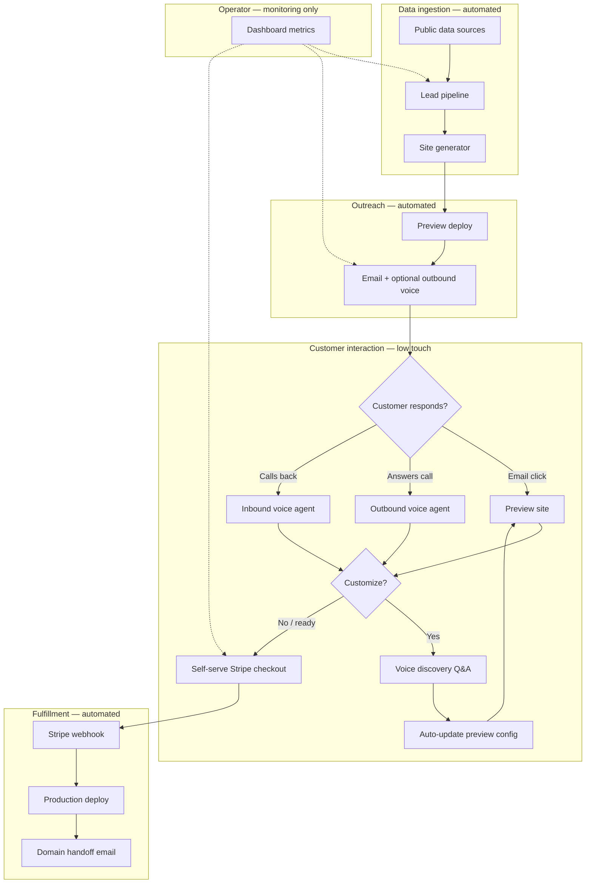
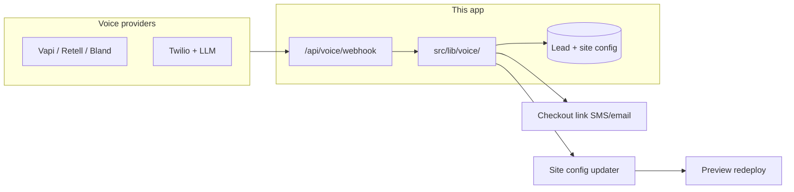
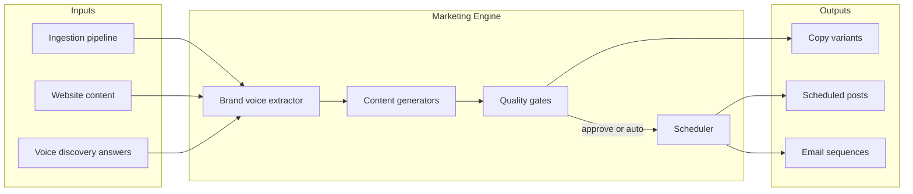

# Architecture

**Local Site Studio** is a product operated by **Maris Stella Labs** (Colorado, USA). It is an **automation-first**, sales-led service for pre-building websites for local businesses. The operator runs a **zero-touch pipeline**: leads are discovered, sites are generated, outreach is sent under the Maris Stella Labs brand, and **AI voice agents** handle all customer interaction. Prospects receive a preview link, customize via voice or self-serve checkout, and pay Maris Stella Labs via Stripe without human sales involvement.

## Design principles

| Stakeholder | Goal |
|-------------|------|
| **Local business owner (customer)** | Low friction — preview link, optional AI call, self-serve Stripe checkout |
| **Operator (Maris Stella Labs)** | Zero touch — no discovery calls, no manual outreach replies, automated funnel end-to-end |
| **System** | Voice agent gathers branding/content, updates preview, handles objections, hands off to payment |

## Automated funnel (zero-touch operator)



The operator dashboard is **read-only monitoring** at scale: funnel counts, error alerts, revenue — not a daily workflow tool.

## Components

### 1. Data ingestion (future)

**Purpose:** Continuously populate the lead pipeline without manual entry.

**Planned sources (public information only):**

| Source | Data | Approach |
|--------|------|----------|
| Google Places API | Name, category, address, phone, hours | Official API (preferred) |
| Business directories / chambers | Listings, contact | CSV import, licensed data providers |
| Facebook Pages | Public page info | Graph API where permitted; avoid UI scraping |

**Important:** Do not implement raw scrapers against Google Maps or Facebook without legal review. See [COMPLIANCE.md](./COMPLIANCE.md).

**Storage (planned):** `leads` table — `source`, `externalId`, `businessName`, `category`, `location`, `contactEmail`, `phone`, `status`, `previewSlug`, `voiceCallId`, `customizationJson`, `createdAt`.

### 2. Site generation (future)

**Purpose:** Turn lead data into a branded preview site automatically.

1. Select template by business category (restaurant, salon, trades, retail).
2. Merge public fields into template slots (name, tagline, services, hours, map embed).
3. Generate preview slug: `{business-name}-{city}`.
4. Store site config as JSON; render via `/preview/[slug]` or subdomain.

**AI assist:** LLM drafts copy from public business description; voice agent collects overrides from the customer.

**Template types:**

- **Landing + marketing** (default, $500)
- **E-commerce lite** (add-on) — product grid, Stripe Payment Links

### 3. Preview hosting

**Purpose:** Trustworthy URL before payment.

- **Primary app:** Vercel (`localsitestudio.com`)
- **Preview sites:** `{slug}.preview.localsitestudio.com` via wildcard DNS + middleware, or stable Vercel alias per lead

**Current scaffold:** `/preview/[slug]` placeholder template with "Claim this site" CTA.

### 4. Outreach (automated)

**Channels:**

| Channel | Role | Automation |
|---------|------|------------|
| **Email** | Primary — preview link + optional callback number | Scheduled sends, follow-up sequences |
| **Outbound voice** | Secondary — "we built your site" call | Triggered after site deploy or on schedule |
| **Inbound voice** | Customer callback from email/preview | Routes to same voice agent persona |

No operator-written emails or calls. Templates + voice agent scripts are version-controlled in repo docs.

**Tracking:** Webhooks update lead status — `outreach_sent`, `preview_viewed`, `voice_started`, `voice_completed`, `checkout_started`, `paid`.

### 5. Voice agent layer (core differentiator)

**Purpose:** Replace human discovery calls with AI voice agents for info gathering, Q&A, objections, and checkout handoff.



**Responsibilities:**

| Flow | Trigger | Agent actions |
|------|---------|---------------|
| **Outbound** | Lead has preview + phone | Intro, mention preview URL, offer to walk through or send link via SMS |
| **Inbound** | Customer calls published number | Identify lead (caller ID / PIN), answer questions, run discovery script |
| **Discovery** | Customer wants changes | Collect logo URL, colors, services, hours, photos; write to `customizationJson` |
| **Objection handling** | Price, timing, trust | Scripted responses; offer email with checkout link |
| **Handoff** | Customer ready to buy | Trigger Stripe Checkout Session; send link via SMS or email during call |

**Integration pattern:**

1. Voice provider places/receives call with assistant configured via API.
2. Provider POSTs events to `/api/voice/webhook` (call started, transcript, tool calls, ended).
3. `src/lib/voice/` validates signature, maps `leadId`, executes tools (update site, create checkout).
4. Post-call: optional summary email to customer with preview + payment link.

See [VOICE-AGENT-FLOW.md](./VOICE-AGENT-FLOW.md) for scripts and state machine.

**Recommended stack:** [Vapi](https://vapi.ai) or [Retell](https://retellai.com) for fastest MVP (built-in telephony + LLM + webhooks). Twilio + custom LLM pipeline for maximum control at higher build cost.

### 6. Payments (self-serve)

**Purpose:** Customer completes purchase without operator.

1. Customer clicks "Claim this site" on preview **or** voice agent sends checkout link.
2. `POST /api/stripe/checkout` creates Stripe Checkout Session (`mode: payment`).
3. Webhook `checkout.session.completed` → mark lead paid → trigger production deploy workflow.
4. Automated handoff email: DNS instructions, receipt.

**Current scaffold:** `/checkout` UI + `/api/stripe/checkout` returns 501 until configured.

### 7. Production deploy (automated)

After payment (no operator step):

1. Promote preview config to production tenant.
2. Send automated DNS instructions (CNAME to Vercel).
3. Remove preview banner; route contact form to client email.

### 8. Marketing Engine (future add-on)

**Purpose:** Generate and optionally publish ongoing marketing for paying clients — fully AI-driven, zero operator copywriting. Upsold during voice discovery, on the preview site, or post-purchase.



**Inputs:**

| Source | Data used |
|--------|-----------|
| **Ingestion pipeline** | Business name, category, address, hours, phone, services, public reviews |
| **Website content** | Tagline, service pages, hero copy, CTAs, location pages |
| **Voice agent discovery** | Brand tone preferences, seasonal promos, owner quotes, photo URLs, opt-out of topics |

**Outputs:**

| Output | Format | Delivery |
|--------|--------|----------|
| Copy variants | GBP posts, social captions, ad copy, email subject/body | Stored in `marketingContent` table; review link for customer |
| Scheduled posts | Platform-specific payloads + publish time | Buffer API or direct platform APIs (Google Business Profile, Meta) |
| Email sequences | Review requests, seasonal promos, re-engagement | Resend (transactional) with CAN-SPAM footer |

**Suggested stack:**

| Layer | Choice | Notes |
|-------|--------|-------|
| LLM | OpenAI or Anthropic | Structured JSON output; brand voice system prompt from scraped data |
| Scheduling | Buffer API (MVP) | Multi-platform queue; upgrade to direct GBP/Meta APIs where OAuth permits |
| Image gen | Optional (DALL·E / Flux) | Promo graphics; prefer client photos from ingestion when available |
| Review | Customer approval link | Optional approve-before-publish; default auto within compliance bounds |

**Quality gates:**

1. **Templates** — Category-specific prompts (restaurant vs trades vs salon); slot real business data, never generic placeholders.
2. **Brand voice** — Derived from website copy + voice discovery; reject outputs missing location, hours, or service names.
3. **Fact check** — Cross-reference generated claims against ingestion record (no invented discounts or fake awards).
4. **Human-readable review** — Optional customer link (`/marketing/review/[token]`) to approve, edit, or skip before publish.
5. **Compliance filter** — Block prohibited claims, missing unsubscribe on email, platform character limits.

**Integration points:**

- Voice agent tool: `offerMarketingPackage()` → explain tiers, add to Stripe subscription or one-time checkout.
- Preview site CTA: "Add automated marketing from $99/mo" on claim page.
- Post-payment webhook: if marketing add-on purchased, enqueue first content batch within 24h.

See [MARKETING-AUTOMATION.md](./MARKETING-AUTOMATION.md) for content types, automation levels, and compliance.

## Tech stack

| Layer | Choice |
|-------|--------|
| App framework | Next.js 16 (App Router) + TypeScript |
| Styling | Tailwind CSS v4 |
| Hosting | Vercel |
| Payments | Stripe Checkout |
| Voice | Vapi / Retell / Bland (TBD) — see roadmap |
| Marketing LLM | OpenAI or Anthropic — content generation |
| Marketing scheduling | Buffer API (MVP); direct GBP/Meta APIs (Phase 2) |
| Email | Resend (transactional + outreach + marketing sequences) |
| Database | TBD — Convex or PostgreSQL for leads + voice session logs + marketing queue |
| Auth (dashboard) | Clerk / NextAuth — operator monitoring only |

## Repository structure

```
src/
  app/
    page.tsx                    # Agency marketing landing
    dashboard/                  # Operator monitoring (read-only metrics)
    preview/[slug]/             # Client preview sites
    checkout/                   # Self-serve Stripe checkout UI
    api/
      stripe/checkout/          # Checkout session API (stub)
      voice/
        webhook/route.ts        # Voice provider webhooks (stub)
  lib/
    voice/
      config.ts                 # Provider env config
      types.ts                  # Call events, tool payloads
      handlers.ts               # Event routing (stub)
    marketing/
      types.ts                  # Content types, automation levels
      generators.ts             # LLM generator interface (stub)
  app/api/marketing/
    generate/route.ts           # POST — generate marketing copy (stub)
docs/
  VOICE-AGENT-FLOW.md           # Call scripts and state machine
  MARKETING-AUTOMATION.md       # Content types, automation, compliance
```

## Security notes

- Never commit `.env.local` or API keys.
- Validate Stripe and voice provider webhook signatures.
- Restrict dashboard to operator; customers never log in.
- Store call transcripts with retention limits (see COMPLIANCE.md).
- TCPA/consent for outbound calls — document lawful basis per jurisdiction.

## Environment variables

See `.env.example` for Stripe, voice provider, email, and hosting keys.
