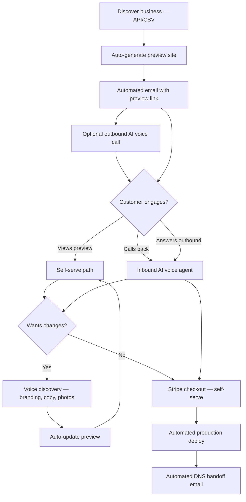

# Business model

## Value proposition

We sell **pre-built websites** to local businesses under a **public brand** (TBD — set `NEXT_PUBLIC_BRAND_NAME`). The differentiator is **preview before purchase** plus **zero human sales friction**: customers get a link, talk to an AI assistant if they want changes, and pay $500 self-serve — no waiting on a salesperson.

**Legal entity:** Maris Stella Labs (Colorado, USA) — handles Stripe, contracts, and compliance. **Public brand** — used in marketing, outreach, and voice agent persona.

## Operating model: zero-touch operator

| Traditional agency | This product |
|--------------------|--------------|
| Operator discovery calls | **AI voice agent** gathers branding and answers questions |
| Manual email replies | Automated sequences + voice callback number |
| Custom quotes | Fixed $500 (+ optional e-commerce add-on) |
| Operator deploys site | Automated post-payment deploy |

**Operator role:** Configure automation, monitor dashboard metrics, handle edge-case alerts (failed payments, deploy errors) — not day-to-day sales.

## Target customers

- **Geography:** Business-friendly countries (US, UK, Canada, Australia — start with one metro).
- **Segments:** Restaurants, salons, trades, retail, gyms, professional services with weak or no web presence.
- **Profile:** Listed on Google Maps, reachable phone/email, would benefit from a simple landing page.

## Pricing

| Package | Price | Includes |
|---------|-------|----------|
| Standard landing site | **$500** one-time | Marketing site, mobile responsive, contact form, map embed, basic SEO, subdomain hosting, domain connection docs |
| E-commerce lite add-on | **+$200–400** (TBD) | Product catalog, Stripe checkout |
| Rush / custom | Quote | Only if automated flow cannot satisfy (exception path) |

**Optional recurring (future):** Hosting + minor updates at $29–49/mo.

Invoices and Stripe receipts show **Maris Stella Labs** as seller. Marketing and outreach use the **public brand**.

## Sales funnel (fully automated)

**No operator discovery calls.** All "discovery" happens via:

1. **Self-serve:** Customer reviews preview and pays, or
2. **Voice agent:** Customer calls (or receives outbound call) and AI collects customization inputs.

## Customer touchpoints (low touch)

| Touchpoint | Customer effort | Handler |
|------------|-----------------|---------|
| Receive email | Open link | Automated |
| View preview | Browse site | Self-serve |
| Customize site | 5–10 min voice call OR ignore and buy as-is | AI voice agent |
| Pay | Click checkout link | Stripe self-serve |
| Go live | Follow DNS email | Automated instructions |

## Outreach (automated)

Outreach uses the **public brand** in subject lines, From name, and voice scripts. Email footers and checkout identify **Maris Stella Labs** for legal compliance.

### Email 1 — Preview delivery

**From:** `{Public Brand}` (e.g. SitePreview)

**Subject:** `{BusinessName} — we built your website (free preview)`

**Body outline:**

1. We build sites for local businesses — yours is ready to preview.
2. Link: `https://{slug}.preview.yourdomain.com`
3. **Call us anytime:** `{VOICE_CALLBACK_NUMBER}` — AI assistant can walk you through and make changes.
4. **Or buy now:** checkout link on preview page — $500, no call required.
5. CAN-SPAM footer: public brand + Maris Stella Labs address, unsubscribe.

### Email 2 — Follow-up (automated, 3–5 days)

- Reminder + preview link + callback number.
- "Prefer not to call? Click Claim on your preview page."

### Email 3 — Final touch (7–10 days)

- Last automated note; opt-out honored permanently.

### Outbound voice (optional, automated)

Triggered when lead has phone and consent basis documented.

**Opening (see VOICE-AGENT-FLOW.md):** "Hi, this is [Assistant] from **{Public Brand}**. We built a preview website for {BusinessName}. I can text you the link or walk you through it now — takes about two minutes."

If no answer: voicemail with preview URL (where legally permitted) + email backup.

## Voice agent vs self-serve

| Path | Best for |
|------|----------|
| **Self-serve checkout** | Customer happy with preview; minimal friction |
| **Inbound callback** | Questions, wants tweaks, needs reassurance |
| **Outbound call** | Higher engagement markets; phone-first SMBs |

Both paths converge on the same Stripe checkout — voice agent can SMS/email the link during the call.

## Operator workflow (monitoring only)

1. Weekly: review dashboard conversion metrics.
2. On alert: failed webhooks, deploy errors, spike in opt-outs.
3. Monthly: tune voice scripts and email templates from transcript analytics.
4. **Not required:** daily outreach, discovery calls, manual site edits.

## Unit economics (rough)

| Item | Estimate |
|------|----------|
| Revenue per sale | $500 |
| Stripe fees | ~$15 |
| Voice (2–5 min call) | ~$0.10–0.50 (Vapi/Retell) |
| Email | ~$0.01–0.05 per lead |
| Hosting | ~$0–20/mo shared |
| Operator time | Near-zero at scale |

## Competitive positioning

- **vs DIY:** Done for you, preview first, AI help if needed — no learning curve.
- **vs agencies:** $500 flat, instant preview, no sales calls.
- **vs freelancers:** Productized, automated, consistent quality.

## Metrics to track

- Leads ingested / week (automated)
- Previews deployed / week
- Email open → preview view rate
- Voice calls: outbound connect rate, inbound volume, avg duration
- Voice → customization applied rate
- Preview → checkout → paid (self-serve vs post-voice)
- Time to live after payment
- Opt-out / complaint rate
