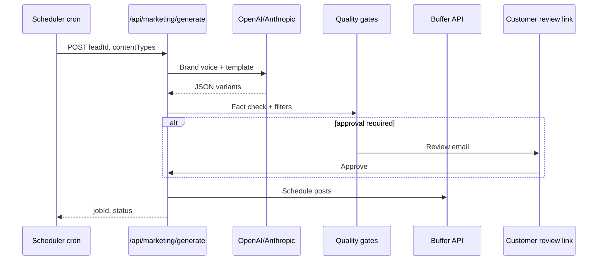

# Marketing automation

AI-only marketing for local business clients — no human copywriter, zero operator touch at scale. Content is generated from real business data (ingestion pipeline, website, voice discovery) and optionally scheduled to platforms.

## Content types

| Type | Platform / channel | Frequency (Essentials) | Notes |
|------|-------------------|------------------------|-------|
| **Google Business Profile posts** | GBP | 2/mo | Offers, updates, events; link to site |
| **Facebook / Instagram captions** | Meta (via Buffer) | 4/mo | Short, local hooks; use real hours/location |
| **Local SEO meta** | Website / GBP | One-time + quarterly refresh | Title, description, service-area keywords |
| **Seasonal promos** | Social + email | As calendar triggers | Holidays, weather, local events (e.g. "AC tune-up season") |
| **Review request emails** | Email (Resend) | 1/mo | Post-visit template; CAN-SPAM compliant |
| **Ad copy variants** | Google/Meta ads (copy only) | On request / Pro tier | Headlines + descriptions for local campaigns |
| **Re-engagement email** | Email | Pro: 1/mo | "We miss you" + current offer from business data |

All outputs must reference **specific** business facts: city/neighborhood, services, hours, phone, differentiators from scraped or voice-collected data.

## Automation levels

| Level | Code | Behavior | Best for |
|-------|------|----------|------------|
| **Generate-only** | `generate` | LLM produces copy pack; customer downloads or copies manually | One-time buyers, low budget |
| **Generate + schedule** | `schedule` | Content queued via Buffer (or direct API); publishes on calendar | Essentials / Pro subscribers |
| **Generate + schedule + optimize** | `optimize` | A/B subject lines or post hooks; winner promoted after 7 days | Pro tier; higher engagement |

Default for zero-touch customers: **`schedule`** with compliance filters — no approve step unless customer opts in via voice or checkout flag.

### Customer approval modes

| Mode | Setting | Flow |
|------|---------|------|
| **Fully automated** | `approval: none` | Generate → quality gates → schedule (default) |
| **Review link** | `approval: optional` | Email link to `/marketing/review/[token]` — approve, skip, or request regenerate |
| **Approve required** | `approval: required` | Nothing publishes until customer clicks approve (higher touch; not default) |

## Quality principles

### Local-specific, not AI slop

**Required in every piece:**

- Business name and city (or neighborhood)
- At least one concrete service or product from ingestion data
- Accurate hours or "call for hours" if unknown — never invent
- CTA aligned with business (call, book, visit, order)

**Forbidden patterns:**

- "In today's fast-paced world…"
- Generic superlatives without source ("best in town" unless from a cited review)
- Wrong city, competitor names, or fabricated awards
- Hashtag spam (#SmallBusiness #LocalBusiness only as supplement, not content)

### Brand voice extraction

1. Parse website hero, about, and services sections.
2. Merge voice discovery answers (formal vs friendly, keywords to avoid).
3. Build system prompt: `{tone}, {category}, {location}, services: [...], hours: [...]`.
4. Run output through fact-check pass against ingestion JSON.

### Category templates

Prompt templates live in repo (future: `src/lib/marketing/templates/`):

- **Restaurant** — menu highlights, daily specials framing, reservation CTA
- **Salon / spa** — service menu, stylist chair availability, self-care angle
- **Trades** — emergency vs scheduled, service area, license/insured if in data
- **Retail** — new arrivals, store hours, parking/location landmarks
- **Professional services** — consultation CTA, credentials from public data only

## Compliance

### Email (CAN-SPAM)

- Clear `From` using public brand; footer identifies Maris Stella Labs
- Physical postal address in every marketing email
- Working unsubscribe link; honor within 10 business days
- Accurate subject lines — no deceptive headers
- Review-request emails: identify sender as the business (with client permission via purchase terms)

### Platform terms of service

| Platform | Considerations |
|----------|----------------|
| **Google Business Profile** | No prohibited content; no keyword stuffing; follow [GBP policies](https://support.google.com/business/answer/3038177) |
| **Meta (Facebook/Instagram)** | Community standards; disclose paid partnership only if applicable; no engagement bait |
| **Buffer / schedulers** | Use official APIs; store OAuth tokens securely; respect rate limits |

### AI disclosure

- **Not required** for most local business marketing copy (business speaks as itself).
- If jurisdiction requires AI disclosure for ads, append to Terms of Service at purchase and optionally footnote emails: "Content assisted by automated tools."
- Never represent AI-generated quotes as verbatim customer testimonials.

### TCPA / SMS (if added later)

- Separate opt-in for SMS marketing; not bundled with voice outreach consent.
- Document consent timestamp on lead record.

## Technical flow

## Metrics

- Content generated / client / month
- Approval rate (if review link enabled)
- Scheduled vs failed publishes
- Email open/click (review requests)
- Opt-out / complaint rate
- Churn on marketing subscriptions

## Related docs

- [ARCHITECTURE.md](./ARCHITECTURE.md) — Marketing Engine module
- [BUSINESS-MODEL.md](./BUSINESS-MODEL.md) — Pricing tiers and upsell flow
- [COMPLIANCE.md](./COMPLIANCE.md) — Outreach and data handling
- [ROADMAP.md](./ROADMAP.md) — Phase 7 implementation plan
