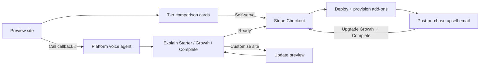

# Product bundles

Digital presence + sales bundles for local businesses. Sold under the **public brand**; fulfilled by **Maris Stella Labs**. Fully automated — no operator sales calls.

## Bundle overview

| Bundle | Tagline | Best for |
|--------|---------|----------|
| **Starter** | "Your site, live in days" | Businesses that only need credibility + contact — trades, consultants, simple service providers |
| **Growth** | "Site + customers on autopilot" | SMBs that want visibility but won't post themselves — salons, gyms, restaurants without online ordering |
| **Complete** | "Never miss a call or a customer" | Phone-heavy businesses — medical/dental offices, home services, busy restaurants, appointment-based salons |
| **Commerce** *(add-on)* | "Sell online, not just inform" | Retail, restaurants with pickup/delivery, salons with deposits, studios with class packs |

---

## Starter — $500 one-time

**Includes:**

- Professional landing page (category template)
- Mobile responsive, fast hosting
- Contact form → client email
- Google Maps embed, hours, services
- Basic SEO (title, meta, local schema)
- Preview subdomain → custom domain handoff docs
- Self-serve Stripe checkout

**Does not include:** ongoing marketing, AI phone for their business, e-commerce.

**Upsell path:** Preview CTA and post-purchase email offer Growth ($99/mo).

---

## Growth — $500 + $99/mo

**Everything in Starter, plus:**

- **AI marketing engine** — 8 social/GBP posts + 2 emails per month
- Auto-scheduled to Google Business Profile, Facebook, Instagram (via Buffer MVP)
- Brand voice extracted from site + ingestion data
- Review-request and promo email sequences (CAN-SPAM compliant)
- Optional approve-before-publish link

**Recurring starts:** At go-live or when customer adds marketing post-purchase.

**Best for:** Owner knows they should post but won't; relies on Google Maps and word-of-mouth; doesn't take appointments by phone as primary channel.

---

## Complete — $500 + $199/mo

**Everything in Growth, plus:**

- **Full marketing tier** — seasonal promos, A/B caption variants, broader platform coverage
- **Client AI phone agent** — answers *their* business line (forward or dedicated number)

### Client AI phone agent — use cases

| Use case | Example | Outcome |
|----------|---------|---------|
| **After-hours / missed call callback** | Customer calls salon at 8pm; AI answers, takes message, texts owner | Lead captured instead of lost |
| **Business hours FAQ** | "Are you open Saturday?" "Do you take walk-ins?" | Reduces owner interruptions |
| **Appointment scheduling** | "I'd like a haircut Thursday" → checks Cal.com-style availability, books slot | Calendar filled without staff |
| **Lead qualification** | "How much for a kitchen remodel?" → collects sq ft, timeline, budget band | Qualified lead emailed to owner |
| **Service routing** | "Is this an emergency?" → urgent vs routine callback | Prioritized notifications |
| **Order status / hours (restaurants)** | "Are you doing delivery tonight?" | FAQ without tying up kitchen |
| **Voicemail replacement** | Inbound when owner is on a job site | Professional experience vs generic VM |

**Technical:** Twilio number (client forwards existing line or we provision) + Vapi/Retell assistant trained on their site data, hours, and services. Transcripts + lead summaries to client email and optional CRM stub.

**Not included:** Outbound telemarketing for the client, complex multi-location call centers, HIPAA-compliant medical triage (refer to specialized vendors).

**Best for:** Businesses where **the phone is the revenue line** — missed calls = lost jobs.

---

## Commerce — +$300 one-time + $49/mo *(optional add-on)*

Stacks on **Starter**, **Growth**, or **Complete**. Does not replace the base website — extends it with transactional capability.

### Includes

- Stripe Checkout integration (Payment Links or embedded checkout)
- Simple product/service catalog (≤50 SKUs)
- Order notification emails to client
- One of:
  - **Retail catalog** — products with variants, pickup or ship
  - **Restaurant ordering** — menu items, modifiers, pickup time slots
  - **Booking + deposits** — service menu, deposit or prepay (Cal.com-style or native)
  - **Gift cards / packages** — salon bundles, class packs, membership prepay

### When Commerce makes sense

| Scenario | Recommend Commerce? | Why |
|----------|---------------------|-----|
| Restaurant with delivery/pickup orders | **Yes** | Revenue directly from site; reduces phone order load |
| Retail shop with ≤50 SKUs | **Yes** | Extends hours; complements in-store |
| Salon — deposits for bookings | **Yes** | Reduces no-shows; pairs with Complete phone agent |
| Fitness studio — class packs online | **Yes** | Prepay before arrival |
| Plumber / electrician | **No** — Starter or Complete | Job intake via form/phone beats cart |
| Lawyer / accountant | **No** — Starter or Growth | Trust site + contact; no SKU catalog |
| Restaurant — reservations only, no online menu sales | **Maybe** — booking-only Commerce subset | Deposit for large parties, not full menu |
| Business with 500+ SKUs | **No** — refer to Shopify | Catalog complexity exceeds lite tier |

**Rule of thumb:** If customers would **pay online** for something with a clear price, Commerce fits. If they **call for a quote**, Complete (phone) + landing page beats e-commerce.

### When landing-page-only is better

- **Quote-based services** (trades, B2B) — contact form + AI phone qualification
- **High-trust professional services** — no impulse checkout
- **Single-location "call us" culture** — phone-first demographics
- **Inventory changes daily** (some restaurants) — menu maintenance burden without POS sync

---

## À la carte (legacy / entry upsell)

| Item | Price | Notes |
|------|-------|-------|
| Copy pack | $49 one-time | GBP posts, social captions, review email — download only, no scheduling |
| Commerce only (existing site) | $300 + $49/mo | For customers who already have a site elsewhere |

Copy pack buyers are nurtured toward Growth subscription via automated email sequence.

---

## Upsell path: preview → voice → Stripe

### Platform voice bundle script (summary)

After site customization or when customer asks about pricing:

> "We have three plans. **Starter** is $500 one-time — your website, done. **Growth** adds automated Google and social posts for $99 a month. **Complete** is $199 a month — that includes everything in Growth plus an AI assistant that answers *your* business phone, books appointments, and captures leads so you never miss a call. If you sell products or take online orders, we can add **Commerce** for a one-time $300 plus $49 a month. Want me to text you the checkout link for {recommended tier}?"

Recommendation logic (voice tool / preview UI):

- Has high phone volume or appointment business → suggest **Complete**
- Wants marketing only → **Growth**
- Price-sensitive / trades quote workflow → **Starter**
- Mentions online ordering, menu, or deposits → add **Commerce**

---

## Stripe SKU mapping (planned)

| Stripe Product | Price ID type | Amount |
|----------------|---------------|--------|
| `bundle_starter` | one-time | $500 |
| `bundle_growth_setup` | one-time | $500 |
| `bundle_growth_monthly` | recurring | $99/mo |
| `bundle_complete_setup` | one-time | $500 |
| `bundle_complete_monthly` | recurring | $199/mo |
| `addon_commerce_setup` | one-time | $300 |
| `addon_commerce_monthly` | recurring | $49/mo |
| `addon_copy_pack` | one-time | $49 |

Checkout supports: website one-time + optional subscription line items in one session (Stripe Checkout `mode: subscription` with `line_items` for setup fee via `add_invoice_items` or separate payment + subscription flow).

---

## Related documents

- [BUSINESS-MODEL.md](./BUSINESS-MODEL.md) — pricing summary and unit economics
- [ARCHITECTURE.md](./ARCHITECTURE.md) — technical modules per tier
- [VOICE-AGENT-FLOW.md](./VOICE-AGENT-FLOW.md) — platform vs client voice
- [MARKETING-AUTOMATION.md](./MARKETING-AUTOMATION.md) — Growth/Complete marketing engine
- [ROADMAP.md](./ROADMAP.md) — phased rollout
