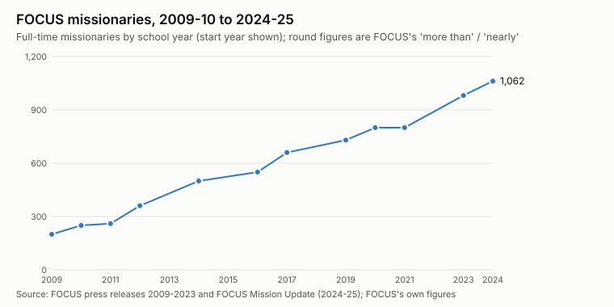
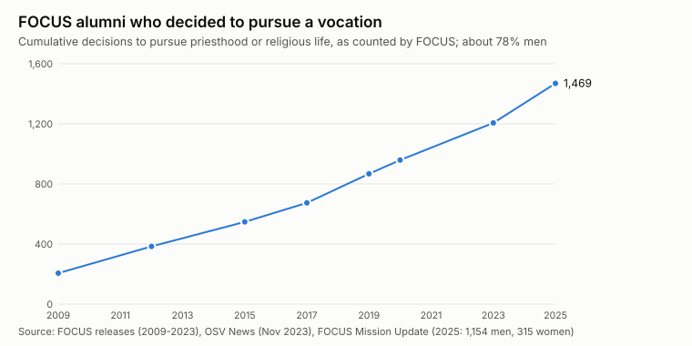
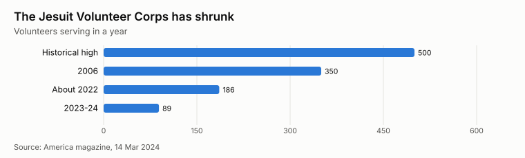
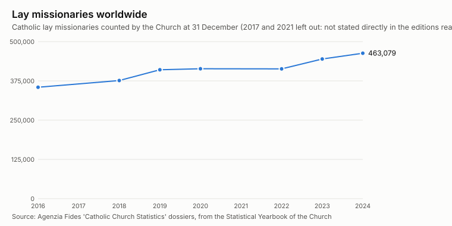

FOCUS, the Fellowship of Catholic University Students, sends recent graduates to college campuses as full-time missionaries. They usually work in teams of two men and two women, run Bible studies and serve two or more years. It is the largest Catholic lay mission in the United States and, by its own numbers, one of the fastest growing. This post charts what FOCUS and other Catholic mission groups have published, alongside the Church's worldwide count of lay missionaries.

One caveat applies throughout. **Nearly all the FOCUS numbers are the organisation's own claims** from press releases and its annual "Mission Update". Nobody has audited them. FOCUS often writes "more than 200" or "nearly 800", and the charts plot those round numbers as stated.

## Missionaries: from 200 to over 1,000

| School year | Missionaries | Locations | Source |
|---|---|---|---|
| 1998-99 | 2 full-time + 2 part-time | 1 (Benedictine College) | [OSV News](https://nwcatholic.org/news/kiki-hayden-osv-news/focus-marks-25-years-of-missionary-driven-evangelization-at-colleges-universities) |
| 2009-10 | more than 200 | 45 campuses | [EWTN News](https://www.ewtnnews.com/world/us/focus-adds-12-new-universities-to-national-campus-outreach) |
| 2012-13 | 361 | 74 | [PR Newswire](https://prnewswire.com/news-releases/focus-averages-25-percent-growth-per-year-since-its-founding-adds-16-new-campuses-for-2012-13-school-year-167182495.html) |
| 2014-15 | nearly 500 | 113 | [FY15 annual report](https://focus.org/about/news-press-room/recent-press-releases/fy15-annual-report/) |
| 2017-18 | more than 660 | 137 | [FOCUS](https://focus.org/about/news-press-room/recent-press-releases/focus-fosters-decisions-to-pursue-catholic-vocations/) |
| 2021-22 | nearly 800 | 205 (7 international, 22 parishes) | [FOCUS](https://focus.org/about/news-press-room/recent-press-releases/focus-sends-800-missionaries-to-205-locations-to-share-evangelistic-passion/) |
| 2023-24 | 981 | 234 | [FOCUS](https://focus.org/about/news-press-room/recent-press-releases/focus-campus-expansion-and-welcoming-francis-x-maier-to-the-board-of-directors/) |
| 2024-25 | 1,062 | 259 (221 US campuses, 10 international, 10 digital, 28 parishes) | [Mission Update](https://focus.org/wp-content/uploads/2026/06/Focus-25-Stats-.pdf) |

Growth has been steady, not explosive. The count roughly doubled between 2012 and 2020 and grew about a third again by 2024. It also fell short of FOCUS's own plan: a 2021 release projected "nearly 1,300" missionaries by 2026. The same 2024-25 update reports 49,439 students in FOCUS Bible studies, up from 17,000 or more in 2014-15. It also reports 2,377 total missionary alumni and 13,406 student-leader alumni.

## Vocations: 1,469 decisions, about four in five by men

FOCUS counts "decisions to pursue priesthood or religious life" among the students and missionaries it has worked with. By 2025 that cumulative count was **1,469: 1,154 men and 315 women**. The men's share has held at about 77-79% in every year that gives a split (2009: 162 of 206; 2017: 530 of 674; 2019: 662 of 867). This counts decisions, not ordinations or final vows, and FOCUS's own series is not perfectly consistent: a 2013 release gave 355, below the 384 it reported in 2012. That 2013 point is left off the chart.

## What we don't know about the missionaries themselves

FOCUS publishes almost nothing about who its missionaries are. I found no sex ratio, average age, length of service, race breakdown or count of missionaries who marry each other. The scraps that exist:

- Teams are typically two men and two women. Groups such as FOCUS and NET Ministries have reported more trouble recruiting men than women ([The Catholic Spirit, 2017](https://thecatholicspirit.com/news/nation-and-world/ministries-struggle-recruit-men-help-bring-christ-youth/)). NET had 98 women committed for 2017-18 and was still about 24 men short.
- Sociologist Katherine Dugan's book *Millennial Missionaries* describes missionaries as mostly white and middle to upper class, but gives no counts.
- The only alumni research is a 2015 survey that FOCUS commissioned, which gave no sample size. In it, 63% of alumni aged 22-32 said their Catholic identity was important, against 18% of a comparison group ([FOCUS](https://focus.org/about/news-press-room/recent-press-releases/2016-annual-report-shares-stories-and-research-on-focus-effect/)). No independent study of alumni Mass attendance, marriage or family size turned up.

FOCUS last filed a public Form 990 for the fiscal year ending May 2014. That year its revenue was **$30.3 million**, up from $17.8 million in 2011 ([ProPublica](https://projects.propublica.org/nonprofits/organizations/841522811)). Its IRS record suggests it now files as a church-related organisation that is not required to file, but I have not confirmed that. So no public budget figure exists for the last decade.

## The other lay missions

| Programme | What's published | Source |
|---|---|---|
| NET Ministries | 3,400+ young adults have served on a NET team; 80+ alumni ordained priests | [netusa.org](https://www.netusa.org/) |
| St. Paul's Outreach | 157 missionaries on 46 campuses (May 2019) | [The Leaven](https://theleaven.org/?p=82776) |
| Maryknoll Lay Missioners | nearly 1,000 sent since 1975 to 35 countries; 40 serving in 9 countries (2025) | [Maryknoll Magazine](https://www.maryknollmagazine.org/2025/06/fifty-years-of-sharing-hope/) |
| Catholic Volunteer Network | 14,488 volunteers in 182 programmes in 2009-10; 77 member organisations in 2024 | [FamVin, 2010](https://archive.famvin.org/2010/12/25/catholic-volunteers-set-record/); [America, 2024](https://www.americamagazine.org/faith/2024/03/14/volunteers-decline-united-states-jesuit-peace-corps-247491) |
| Christ in the City (Denver) | revenue up from $341k (FY2014) to $2.37M (FY2023) | [ProPublica](https://projects.propublica.org/nonprofits/organizations/274663181) |

The contrast matters. Year-of-service programmes in the older social-justice tradition have shrunk sharply. The Jesuit Volunteer Corps fell from a high of 500 volunteers to 89 in 2023-24 ([America](https://www.americamagazine.org/faith/2024/03/14/volunteers-decline-united-states-jesuit-peace-corps-247491)). Catholic Volunteer Network's own revenue fell from $1.15 million in 2011 to $209,000 in 2024. Over the same years, evangelisation-focused missions such as FOCUS and Christ in the City grew. That supports a common observation: the energy in young-adult Catholic mission has moved from service programmes to evangelisation. It is not proof, because the two kinds of programme count different things.

## Worldwide: lay missionaries are rising

The Church's own statistics, published each October by Agenzia Fides from the *Statistical Yearbook of the Church*, count **463,079 lay missionaries worldwide at the end of 2024**. That is up from 354,743 in 2016. Most of the growth is in the Americas, which account for about 86% of the 2023 total. Over the same period catechists fell from 3.09 million (2016) to 2.89 million (2024).

| 31 Dec | Lay missionaries | Catechists |
|---|---|---|
| 2016 | 354,743 | 3,086,289 |
| 2018 | 376,188 | 3,076,624 |
| 2019 | 410,440 | 3,074,034 |
| 2020 | 413,561 | 2,883,049 |
| 2022 | 413,286 | 2,849,582 |
| 2023 | 444,606 | 2,866,966 |
| 2024 | 463,079 | 2,889,336 |

How many US Catholics serve as missionaries overseas is a gap. The often-cited peak around 1968 has no primary series I could reach online. The printed *U.S. Catholic Mission Handbook* is the place to look.

## Sources and code

The numbers in the charts are typed into [`missions_charts.py`](../data/catholic-demographics/missions_charts.py) next to their sources. Companion posts: [Latin Mass attendees](2026-11-03-who-attends-the-latin-mass-what-the-numbers-show.md) and [Newman Guide colleges](2026-11-03-who-goes-to-newman-guide-colleges.md). FOCUS began in 1998 at Benedictine College, one of them.
