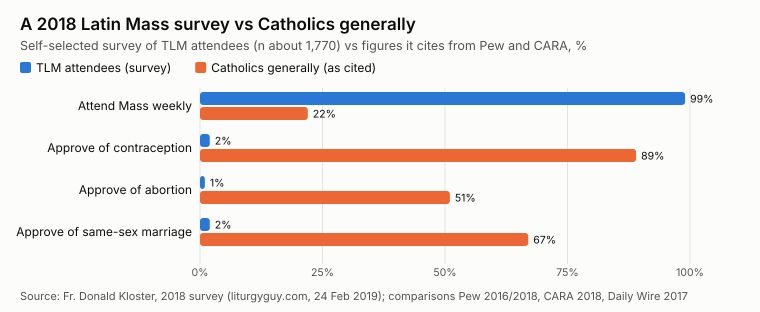
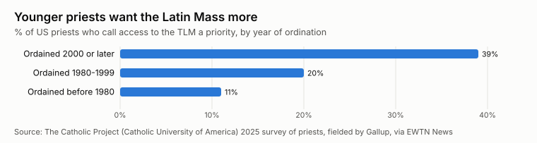
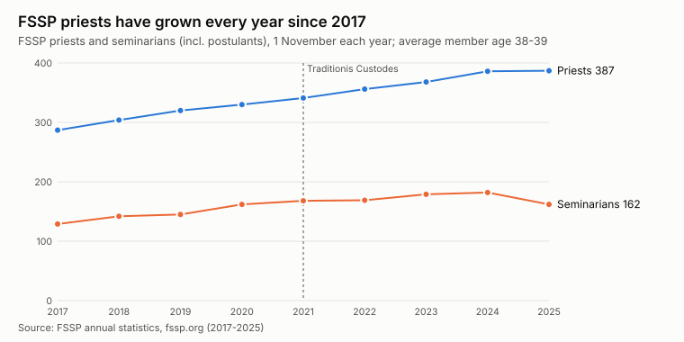
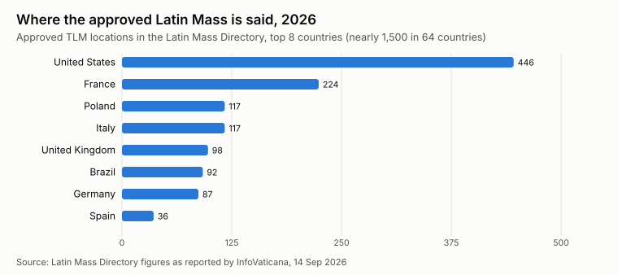

Pope Francis restricted the Traditional Latin Mass (TLM) in 2021 with *Traditionis Custodes*. Its supporters and critics both make large claims about who attends it: young, fertile and devout on one side, small and fringe on the other. Here is what can actually be sourced, charted, with each number's provenance and its weak points.

The short version: the only nationally representative data is one Pew question from 2025. Most demographic claims rest on surveys that recruited Latin Mass attendees themselves. Those surveys are informative but not representative, and they say so.

## How many: about 2% of US Catholics weekly

Pew asked about the TLM for the first time in February 2025, describing it as a Mass where "the entire Mass is said in Latin and where the priest faces the altar". Of 1,787 Catholics surveyed, **13% had attended one in the last five years** and **2% attend weekly now**. Among weekly Mass-goers the figures are 22% and 4%. Converts were somewhat more likely than cradle Catholics to have attended (18% vs 13%, p. 59).

| Group (Pew, Feb 2025) | Attended a TLM in last 5 years | Attend a TLM weekly now |
|---|---|---|
| All US Catholics | 13% | 2% |
| Attend Mass weekly | 22% | 4% |
| Attend once or twice a month | 15% | 1% |
| Attend a few times a year / seldom | 8% | <1% |
| Never attend Mass | 7% | 1% |

Two percent of US Catholics would be over a million weekly attendees. That is far above counts based on the number of Masses, which come out nearer 100,000. Fr. Donald Kloster estimated about 200 people at each of 489 Sunday Masses in 2019, and Stephen P. White [makes the comparison](https://www.thecatholicthing.org/2025/06/26/is-the-traditional-latin-mass-booming/). A 2% figure sits close to a survey's margin of error, and some respondents may count a Latin-language ordinary-form Mass. Treat it as an upper bound. Source: [Pew report, 16 June 2025](https://www.pewresearch.org/wp-content/uploads/sites/20/2025/06/PR_2025.06.16_catholic-life-in-us_report.pdf), pp. 36-37.

## What attendees say about themselves

Fr. Donald Kloster's 2018 survey (about 1,770 responses from 16 states, mostly handed out in the pews) is the source of most widely shared TLM statistics. They include 99% weekly Mass attendance, 2% approval of contraception and a fertility rate of 6.0 children among women respondents (against 2.3 that he cites for Catholics generally). The comparison figures come from other surveys, mainly Pew and CARA, taken in different years with different wording. Audra Dugandzic, a Notre Dame sociology doctoral student, [set out the limits in *First Things*](https://firstthings.com/orthodoxy-and-the-latin-mass/): a convenience sample, self-selection and no way to tell cause from effect. The results table is an image on [the original post](https://liturgyguy.com/2019/02/24/national-survey-results-what-we-learned-about-latin-mass-attendees/), and the figures above are from a text mirror of it.

Kloster's 2019-20 survey of young adults (ages 18-39, 1,779 respondents from 39 states, recruited online and at TLM events) gives the closest thing to a demographic profile. All of it is self-reported by people who chose to respond ([summary](https://liturgyguy.com/2020/05/26/2019-20-tlm-survey-what-we-learned-about-latin-mass-attending-young-adults/)):

| Young-adult TLM survey, 2019-20 | Value |
|---|---|
| Mean age | 27.4 |
| Male | 57% |
| Came back to or into the Church (reverts plus converts) | 45% |
| Not raised in the TLM | 90% |
| Have considered a priestly or religious vocation | 80% |
| Average total children reported | 3.5 |
| Years of education after high school | 4.0 |

The most careful recent work is by Stephen Bullivant and Stephen Cranney. Their 2024 survey of 446 Catholics who attend a licit (non-SSPX) TLM at least once a year is preliminary, and they have not published how it was sampled or weighted. They found **77% lean Republican**, 85% say abortion should be illegal in all cases, and 64% agree at least somewhat that they accept the teachings of Vatican II, while 21% disagree ([data post, July 2024](https://whatweneednow.substack.com/p/data-and-the-traditional-latin-mass)). A parish-level survey they reported found that 44% of monthly-or-more TLM attendees were under 45, against 20% of other parishioners in the same parishes. I could only read that figure second-hand. Their book *Trads* (OUP, 2026) has the full data.

## The clergy: younger priests lean traditional

The 2025 Catholic Project study of US priests, fielded by Gallup, found that access to the TLM is a priority for 39% of priests ordained since 2000, against 11% of those ordained before 1980 ([EWTN News summary](https://www.ewtnnews.com/world/us/younger-us-priests-remain-more-conservative-than-older-priests-survey-says)). The 2022 study of the same kind found that 85% of priests ordained after 2020 called themselves conservative/orthodox or very conservative/orthodox.

The Priestly Fraternity of St. Peter (FSSP), the largest society of priests in full communion with Rome that says only the old rite, publishes its numbers every 1 November. Its priests have grown every year, from 287 in 2017 to 387 in 2025, and the average member is 38 or 39. Seminarians peaked at 182 in 2024 and fell to 162 in 2025. One year's drop is not a trend.

| FSSP (1 Nov) | 2017 | 2019 | 2021 | 2023 | 2024 | 2025 |
|---|---|---|---|---|---|---|
| Priests | 287 | 320 | 341 | 368 | 386 | 387 |
| Seminarians | 129 | 145 | 168 | 179 | 182 | 162 |
| Average age | 38 | 38 | 38 | 39 | 39 | 39 |

The Society of St. Pius X (SSPX), whose canonical status is irregular, reported 733 priests and 264 seminarians on 1 November 2025, with an average age of 47 ([FSSPX.News](https://fsspx.news/fr/news/statistiques-2025-la-fsspx-56151)). That is up from about 590 priests in 2014. The Institute of Christ the King reported 150 priests at the end of 2024 and passed 100 seminarians in 2026.

## Where it is said

The Latin Mass Directory listed 446 US locations in 2026 and nearly 1,500 in 64 countries ([InfoVaticana, September 2026](https://infovaticana.com/en/2026/09/14/not-even-1-of-the-authorized-dioceses-the-numbers-from-traditionis-custodes-confirm-the-strangulation-of-the-traditional-mass/)). There is no consistent US series over time. The counts below each use a different definition, so read them as rough markers, not a trend line:

| When | US count | What was counted |
|---|---|---|
| Feb 2010 | 289 approved (+70 unauthorised) | Every-Sunday sites ([Rorate Caeli](https://rorate-caeli.blogspot.com/2010/02/statistics-for-every-sunday-tlms-in-10.html)) |
| 2019 | 489 | Sunday TLMs in the Latin Mass Directory (Kloster) |
| Oct 2021 | 662 | Latin Mass Directory venues |
| 2024 | nearly 500, plus 103 SSPX chapels | Non-SSPX parishes (Bullivant and Cranney) |
| 2026 | 446 | Latin Mass Directory |

## What nobody has measured

There is no representative data on the age, sex, race, income, marriage or family size of US Latin Mass attendees. Pew published no breakdowns, and every profile above comes from people who chose to answer a TLM survey. The striking fertility and belief numbers may be true of regular attendees, but no random sample has tested them. A national survey that asked the TLM question alongside the standard demographics would settle most of these arguments.

The numbers in the charts are typed into [`tlm_charts.py`](../data/catholic-demographics/tlm_charts.py) next to their sources. Companion posts: [Newman Guide colleges](2026-11-03-who-goes-to-newman-guide-colleges.md) and [FOCUS and other Catholic missionaries](2026-11-03-focus-missionaries-and-catholic-lay-missions-by-the-numbers.md).
