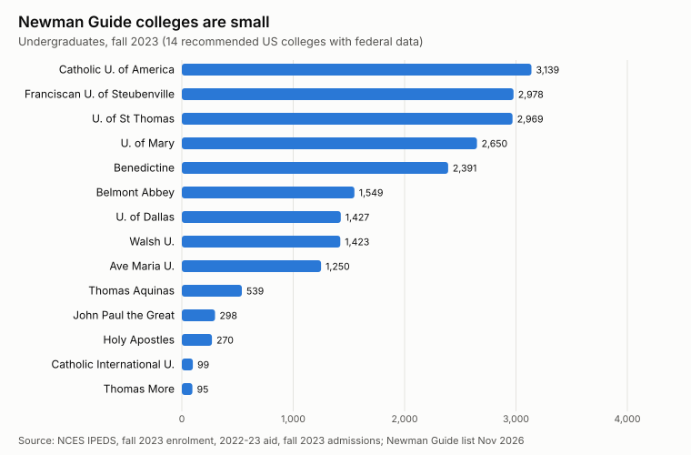
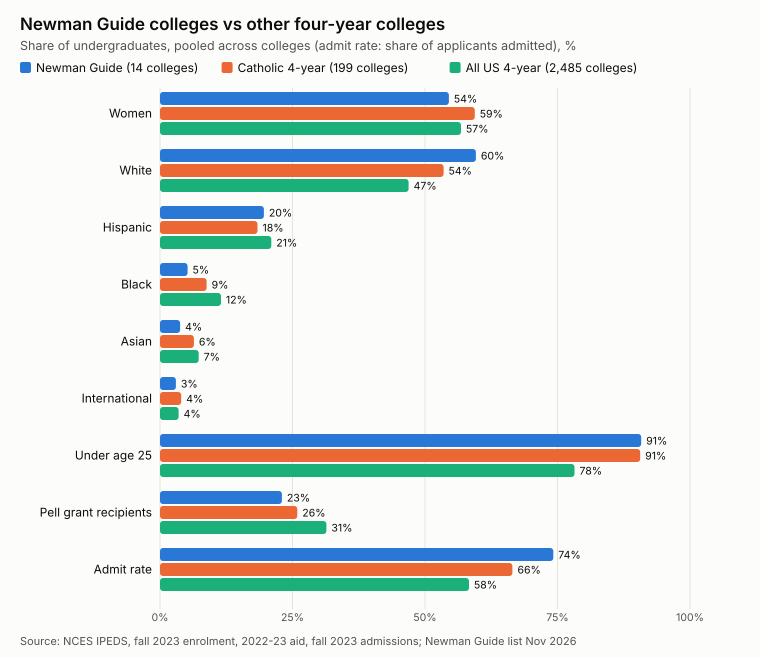
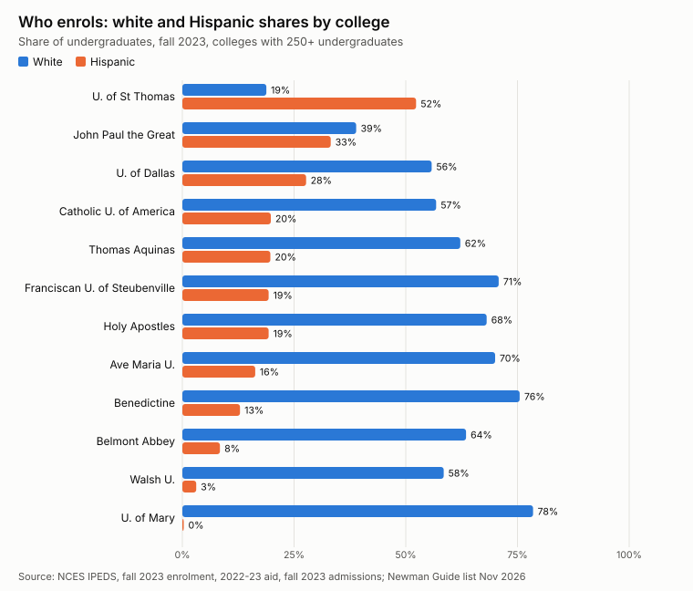

The Cardinal Newman Society's [Newman Guide](https://cardinalnewmansociety.org/college/) recommends colleges for a strong Catholic identity. The 2026-27 edition lists **24 colleges**: 14 US residential colleges, 2 online or non-residential ones, 5 international ones and 3 with provisional recognition. Who actually enrols at them? The federal college database, IPEDS, answers that for 14 of the US schools. Every number below comes from those federal files (fall 2023 enrolment, 2022-23 Pell grants, fall 2023 admissions). The comparison groups are the 199 four-year colleges that IPEDS tags as Roman Catholic and all 2,485 active, degree-granting four-year colleges.

Four US schools on the list have no IPEDS record: Christendom College and Wyoming Catholic College, plus the two new provisional colleges, St. Joseph the Worker and Rosary College. The first two are known for refusing federal student aid, which is probably why, though I have not confirmed it. So the charts cover 12 residential colleges plus Catholic International University and Holy Apostles.

## Small schools, 21,077 undergraduates in all

Taken together, the 14 schools enrol **21,077 undergraduates**. That is about 4.5% of the 470,992 undergraduates at Catholic four-year colleges, and fewer than at many single state universities. None has more than 3,200 undergraduates. The median Newman school has 1,427, against 1,648 for Catholic colleges and 1,622 for four-year colleges overall.

## How they compare

| Share of undergraduates | Newman Guide (14) | Catholic 4-year (199) | All 4-year (2,485) |
|---|---|---|---|
| Women | 54.5% | 59.4% | 56.8% |
| White | 59.6% | 53.5% | 46.9% |
| Hispanic | 19.6% | 18.4% | 21.0% |
| Black | 5.2% | 8.8% | 11.5% |
| Asian | 3.8% | 6.4% | 7.3% |
| International | 3.0% | 4.0% | 3.5% |
| Under age 25 | 90.8% | 90.6% | 78.2% |
| Pell grant recipients | 23.0% | 25.9% | 31.4% |
| Admit rate (of applicants) | 74.2% | 66.5% | 58.3% |

Shares are pooled: each group's students are added up first, so a big school counts for more than a small one. What stands out:

- **More men.** Women are 54.5% of Newman undergraduates, five points below other Catholic colleges. Belmont Abbey (46.9%) and John Paul the Great (47.3%) enrol more men than women.
- **Whiter, but with one big exception.** Six in ten Newman undergraduates are white, against fewer than half nationally. Black and Asian students are underrepresented by roughly half.
- **Traditional age.** 91% are under 25, the same as at Catholic colleges and well above the 78% national figure.
- **Somewhat better off.** 23% receive a Pell grant, the federal grant for low-income students, against 31% nationally.
- **Not selective as a group.** Newman colleges admit three applicants in four, which is more than average. Ave Maria (45%) and the University of Dallas (54%) are the exceptions.

## One Houston university carries the Hispanic share

The group's Hispanic share, 19.6%, looks close to the national figure. That is mostly the University of St. Thomas in Houston, which is 52% Hispanic and has nearly 3,000 undergraduates. Without it, the other 13 schools are **14.2% Hispanic and 66.4% white**. John Paul the Great (33%) and the University of Dallas (28%) are the only others above a quarter. The Catholic Church in the United States is increasingly Hispanic, but most Newman colleges do not yet reflect that.

## What this can't tell you

IPEDS counts race, sex, age and aid. It says nothing about religion, so this data cannot tell you how many students are practising Catholics. That figure would come from the colleges' own surveys, which are not federal data. Some details need care:

- The University of Mary reports zero Hispanic undergraduates and 280 of unknown race, so its Hispanic share is probably understated.
- Thomas Aquinas College has two campuses, and I found only one IPEDS ID. Whether that record includes the Massachusetts campus is unconfirmed.
- At the two smallest schools (fewer than 100 undergraduates), a handful of students moves a percentage by several points.

## Reproduce it

The list with its IPEDS IDs is in [`newman_colleges.csv`](../data/catholic-demographics/newman_colleges.csv). [`newman_ipeds.py`](../data/catholic-demographics/newman_ipeds.py) rebuilds the per-college and group tables from the free [NCES IPEDS data files](https://nces.ed.gov/ipeds/datacenter/DataFiles.aspx) (HD2024, IC2024, EF2023A, EF2023B, SFA2223, ADM2023), and `newman_charts.py` redraws the charts. Companion posts look at [Latin Mass attendees](2026-11-03-who-attends-the-latin-mass-what-the-numbers-show.md) and [FOCUS and other Catholic missionaries](2026-11-03-focus-missionaries-and-catholic-lay-missions-by-the-numbers.md).
