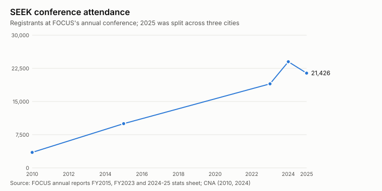
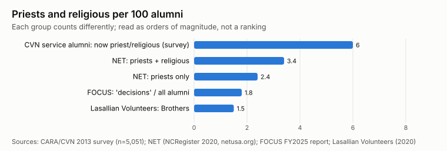
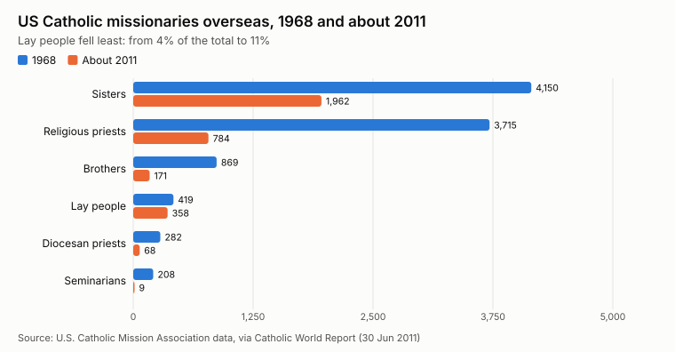

A [post two days ago](2026-11-03-focus-missionaries-and-catholic-lay-missions-by-the-numbers.md) charted how FOCUS grew from 2 missionaries to 1,062. Readers asked the next questions. Where are the missionaries? Who are they? How long do they serve? What do they do afterwards, and how many become priests or religious? And what are the answers for the other Catholic lay groups?

The short answer is that the groups publish growth and very little about people. Nobody publishes an average length of service, a career breakdown of alumni or a sex ratio of alumni, except for one survey of service-programme alumni and a few teacher-retention figures. What follows is everything I could source, plus two clearly labelled estimates.

**Almost every number here is the group's own claim.** The independent exceptions are named. Figures marked † were seen only in a search-engine extract of the cited page, because the page itself refused automated reading (National Catholic Reporter, Catholic World Report and several programme sites). Check those before relying on them.

## FOCUS

### Where the missionaries are

FOCUS's [2024-25 stats sheet](https://focus.org/wp-content/uploads/2026/06/Focus-25-Stats-.pdf) and [FY2025 annual report](https://focus.org/wp-content/uploads/2025/11/FOCUS_Annual_Report_2025.pdf) give 259 locations. They include 211 to 221 US campuses (the two documents differ), 28 parishes, 10 digital campuses and 10 international sites, in 44 states and 6 countries.

- **The campuses are mostly large state universities.** A rough sort of the [campus list](https://www.focus.org/campuses) (216 entries) gives about 168 public universities, including 4 service academies, about 36 private non-Catholic schools such as Harvard, Stanford and Duke, and only about 8 Catholic colleges. This is my sort, not a FOCUS figure.
- **By state**, California and Texas have 11 campuses each and Pennsylvania 10. Colorado, Louisiana, Massachusetts, Michigan, Ohio and Wisconsin have 8 each. Alaska, New Hampshire and Wyoming have none. Per head of population, the Plains (Kansas, Nebraska, the Dakotas, Iowa) are over-represented.
- **Abroad**, the FY2023 report lists Dublin, Cork, Belfast, Krems, St. Pölten, Vienna, Passau, Düsseldorf and a hybrid site in Monterrey.
- **Teams average four missionaries** ([press kit](https://assets.focus.org/resources/press-kit/FOCUS%20Overview.pdf)). FOCUS doesn't publish team sizes by campus.

### Who the missionaries are

| Measure | Figure | Source |
|---|---|---|
| Sex, 2025-26 | 505 men, 557 women (52% women) | FY2025 annual report |
| Age | "22–25 years old" | [Recruitment page for parents](https://join.focus.org/focus-recruitment-landing-page/parents/) |
| Role, 2023 | 936 campus, 21 parish, 19 digital | FY2023 annual report |
| Pay | Fully funded at $3,260 a month in raised support; benefits and a retirement match | [FOCUS badge page](https://credly.com/org/focus/badge/fundraising-milestone-achieved-level-1-fundraising-goal) |
| Older pay | $28,000 starting salary for a single person; $55,000 for a married couple (about 2017-18) | National Catholic Reporter † |
| How the money flows | $75.8M of $126.7M revenue raised by missionaries' own support teams; $59.2M paid out as support-team salaries (FY2025) | FY2025 annual report |

FOCUS publishes no race breakdown, no count of married missionaries and no split between new and returning missionaries. Katherine Dugan's ethnography *Millennial Missionaries* (Oxford, 2019), based on interviews with more than 50 missionaries, describes them as mostly white and middle class but gives no counts.

### How long they serve

FOCUS asks for at least two years. "Most choose to serve longer than two years," its FY2023 report says, but it gives no average. Two rough estimates:

1. **Turnover.** In January 2026 the founder, Curtis Martin, told [EWTN News](https://www.ewtnnews.com/world/us/focus-expands-reach-into-parishes-hoping-to-revitalize-the-local-church) that "probably 25% of the missionaries left on campus; that's part of our cycle". If a quarter leave each year, the average stay is about four years, a little less while FOCUS is growing.
2. **Person-years.** Add up FOCUS's yearly headcounts since 1998, filling gaps between reported years, and divide by everyone who has ever served (2,377 missionary alumni plus 1,062 serving). That gives about **3.0 years per person**. Current missionaries are only part-way through, so the true figure for those who finish is higher.

Both point to a **typical stay of about three to four years**. A median is probably two or three years, given the two-year commitment and a long tail of career staff; the FY2023 report profiles veterans with 14 to 23 years on staff. The arithmetic is in [`lay_groups_charts.py`](../data/catholic-demographics/lay_groups_charts.py). It rests on FOCUS's own counts and one spoken "probably".

### Roles off campus

FOCUS reports no headquarters headcount. The work beyond campus teams, as FOCUS reports it:

| Area | 2024-25 |
|---|---|
| Parish missionaries | 38, in 28 parishes, with 1,798 parishioners in Bible studies; FOCUS reported 100% retention of parish missionaries and plans 25 more parishes in 2026 |
| Digital | 10 partner campuses; digital outreach on 70 |
| Varsity Catholic (athletes) | 113 missionaries on 72 campuses (stats sheet); 225 on 128 campuses in 2024 by another count † |
| Greek life | 588 missionaries do some outreach to fraternities and sororities, 240 of them mainly |
| Mission trips | 107 trips, 1,945 participants, 27 countries |
| Retreats | 49 retreats, 2,754 participants |
| SEEK conference | 21,426 attendees in 2025, including 12,583 students, 694 priests and 47 bishops |

### Alumni

FOCUS says it has "more than 80,000 missionary and student alumni" (FY2025). That number was 20,000 in 2015, 50,000 in 2022 and 70,000 in 2023. Most are students who were in a Bible study, not missionaries: missionary alumni number 2,377. FOCUS says about 15,000 have been "formed for post-campus evangelization".

FOCUS publishes nothing on what alumni do for work, how many marry, how many children they have or how many work for the Church. The only alumni survey, from 2015, gave no sample size. Dugan's fieldwork is qualitative. Critics have noticed the silence too: a September 2026 [Substack analysis](https://chrisdamian.substack.com/p/focus-ministries-the-126-million) asks where $16.6M of support-team money goes, and notes that FOCUS has not disclosed its chief executive's pay since its last full Form 990, for 2014.

### Vocations

FOCUS counts 1,469 "decisions to pursue priesthood or religious life" through 2025: 1,154 men and 315 women. In April 2023 it said more than 1,000 people had actually entered a seminary or house of formation, across more than 75 religious orders. **It has never published a split between diocesan priesthood and religious orders, between former missionaries and former students, or a count of completed ordinations.**

The one independent-ish signal: in a 2019 poll by the National Conference of Diocesan Vocation Directors, more than a third of US seminarians said FOCUS had shaped their discernment ([OSV News](https://www.oursundayvisitor.com/one-third-of-all-seminarians-have-this-in-common/)).

## Other lay missions and service corps

| Programme | Size | Tenure and retention | Alumni and vocations |
|---|---|---|---|
| **NET Ministries** (youth retreat teams) | 148 to 175 missionaries a year on 14 to 16 teams, aged 18 to 28 † | – | 3,400+ alumni; in 2020, 2 bishops, 77 priests and 40 religious ([NCRegister](https://www.ncregister.com/features/net-ministries-honored-for-making-lifelong-missionary-disciples-of-jesus)) |
| **St. Paul's Outreach** (campus households) | 157 missionaries on 46 campuses (2019); 98 in 8 states (2018) † | – | "Thousands of alumni"; no count |
| **Christ in the City** (Denver, Philadelphia) | 24 to 34 year-long missionaries aged 18 to 27 † | – | – |
| **Jesuit Volunteer Corps** | Peak of 500; 89 in 2023-24 ([America](https://www.americamagazine.org/faith/2024/03/14/volunteers-decline-united-states-jesuit-peace-corps-247491)) | JVC Northwest: about 18 to 20% stayed a second year (2011, 2013) † | 12,000+ alumni † |
| **Alliance for Catholic Education** (Notre Dame teachers) | 2,000+ graduates | "77% of ACE grads remain committed to education" ([ACE](https://ace.nd.edu/programs/teach/seewhereacetakesyou)) | 251 school leaders and 9 diocesan superintendents |
| **Mercy Volunteer Corps** | 1,000+ since 1978; 11 to 13 a year now | – | 4 of 7 staff are alumni |
| **Lasallian Volunteers** (closed 2022) | 775+ alumni | – | 12 entered the Christian Brothers; 85 still in Lasallian work ([lasalle.org](https://www.lasalle.org/en/relan-lasallian-volunteers-celebrates-30-years/)) |
| **Maryknoll Lay Missioners** | ~1,000 since 1975; 40 serving in 9 countries | – | – |
| **Echo** (Notre Dame catechists) | ~260 graduates † | "Over 90 percent" still in full-time ministry † | – |
| **Family Missions Company** | 1,000+ since 1997; 200+ serving in 9 countries (2023) † | Families as well as singles | – |

The only independent study of alumni across programmes is a 2013 CARA survey commissioned by the Catholic Volunteer Network. It got 5,051 responses from 18,515 alumni of 60 programmes (a 27% response rate) †. Among respondents:

- 46% went to Mass weekly, against 25% of US Catholics.
- 37% had considered priesthood or religious life, and 6% were living that life, including people still in formation.
- 47% were married, against 48% of US adults.
- 67% said service shaped their choice of career.

Self-selection inflates all of these: alumni who still care answer surveys.

The chart compares rates that are defined differently, so read it as orders of magnitude. **Between one and six in every hundred alumni of these programmes become priests or religious.** Even so, these programmes are not mainly vocation pipelines. Their typical alumnus marries and works in an ordinary job, and the teacher programmes keep about three quarters in education.

The wider picture is a long fall in clergy and religious missionaries, with lay people falling least:

## Movements and associations

These are lifelong memberships, not terms of service, so "length of service" mostly does not apply. None of them publishes retention or former-member data.

| Group | Size (year) | Breakdown published | Source |
|---|---|---|---|
| **Knights of Columbus** | 2.1 million members; 92,000 joined in a year (2023) | Average age 62 in Michigan; 47 million volunteer hours | [EWTN News](https://ewtnnews.com/world/knights-of-columbus-report-rise-in-membership-charitable-donations-at-annual-convention) |
| **Opus Dei** | 93,510 members and 2,115 priests (2021) | 70% supernumeraries (married or living in their own homes), 57% women, 98% lay; Europe 57%, Americas 34% | Annuario Pontificio via [catholic-hierarchy.org](https://www.catholic-hierarchy.org/diocese/dqod0.html) (independent); [opusdei.org](https://opusdei.org/en/article/members/) |
| **St. Vincent de Paul Society, US** | 81,690 members in 4,078 conferences (FY2025); 5.3 million people assisted | About 20 members per conference | [SVdP USA annual report](https://ssvpusa.org/wp-content/uploads/2026/07/SVDPUSA_Annual-Report2025_web_HiRes.pdf) |
| **Teams of Our Lady** (married couples) | 74,635 couples in 14,459 teams (2024) | Brazil 4,487 teams; 45% of teams are 10 years old or younger; French-speaking Africa growing 8 to 10% a year | [END statistics](https://equipes-notre-dame.com/en/les-statistiques-des-equipes-notre-dame-2025/) |
| **Lay Dominicans** | 137,412 in 75 countries (2025) | Outnumber the friars 26 to 1 | op.org † |
| **Neocatechumenal Way** | 21,300 communities in 134 countries | 1,668 families on mission; 100 to 120 Redemptoris Mater seminaries, claiming 2,000+ priests ordained | various † |
| **Regnum Christi** | 37,280 members (2025) | 1,033 Legionary priests; consecrated women fell from 540 (2005) to 484 (2024) | [Catholic World Report](https://www.catholicworldreport.com/2025/03/24/consecrated-women-of-regnum-christi-on-the-rebound-despite-deep-wound-from-founder/) † |
| **Focolare** | 110,000 to 141,000 members | About 6,800 with vows (4,300 women, 2,540 men) | Vatican News † |
| **Communion and Liberation** | ~60,000 in its Fraternity | Keeps no membership register | † |
| **Sant'Egidio** | 50,000 to 60,000 in 70+ countries | No formal membership | Vatican News † |
| **Emmanuel Community** | 11,500 in 67 countries | 275 priests, 225 consecrated | emmanuel.info † |
| **Secular Franciscans** | "More or less 200,000", but only 22,000 registered | The order itself called for a census in 2021 | ciofs.info † |
| **Legion of Mary** | 3 to 4 million active, plus auxiliaries | – | † |
| **Charismatic Renewal** | 100 to 160 million claimed | No register; the claims differ by 60 million | † |

The Holy See's Dicastery for Laity, Family and Life recognises 117 international associations of the faithful (June 2024) †.

## What would answer the questions properly

The data to answer most of these questions already sits in these organisations' own records. FOCUS knows each missionary's start date, end date, sex and campus. Publishing an anonymised table of tenure, plus a few questions to alumni about their careers and families, would settle most of what is asked here. CARA ran exactly that kind of survey for service-programme alumni in 2013. A repeat that includes FOCUS, NET and St. Paul's Outreach, with a comparison group, would be the first independent measure of what the evangelising missions produce. Until then, treat every "impact" figure above as the group's own claim.

## Sources and code

The chart numbers and the tenure estimate are in [`lay_groups_charts.py`](../data/catholic-demographics/lay_groups_charts.py), each beside its source. Companion posts: [FOCUS by the numbers](2026-11-03-focus-missionaries-and-catholic-lay-missions-by-the-numbers.md) and [six kinds of US Catholic community](2026-11-03-six-kinds-of-us-catholic-community-compared.md).
