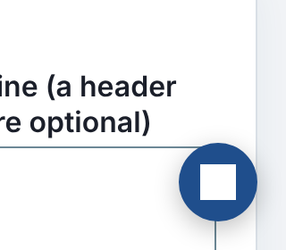
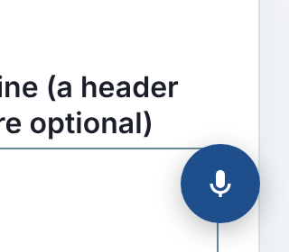

Every calculator on this site with two or more number fields gets a round
blue button in the bottom-right corner: "Speak or type". It opens the
[voice and chat filler](2026-10-20-voice-and-chat-for-1300-calculators.md).
On a phone the label is hidden and only a white microphone icon shows.

During a phone-width screenshot pass today, the button on the
[changepoint detector](https://marisstella.app/changepoint-detector/) showed
no microphone. It showed a solid white square, which looks more like a
"stop" control than a way to talk to the page.




## Cause

The site build adds the button to each page with a script. That puts it
inside a page whose CSS the build does not control. The changepoint detector
draws its charts as inline SVG, and to give them a white plate it styles
every SVG on the page:

```css
svg { width: 100%; height: auto; background: #fff; }
```

The button's microphone is an SVG too, so it picked up that white
background. A white icon on a white square leaves nothing visible.

## How many pages

A headless-browser sweep loaded all 1,338 tool pages at 390 px. 955 of them
show the button. For each one it checked three things: the icon colour
differs from what is behind it, the icon has no background of its own, and
it is 20 by 20 pixels.

| | before | after |
|---|---|---|
| pages with a blank icon (white on white) | 65 | 0 |
| pages with a resized icon | 1 (wall-framing-takeoff, 22 px) | 0 |
| pages that draw the mic correctly | 890 | 955 |

The 65 range from an A/B test significance calculator to a wedding
photographer's profit calculator. Each one has charts and a bare `svg`
rule. The flagship framing takeoff tool styles its SVGs with a 1 px border.
That gave the icon a cream background (`#fbfaf7`) and grew it by 2 px.

## Fix

The button's stylesheet now resets its own icon by name: fixed size, no
background, no border, and the path filled with the button's text colour. A
class-qualified selector (`.pf-ask-voice svg`) beats a page's bare `svg`
rule, so no `!important` is needed. Every byte of this script loads on every
page, and a test holds it under 3,600 bytes. To make room, two duplicate
rules were merged. The result is 3,598.

## Keeping it fixed

A unit test pins the reset rule. It cannot know which page rule will clash
next, though: a `path { fill: ... }`, or a `width: 100%` that wins. So the
sweep is now a script in the repository, `platform/pages/ask-voice-icon.mjs`.
It exits non-zero and names each page whose icon is not drawn.

The general lesson: anything injected into pages you don't style needs to
reset every property those pages are likely to set, and the only way to know
it worked is to look at every page.
