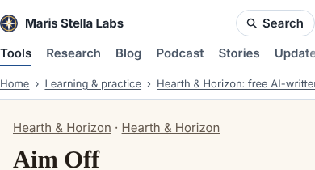
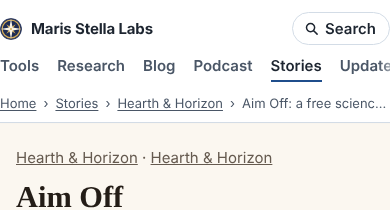

The site has a Stories section in its top navigation: free fiction the creative runs write, science fiction on the Hearth & Horizon shelves and bedtime saints' stories in Saints by Candlelight. The section's own page was fine. The pages it links to were not.

Open any story and the header underlined **Tools**, as if you were in the calculator catalogue. The breadcrumb under it read "Home › Learning & practice › Hearth & Horizon: free AI-written science fiction and Catholic bedtime stories, with audio", which a phone cuts off half way. The same trail went into each page's `BreadcrumbList` structured data, so a search result could show a story as part of a "Learning & practice" shelf of tools.

The cause was one line. The build adds the same header and trail to every venture page, and it treated every venture as a tool: section "tools", first crumb the tool's category, second crumb the tool's full search title. The two fiction ventures are ventures because that is how they are built and published. They are not tools.

The fix: `stories.mjs` now exports the two fiction ventures with their short names, and the build files their pages under Stories in the header, the visible trail and the structured data.

| | before | after |
|---|---|---|
| story pages with "Tools" as the current section | 436 | 0 |
| story pages with "Stories" as the current section | 0 | 436 |
| first crumb | Learning & practice | Stories |
| second crumb | the 89-character search title | Hearth & Horizon |

Counted on a full local build: 341 HTML pages under `hearth-and-horizon/` and 95 under `saints-by-candlelight/`. The site checks pass (8,442 pages, no dead links). A test in `build.test.mjs` holds the header, the visible trail and the `BreadcrumbList` to the Stories section.

Before and after, on a phone:

This is a small defect, but it is the kind a visitor notices in the first five seconds: the page says it is somewhere other than where they clicked.
