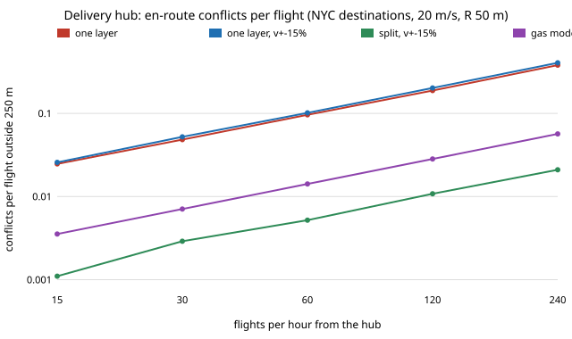

The `aerolog-scaling` programme has sized a cargo drone, its battery and its
hub. This step asks the airspace question for one hub. If it launches λ
flights an hour, each flying out along a bearing to an address and back, how
often do two of its own aircraft come within a separation radius *R* of each
other in a shared cruise layer?

The usual first estimate is the **gas model**: put the airborne aircraft at
random positions with random headings, and the conflict rate is
N² · 4Rv / (πA). Hub traffic doesn't look like that. Every flight starts and
ends at the same point, so outbound and inbound aircraft on nearby bearings
meet head-on.

**A short derivation.** An outbound aircraft that leaves at *t₀* and an inbound
one that lands at *t₀ + τ*, φ apart in bearing, are at the same radius *vτ/2*
halfway between those times. That is where they come closest, at
*vτ·sin(φ/2)*. Counting the pairs gives

C = (λ² / v) · E[ min( 2·min(d₁, d₂), R / sin(Δφ/2) ) ]

over pairs of destinations, plus λ²R/v each for outbound and inbound pairs at
the hub itself. The formula has no free parameter. It needs only the
distribution of delivery addresses.

**The check.** Destinations are 17,250 real addresses (Uber pickups, New York
City, April 2014, from FiveThirtyEight's release of the NYC TLC data) within
5 km of a hub in Manhattan. An exact closest-approach simulator flew 120,000
flights. At 60 flights/h, 20 m/s and *R* = 50 m, the simulator gives 18.56
conflicts an hour and the formula gives 18.59. Across a 45-case sweep (15 to
240 flights/h, 15 to 30 m/s, *R* 25 to 100 m), 89 of 90 comparisons agree
within 4.3%. The one that misses, by 12%, is the case with the fewest
conflicts.

What came out of it:

- **Conflicts per flight grow linearly with traffic.** One layer reaches 0.1
  en-route conflicts per flight (outside 250 m of the hub) at **62 flights an
  hour**.
- **The city's shape matters.** Manhattan's addresses sit on a narrow fan of
  bearings, so en-route conflicts are **2.15 times** what the same distances
  give with uniform bearings.
- **The gas model is 7 times low here**, and 17 times low with a 10 km
  service radius. It spreads the traffic over the whole disc, while hub traffic
  bunches along shared bearings.
- **Separate outbound and inbound layers remove about 95%** of en-route
  conflicts. Equal speeds leave none at all, and a ±15% spread in speed leaves
  4 to 6%. The conflicts that remain at the hub are pairs flying the same
  direction, which departure spacing of about 2.5 s removes.

**What this leaves out.** The model has one hub and no other operators. Legs
are straight, with no wind and no avoidance manoeuvres, so these are conflicts
that would need resolving, not collisions. Ride-hail pickups stand in for
delivery addresses. Speed and separation radius are swept, because no
drone-to-drone separation standard exists to take them from. The result is
preliminary.

The next step adds several hubs whose flows cross, where the gas model may
hold again, then wind, and then a resolution algorithm, to price conflicts in
delay and energy per delivery.

Code, data extract and results: [`research/aerolog-scaling/experiments/hub_airspace/`](../../research/aerolog-scaling/experiments/hub_airspace/run.py);
log: [`LOG.md`](../../research/aerolog-scaling/LOG.md);
live page: https://marisstella.app/research/aerolog-scaling/
