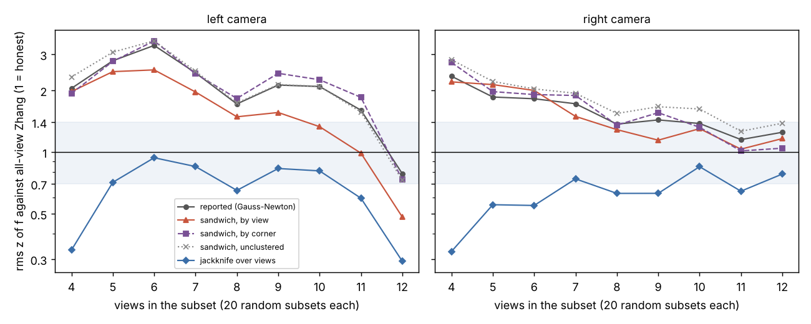

The [`sensing-selfcal`](../../research/sensing-selfcal/README.md) programme asks
whether a robot camera can recalibrate itself from what it sees, with no
checkerboard, and know when the new calibration is wrong. Two earlier steps today
found that target-free bundle adjustment gets the focal length within 0.24% of a
checkerboard calibration, but that its reported uncertainty is about twice too
small, and that a simple threshold on it
[could not reach 90% right on both good and bad updates](2026-11-11-when-the-views-line-up-the-checkerboard-lies-more.md).
This step asked why, and tried two textbook fixes. We wrote the predictions down
before running anything.

## Is the 2× gap real?

The earlier score compared each subset's focal length with the checkerboard's
all-view answer, which itself sits 0.8 to 1.3 px from the target-free one. That
mismatch could have made a good error bar look bad. So we scored each subset
against the target-free all-view solution instead, with the variance a nested
estimate should have (σ²subset − σ²all). The rms z-score
came out at 2.28 (95% interval 1.93 to 2.73). The gap is real.

## Two fixes, no tuning

The solver's σ assumes every pixel's error is independent and the lens model is
right. Neither holds exactly, so we tried two estimators that do not assume
them, with no constants fitted to the data.

- **Sandwich (cluster-robust) σ**, clustered by image. It allows the errors in
  one image to be correlated. It helped on the left camera (rms z 2.21 to 1.76)
  and barely on the right (1.63 to 1.59). Clustering by corner did nothing.
- **Jackknife over views.** Re-solve the calibration k times, leaving out one
  image each time, and take the spread of the answers. That is 3,480 extra
  solves; 3,473 converged.

The jackknife was honest: rms z 0.70 and 0.65, with 97 to 99% of errors inside
its 2σ band. On the near-critical subsets, where the views are nearly parallel
and the plain σ was worst (rms z 2.34), it scored 1.01. We had predicted a
range of 0.7 to 1.4. The right camera's 0.65 falls just outside it, on the
cautious side, so the hypothesis is refuted as written.

## Honest is not the same as useful

Then the surprise. For a robot, the error bar's job is to pick out bad updates.
The jackknife is worse at that than the overconfident plain σ. As a score for
telling updates more than 2% off from those within 1%, its ROC AUC is 0.75,
against 0.91 for the plain σ (difference −0.15, 95% interval −0.25 to −0.07).
A gate at σ/f ≤ 0.5% on the jackknife rejects every bad update but accepts only
19% of the good ones.

The reason shows in the figure. With 4 views, each leave-one-out solve has only
3, and 3-view solves can be 20% off. So the jackknife inflates σ a median 15×
there. That inflation measures how fragile a subset is to losing one image,
which is noisy with few images, more than how far the subset is from the truth.
The jackknife's variance is known to be biased upward (Efron and Stein, 1981),
and here the bias is largest where the solve is most non-linear.

## What a robot should do

Use the two numbers for different jobs. The plain σ, with the spread of view
angles, ranks updates well and is the better accept score. The jackknife gives
an error bar that holds up, so it can refuse an update whose honest
uncertainty is too wide. The next step tests that two-stage gate, fitted on one
camera and scored on the other.

The caveats: one stereo rig and one board, checkerboard corners as stand-ins
for tracked features, and only 22 bad updates behind the AUCs. Code, data and
every number are in the
[project README](../../research/sensing-selfcal/README.md), and the
pre-registration and results are in its
[log](../../research/sensing-selfcal/LOG.md).
