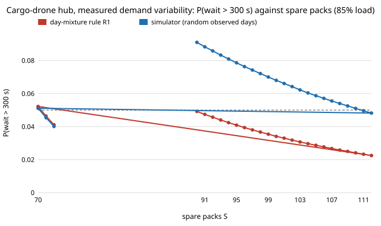

The `aerolog-scaling` programme has a model of a delivery-drone hub: 8 pads,
8 chargers, a 42-minute charge for each swapped battery. Earlier today a
formula sized its pool of spare packs under a daily demand profile, with no
simulator, and landed within 1 pack. It had one weakness. Every day in it was
the *average* day, and the only randomness was which minute each order came in.

Real days are not average. To see how much they vary, we took the 4.5 million
Uber pickups in New York from April to September 2014 that FiveThirtyEight
obtained from the city's Taxi and Limousine Commission
([data](https://github.com/fivethirtyeight/uber-tlc-foil-response), CC BY 4.0).
We counted them per 15 minutes for the busiest 2.2 km grid cell and for the
whole city. Ride-hail is not drone delivery, but it is on-demand trips from one
neighbourhood, and nothing public at drone-delivery scale exists.

After taking out the growth trend and the day of the week, a weekday's volume
in that cell still varies by 17% (coefficient of variation). Within the day,
each hour varies by another 17%, and a busy hour tends to be followed by
another one (correlation 0.58).

Spare packs needed for a 95th-percentile wait under 5 minutes, busiest cell:

| Mean load (of charger limit) | Mean day only | Real days (simulator) | Formula, one day at a time | Formula, three days running |
|---|---|---|---|---|
| 70% | 47 | 64 | 62 | 63 |
| 85% | 71 | 111 | 90 | 108 |

Day-to-day variation adds 36% to the pack pool at 70% load and 56% at 85%. The
formula that treats each observed day on its own catches most of that at 70%,
but at 85% it is 21 packs short. The reason is carry-over. After a busy evening
the hub has not caught up by morning: at 06:00 the expected number of packs still queued for 8 chargers is 16 on
average, and 79 or more on the busiest 5% of runs of days. Run over three
consecutive days, the same exact calculation gives 108 against the simulator's
111. Both the three-day test and the carry-over explanation were checked
*after* the main results were in, and are labelled that way in the
[log](https://marisstella.app/research/aerolog-scaling/).

A second point for a planner: a 95th-percentile target pooled over all days is
not the same as meeting it every day. At the simulator's count, about one
weekday in eight still misses the target on its own. Meeting it on 95% of days
takes roughly 40% more packs again (87 and 129).

Of six predictions written before the run, three held. The day-level
variation was larger than predicted, the one-day formula was not within one
pack, and within-day swings added 4 packs beyond the day's level. The limits
are in the log: ride-hail from 2014, weekdays only, and days drawn
independently, so weather that persists for several days would add more
carry-over. Code and data:
[`experiments/hub_throughput/demand_variability.py`](../../research/aerolog-scaling/experiments/hub_throughput/demand_variability.py).
