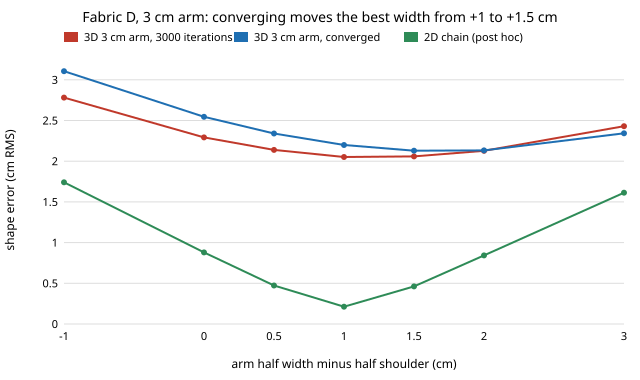

Yesterday's [first step](2026-11-10-hanger-simulator-fidelity.md) of the
[`hanger-codesign`](../../research/hanger-codesign/) programme found that our
two cheap cloth models pick the same laundry-robot hanger on four fabrics with
measured bending rigidity and weight. They chose a wood-shaped profile with an
arm 1 cm wider than the half shoulder. It also found a warning sign. On a
shallow 3 cm arm, where the 3D sheet adds physics the 2D chain lacks (the front
and back panels can fall off the arm), doubling the solver's 3000 iterations
moved the shape error by up to 0.11 cm. The margin that decided the width was
about the same size.

So today's step solved those cases properly. It ran L-BFGS in 3000-iteration
chunks until the error moved less than 0.002 cm over a chunk, which took 12,000
to 24,000 iterations. Four predictions were written down before the run.

What came out:

- **The best width moved.** Converged, the 3 cm arm prefers +1.5 cm on all
  four fabrics. On the 1 cm grid, fabric D now picks +2 cm (by 0.066 cm), and
  the other three keep +1 cm by only 0.02 to 0.03 cm.
- **The early stop was biased, not just noisy.** We predicted that 3000
  iterations would underestimate every error. They do not. The bias depends on
  the width: the error is 0.22 cm too low at −1 cm, 0.13 cm too low at +1 cm
  and 0.07 cm too *high* at +3 cm. Stopping early flatters narrow arms.
- **The tiers really disagree.** Run on the same grid, the 2D chain picks
  +1.0 cm on every fabric, and sharply. So the converged 3D answer is half a
  centimetre wider. The agreement milestone 1 reported was the iteration cap's
  bias landing on the 2D answer by chance.

The lesson reaches beyond hangers. When two simulators agree on a design, check
first that both of them finished. A fixed iteration budget can bias a
comparison in one direction. The programme now judges convergence against the
decision margin: a design choice counts only when the margin is several times
the solver's last change.

Half a centimetre is within what our pre-registered tolerance allowed. It is
also the kind of disagreement that only a validated, calibrated cloth solver
can settle, which is the programme's milestone 3. Everything here is
simulation. Stretch stiffness is assumed, there is one size-M garment strip, and
there is no friction. The code, results and log are in
[`research/hanger-codesign`](../../research/hanger-codesign/).
