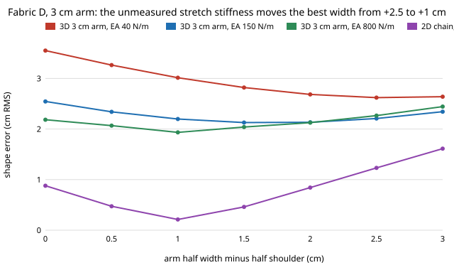

Earlier today the [`hanger-codesign`](../../research/hanger-codesign/)
programme found that two of our cheap cloth models disagree about a laundry
robot's hanger. Solved
[to convergence](2026-11-11-hanger-solver-stopping-rule.md), the 3D sheet
wants a shallow 3 cm arm half a centimetre wider than the 2D chain does. A
later step found the 3D sheet's square spring grid "locks": its simulated
drape test depends on the mesh and on stretch stiffness as much as on the
fabric's bending. So was the half centimetre real, or a meshing artefact?

This step reran the shallow-arm case 70 times, on the softest and stiffest of
four fabrics with measured bending rigidity and weight. It varied the stretch
stiffness (EA 40, 150 and 800 N/m) and the mesh (coarser rows, a finer mesh
across the depth). Each case was solved to the same convergence rule.
Five predictions were committed before the run.

What came out:

- **The mesh is not the problem.** Both mesh changes keep the 3D choice at
  +1.5 cm on both fabrics. The errors move by up to 0.17 cm; the decision does
  not.
- **The stretch stiffness is.** The 3D sheet's best width goes from +2.0 and
  +2.5 cm at EA 40 to +1.5 at 150 and +0.5 and +1.0 at 800. That is a 1.5 cm
  swing, three times the 0.5 cm we predicted.
- **The disagreement changes sign.** The 2D chain stays at +1.0 cm almost
  everywhere. So the 3D-minus-2D gap runs from +1.0 cm on stretchy cloth to
  −0.5 cm on stiff cloth. The 0.5 cm we reported is just where EA = 150 N/m
  happens to land.

The physics is plausible. On a shallow arm the front and back panels hang off
the sides, a soft cloth stretches under its own weight there, and a wider arm
makes up for the sag. A 2D model whose cloth hangs in one plane barely sees
this.

Why it matters: the four fabrics come from a published table of bending
rigidity and weight (KES-FB2). Its tensile columns (LT, WT, RT) do not convert to a stretch stiffness without the tester settings. On the 3D tier, those
two numbers are not enough to choose a shallow-arm hanger. You also need
stretch stiffness, from a tensile test like KES-FB1. That is early evidence
against one of the programme's own hypotheses (H2, "bending and weight are
enough"), at least on this tier. It also sets a precondition for calibrating
anything later: a measured EA.

Caveats: EA is swept, not sourced. Only two fabrics were run. The mesh was
varied only at EA 150, and locking should be worst at high EA, which is not
checked yet. The spring sheet is not a validated solver; the programme's
top tier still has to show whether this EA dependence is physics or springs.
Everything is simulation. Code, results and the pre-registered predictions are
in [`research/hanger-codesign`](../../research/hanger-codesign/).
