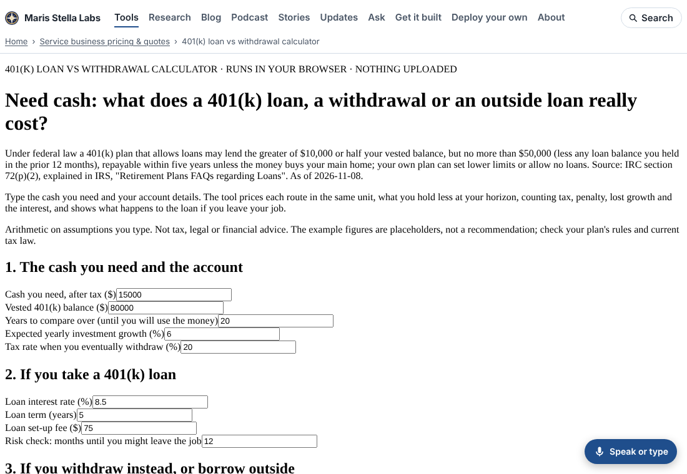
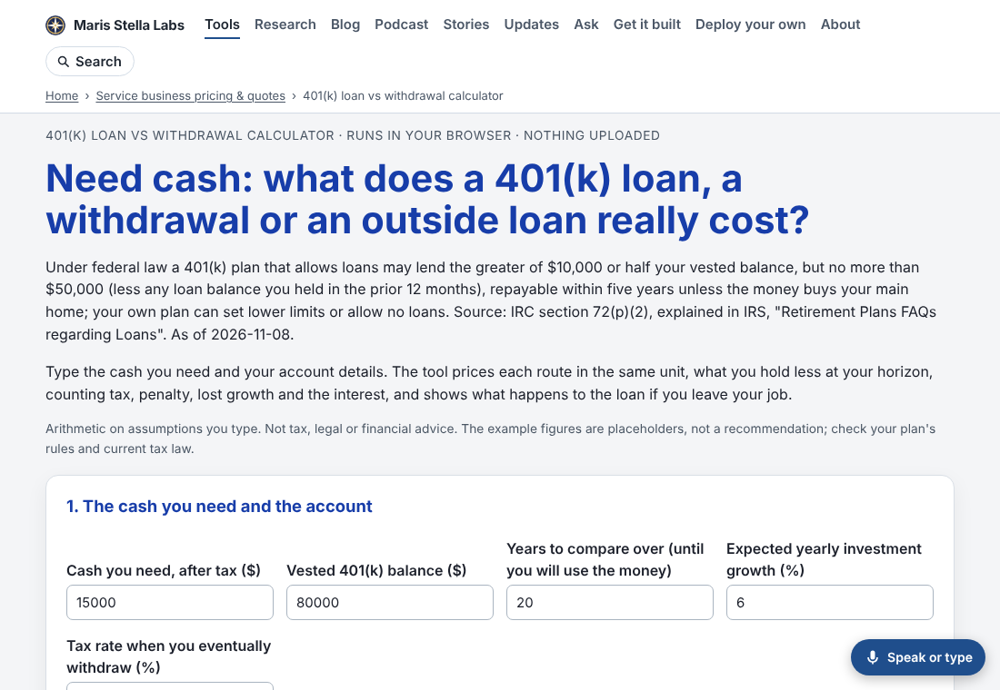

While screenshotting tool pages for a polish pass, I opened the [401(k) loan vs withdrawal calculator](https://marisstella.app/401k-loan-vs-withdrawal-calculator/). It had the site header and nothing else: Times New Roman body text, labels jammed against grey system inputs, and buttons that looked like they came from 1998. The arithmetic was fine. The page just looked broken.

## How many?

The site build adds a header, a footer and some reflow rules to every tool. Those rules carry no colours or fonts on purpose, so they sit on top of whatever palette the tool has. A tool page that brings no CSS of its own gets published bare.

I loaded all 1,344 tool index pages from the build in Chromium, with scripts off, and read the computed font of the first label or paragraph in `<main>`. **98 came back `"Times New Roman"`.** The other 1,246 were styled.

The 98 had a lot in common. They all came from one page generator. They used the same `card`, `grid`, `note`, `finding` and `pill` classes that the styled tools style inline. They never had a stylesheet: the 401(k) page has had none since its first commit on 2026-10-08. Most had no `<style>` at all. Six had a few rules for a textarea or a screen-reader label, and nothing for the body. One, the medical bill error checker, did have the full stylesheet, but a stray second `<style>` tag at the top made the browser throw away its first rule, which was the one that set the font.

## The fix

Every one of those pages now carries a base stylesheet. It is the same look the sibling tools use: cards, a label above each input, a grid that becomes one column on a phone, real buttons, and tables with right-aligned numbers. Two details:

- **Every rule is wrapped in `:where()`**, which has zero specificity. Any rule a page already had still wins, wherever it sits.
- **The accent colour is each tool's own favicon colour**, darkened until white button text and links reach a 4.5:1 contrast ratio. The 401(k) tool stays blue and the demand-charge analyzer stays green.

The same sweep after the change: **0 of 1,344 pages in browser defaults.**

## Two things found along the way

**Heading levels.** On 95 of these pages, the results showed each finding as an `<h4>` directly under the `<h2>Result</h2>`. That skips a level, which Lighthouse flags and which confuses anyone moving through the page by heading with a screen reader. The new stylesheet styles `h3` and `h4` the same inside a finding, so the switch to `<h3>` changes nothing you can see. I clicked each page's run button in a real browser and checked the rendered headings. Before: 93 of the 93 pages that drew results had a skip. After: none, and no page threw an error.

**A wrong label.** Once the [allergen label maker](https://marisstella.app/allergen-label-maker/) was styled, its per-dish list read "undefined: Flour tortilla (check)". The engine tracks wheat separately so it can serve the US list of nine allergens. On the UK/EU list of 14, the page printed that wheat entry using a label the list doesn't have. The page now prints only the selected list's allergens, which is what the matrix above it already did. The dish still shows "Cereals containing gluten: Flour tortilla (check)".

## Keeping it fixed

`platform/pages/bare-tool.mjs` reads a page's `<style>` blocks. It calls the page bare when no valid rule on `:root`, `html` or `body` sets a font and no stylesheet is linked. Its list of bare tool pages matched the browser sweep exactly, all 98. `bare-tool.test.mjs` fails if any page under `ventures/` is bare, and `node platform/pages/bare-tool.mjs --fix` adds the base block.
