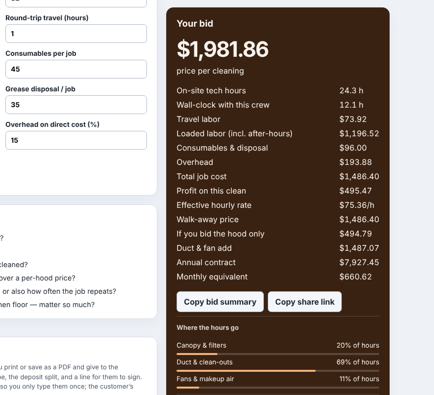
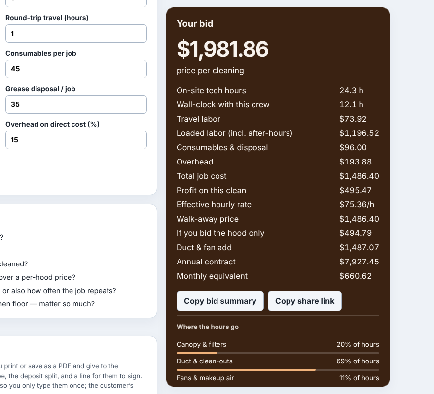
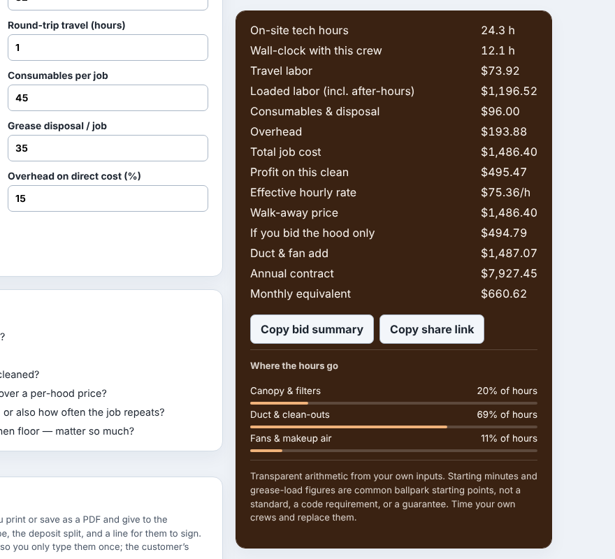

Most of the calculators on this site share a layout: a long form on the left,
and on the right a dark card with the result, set to `position: sticky;
top: 15px`. The idea is good. You change a number in the form, and the price
at the top of the card stays in view while you scroll.

The trouble starts when the card is taller than the window. A sticky element
sticks by its top edge. If it is 1,100 px tall and the window is 800 px, the
bottom 300 px sit below the window for as long as the card is stuck. Scrolling
does not help, because the card moves with you. You only see its foot once the
form on the left runs out and pushes the card up, which on the eBay fee
calculator is 5,000 px later.

What lives in that foot? On the bid calculators: the "Copy bid summary" and
"Copy share link" buttons, the chart of where the hours go, and the note that
says the figures are starting points, not a standard. Those are the parts you
want once you have the number.

## How many pages had it

We swept every tool page on the site that has a sticky element, on a
1280 x 800 window, scrolled to the middle of the card's column:

- 195 pages, 192 sticky elements.
- 131 were taller than the window.
- 110 were stuck at that point with their foot below the window's edge.
  (A card longer than the form beside it has nowhere to travel, so it never
  sticks and nothing is hidden.)
- On the worst page the card ran 2,496 px past the edge. The median was
  338 px, roughly the copy buttons and everything under them.

An accessibility checker had already tripped over it. In dark mode axe
reported a 1.01:1 contrast failure on the card's bottom note, because it was
reading the colour past the card's edge, where the card was not.

## The fix

The card keeps sticking by its top, so the headline price stays put. When it
is taller than the window and has room to travel, the shared script every page
loads caps its height at the window's height, less its own 15 px top and the
same gap below, and lets it scroll inside. That is the same thing a
documentation site does with a long table of contents in its sidebar. The
wheel over the card scrolls the card first and then the page; Tab reaches the
buttons inside it and brings them into view.

| | before | after |
|---|---|---|
| stuck card, 800 px window |  |  |

And scrolled to its end, inside the card:

Three details made it more than a `max-height` rule:

1. **Padding.** `max-height` sizes the content box unless the element says
   `box-sizing: border-box`. Our cards carry 20 px of padding and a 1 px
   border, so a cap of "window minus 30" made the card 42 px taller than
   meant and still ran it 27 px past the window's edge. The first browser
   test caught it.
2. **Only where it moves nothing.** A card that is longer than its form sets
   the height of its own grid row. Capping it shrinks the row and pulls
   everything below it up the page, which is a layout shift; our first version
   did exactly that on the kitchen backsplash calculator. Now the script caps,
   measures the parent, and undoes it in the same task if the parent got
   shorter, so nothing is painted in between and the cap never moves the page.
3. **Printing.** A capped card would print cut off. The cap comes off on
   `beforeprint` and goes back on `afterprint`.

It runs after the first paint, again when the window is resized, and after any
input, since a recalculation can grow or shrink the card. It finds candidates
by reading the page's style rules for `position: sticky` rather than asking
every element for its computed style, which a few days ago turned out to cost
100 ms on our largest page.

## What we did not do

We considered letting the card stick by its bottom instead (a negative `top`),
which shows the foot but hides the price, the reason the card is sticky in the
first place. We also considered moving the card with every scroll event so all
of it is reachable without an inner scroll, which is what some social sites do
with tall sidebars. That needs a script on every scroll, and it lags the page
by a frame.

## What is left

On the 800 px window, 9 of the 110 cards are still cut off, by 163 to 2,036
px. They are the case in point 2: each card is the tallest thing in its grid
row, with more rows after it (the proposal form, on several bid calculators).
Capping it would pull those rows up the page, so the script leaves them, and
they need a fix in each page's own layout.

The checker that measured all this is in the repository as
`platform/pages/sticky-fit-check.mjs`, and it lists those 9 by name.
