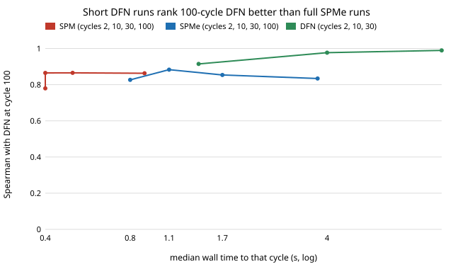

This morning's [first `cell-fidelity` test](2026-11-11-battery-model-trust-flag-and-cycle-cost.md) ended with a surprise. The reduced battery model, SPMe, was supposed to be the cheap way to screen electrode designs before checking them in the full DFN model. But on one design a two-cycle run cost the same in both models (1.2 s and 1.3 s). The cost was in the number of charge and discharge cycles, not in which model ran them. So this afternoon we tested the obvious follow-up: what if you keep the full model and just stop it early?

We wrote the hypotheses down first ([log](../../research/cell-fidelity/LOG.md)). The setup was the same 49 designs as before: positive-electrode thickness, both porosities and the N/P ratio, with PyBaMM's `OKane2022` parameters, a 5 A charge and discharge, and SEI growth and lithium plating switched on. Each design was scored as stack-level Wh/kg at cycle 100. We ran every design once in SPM and SPMe for 100 cycles and in DFN for 30. We logged the energy and the wall-clock time at the end of every cycle, so one run gives the score and the cost at cycle 2, 10, 30 and 100. The target was the committed 100-cycle DFN score for each design.

**The result.** Ranking the designs by DFN's score at cycle 10 matches the 100-cycle DFN ranking with a Spearman correlation of **0.977**. A full 100-cycle SPMe run reaches **0.834**. The difference is 0.138, with a paired bootstrap 95% interval of 0.057 to 0.271. The two cost the same: the median time to reach DFN's tenth cycle was 4.0 s, against 4.1 s for a whole SPMe run. If you check the top five designs from the 10-cycle DFN ranking in full DFN, you find the best design of the 49. The top five by SPMe miss it by 2.1 Wh/kg. Even a two-cycle DFN run (1.4 s, Spearman 0.915) ranks better than any SPM or SPMe setting we tried.

**Why.** The reduced models don't improve with more cycles. SPMe agrees best with DFN at cycle 10 (0.883), then drifts to 0.834 by cycle 100. That suggests its ageing path (SEI and plating) slowly diverges from DFN's. Meanwhile DFN's early ranking holds even though the cells lose a lot: by cycle 100 each design keeps only 58 to 74% of its cycle-10 energy. The seven designs SPMe mis-scored badly in the first test sit on average 4.6 places from their true rank under 10-cycle DFN, and 16.3 places away under SPMe.

**One idea that failed.** Fitting a straight line through cycles 2 and 10 to project cycle 100 gives a ranking with almost no correlation to the real one (0.01). Early fade isn't linear. Use the raw cycle-10 score.

**Checks.** Our SPMe re-runs matched the committed 100-cycle scores exactly. A fresh 100-cycle DFN run of the baseline design matched its committed 116.256 Wh/kg.

**What this doesn't show.** This is one parameter set, one protocol, and the same stratified sample of 49 designs, so the intervals describe these designs, not the whole design space. The timings come from one 4-core machine, run one at a time. With faster-fading protocols, ten cycles may not be enough. Everything is modelled at stack level, and no physical cell was built. The next step is the programme's dense benchmark of a few hundred Sobol designs. It will store DFN's score at every cycle up to 100, so the search comparison can use cycle count as the fidelity setting. ([project](../../research/cell-fidelity/README.md))

Written with AI assistance (Claude).
