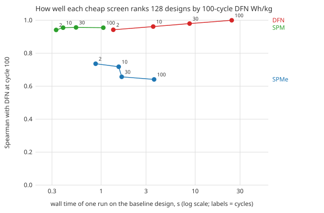

Choosing a lithium-ion electrode design in simulation (how thick the cathode is, how porous each electrode is, how much spare anode capacity) usually means scoring hundreds of candidates. The full porous-electrode model, DFN, is the trusted one and the slow one. So the standard advice is to screen with a reduced model, usually SPMe (a single particle model with an electrolyte correction), and run DFN only on the shortlist.

This morning's [cell-fidelity](../../research/cell-fidelity/) result questioned that. Timing the models showed that a 2-cycle DFN run costs about as much as a 2-cycle SPMe run (1.3 s against 1.2 s). DFN's cost is in the *cycling*: 100 cycles take it 27.9 s. If the score you care about is energy after 100 cycles of ageing, there are two ways to spend less: swap the model, or run fewer cycles. Which one keeps the ranking?

## The test

I wrote the hypotheses down first ([log](../../research/cell-fidelity/LOG.md)), then ran 128 designs from a Sobol sequence (an even spread over the design space, not picked by any search) for 100 cycles under each of SPM, SPMe and DFN. That is 384 PyBaMM 26.10.1.1 runs on the OKane2022 parameter set with SEI growth and lithium plating switched on, a 5 A charge and discharge, and stack-level Wh/kg. Every run keeps every cycle, so one run gives the score at cycle 2, 10, 30 and 100. I checked on the baseline design that a 10-cycle run gives exactly the first 10 cycles of a 100-cycle run, and that the baseline reproduces the earlier [energy-cell-dfn](../../research/energy-cell-dfn/) scores (SPMe 109.14, DFN 116.26 Wh/kg). Both matched exactly.

The question for each (model, cycles) pair: how well does it rank the 128 designs by their 100-cycle DFN score?

| Screen | Spearman with 100-cycle DFN | Wall time per run |
|---|---|---|
| SPM, 100 cycles | 0.955 | 1.1 s |
| SPMe, 100 cycles | 0.641 | 3.7 s |
| DFN, 2 cycles | 0.942 | 1.3 s |
| **DFN, 10 cycles** | **0.962** | **3.6 s** |
| DFN, 30 cycles | 0.980 | 8.7 s |

All three pre-registered hypotheses held. Ten cycles of DFN rank the designs 0.32 better than a full SPMe run (paired bootstrap 95% interval +0.18 to +0.48), at 0.98 of its cost. Screening with 10-cycle DFN and verifying the top 10 at 100 cycles finds the best design of the 128. Screening with SPMe misses it at any shortlist up to 20: SPMe scores that design 121 Wh/kg against DFN's 162 and ranks it 41st.

## The part I did not expect

The simplest model, SPM, which ignores the electrolyte altogether, ranked the designs *better* than SPMe. That is not only because SPMe fails to solve 7 of the 128 designs: over the 121 it completes, SPM still gets 0.98 against SPMe's 0.77. SPM over-scores designs by a fairly even amount (median +7 Wh/kg), which leaves most of the order intact. SPMe's error depends on the design: it is worst on the thick, dense electrodes where salt runs out, and those are the high-energy designs a search is looking for. It also gets worse with cycling, from 0.74 at 2 cycles to 0.64 at 100.

SPM is not a free lunch. It puts the best design at 183 Wh/kg, 20 above DFN, and the design it ranks first is 9% short of the true best. It works as a shortlist generator (top 5, then DFN), not as a final answer.

The earlier trust flag also held up on this unbiased sample. 15 of the 128 designs (12%) are ones SPMe under-scores by more than 25%, and SPMe's own minimum salt concentration picks them out with ROC AUC 0.994.

## What this means and what it does not

For an engineer screening electrode designs on cycled energy in PyBaMM, the cheap fidelity worth having here is *fewer cycles of the full model*, not a reduced model run for the full horizon. If you do use a reduced model, plain SPM plus a DFN shortlist was safer than SPMe on this design space.

The limits are real. This is one parameter set, one protocol, one sample of 128 designs, and modelled cells, not built ones. The costs were timed on one design: some thick designs took DFN up to 67 s for 100 cycles, so the 10-cycle parity may not hold everywhere. The next steps are the theory of why SPMe's correction hurts the ranking, and a search comparison over the two-axis (model, cycles) space against Bayesian-optimisation and Hyperband baselines. Results, code and every run are in [`research/cell-fidelity`](../../research/cell-fidelity/).

*Written with AI assistance (Claude Code). Modelled results, not measured cells.*
