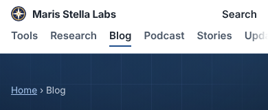
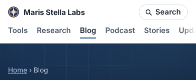

Every page on marisstella.app uses the same header, built from one function
(`renderSiteHeader` in `platform/pages/site-nav.mjs`). Even so, on screens
narrower than 1080px the Search control came in three versions:

- **Blog, research and other site pages:** the word "Search" in plain bold
  text at the right edge. It had no border and no icon, so it read as a
  stray label rather than a button.
- **Tool pages (about 1,300 of them):** a bordered pill. A separate rule in
  the tool-page stylesheet added the border, and nothing gave the site pages
  the same rule.
- **The hub:** no control at all. The reasoning was that the hub already has
  a search box. That holds on a laptop, where the box is in view. On a 390px
  phone the box sits about 700px down (measured in headless Chromium), so it
  is below the fold on most phones.

What changed: the shared header stylesheet now draws one pill. It has a
15px magnifier, the same SVG mask the desktop search form already used, so
the icon picks up the text colour in light and dark themes. The hub now
shows the pill below 1080px and still shows nothing on a wide screen, where
its own box is visible. The tool-page rule that drew a second pill was
deleted.

Before (390px):

After:

The change is small, but the header is on every one of the site's roughly
8,300 pages, so it is the single most-seen element on the site. A header
that looks different from page to page tells a visitor the pages were built
separately, even when they were not. A test in `site-nav.test.mjs` now fails
if the pill rule, its icon or the hub's phone-only link goes missing.
