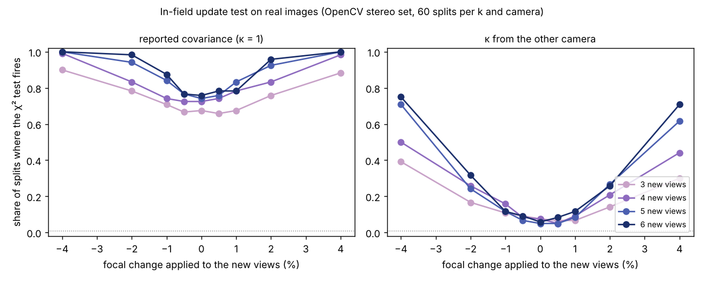

A robot that recalibrates its camera from the features it already sees has to make a
decision each time: keep the calibration it has, adopt the new one, or call for a
checkerboard. The textbook way is a χ² test. Take the old and new intrinsics and their
covariances, and ask whether the difference is bigger than the noise. The
[`sensing-selfcal`](../../research/sensing-selfcal/README.md) programme ran that test on
real photographs. It does not work the way the textbook says.

## The set-up

OpenCV's stereo calibration photos give two real cameras with 13 views each. For each
camera we split the views: an "old" calibration from 7 of them and a "new" one from 3 to 6
of the others, 60 random splits per size. Both are solved without using the board's
geometry, the same target-free bundle adjustment the programme has used since its
[first step](2026-11-11-calibrating-a-camera-without-the-checkerboard.md). Then we change
the new views in known ways. We scale the corners to mimic a focal change of 0.5 to 4%,
shift them to move the principal point, and in one real case take the new views from the
*other* camera of the pair, a second unit of the same model. Its focal length is 0.67%
different and its principal point 17 px. We wrote the predictions down
before running anything.

## Cries wolf

On a camera where nothing changed, the test at a nominal 1% false-alarm rate fired on
**72%** of splits. The solver's covariance is too small between disjoint sets of views,
2.3 to 2.9 times for the focal length and the vertical principal point, and **4.6 times
for one camera's horizontal principal point**. That last gap did not shrink from 3 views
to 6. It is not noise that more data averages away. Each set of views carries its own
offset, and the covariance, which only knows about the residual noise, cannot see it.

## Goes deaf

Earlier steps measured how overconfident the covariance is, so the obvious fix is to inflate
it by that factor. We used the factor measured on the other camera, so nothing was tuned
on the data being scored. False alarms fell to 6.5%. But a 1% focal change was then
detected in only **10 to 12%** of splits with 5 or 6 views, and the swapped camera unit in
30 to 77%. Even with a factor fitted on the scored camera itself, which flatters the test,
4% was the smallest focal change it caught most of the time.

One of the five predictions held. The others failed, most of them badly.

## What a fleet engineer can take from it

- With a handful of views, **the error that matters is systematic and changes from one
  set of views to the next**, so a covariance computed from the fit's residuals
  understates it. The test's error model has to come from outside the fit, for example from
  repeated captures of the same unchanged camera, as the empirical null here did.
- **Keeping the old calibration is the safe default.** With the inflated covariance, the rule
  adopted an update that was worse than the old calibration in 1.4% of decisions (5.6%
  without inflation).
- **Catching small changes in the field needs more views per update** than 3 to 6, or
  cleaner corners. The programme's
  [detector study](2026-11-11-the-23-pixel-window-that-bent-our-checkerboard.md) found
  that a common OpenCV setting misplaces the board's outer corners. Rerunning this test on
  better corners is the next step.

The limits: one stereo rig and one board. 60 splits of 13 views reuse the same images, so
the intervals are narrower than they should be. And apart from the camera swap, the
changes are exact model transforms rather than a physically disturbed lens. Code, data
and the pre-registered predictions are in
[`research/sensing-selfcal`](../../research/sensing-selfcal/README.md), MIT licensed.

*Written with AI assistance (Claude Code).*
