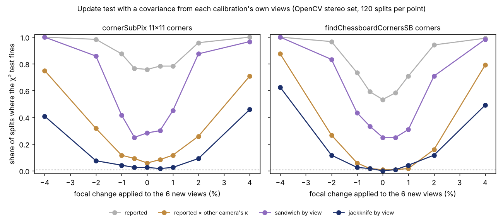

The previous step of the [`sensing-selfcal`](../../research/sensing-selfcal/README.md)
programme ended on a test that [cries wolf](2026-11-12-a-robot-camera-update-test-that-cries-wolf.md).
A robot camera recalibrates itself from a few views, compares the new intrinsics with the old
ones and asks whether anything changed. Using the solver's own covariance, the χ² test fired on
72% of cameras where nothing had changed. Inflating the covariance by a factor measured on the
camera's sibling unit made it quiet on one camera but not the other, and much less sensitive.

That step suggested building the covariance from each calibration's own views instead.
This step did that, on the same real images (OpenCV's stereo calibration set, two
cameras, 13 views each), and repeated everything with a better corner detector.

## Three covariances from the views themselves

The old calibration uses 7 views and the new one 4 to 6 *other* views of the same camera, 60
random splits per size and camera. We compared four error models for the difference between
them:

- **reported**: the solver's covariance, which assumes independent pixel noise;
- **borrowed**: the reported covariance times an overconfidence factor measured on the other
  camera of the pair;
- **sandwich by view**: a cluster-robust covariance that treats each image as one cluster;
- **jackknife by view**: re-solve the calibration with each view left out in turn and use the
  spread of the answers.

The jackknife costs 7 + k extra solves per decision (about 1 to 3 seconds each here), and it
needs at least 4 new views. We wrote down five predictions before running any of the 8,580
solves, and all five held.

| error model | false alarms, old corners | false alarms, SB corners |
|---|---|---|
| reported | 74% | 58% |
| sandwich by view | 38% | 36% |
| borrowed factor | 12% left, 1% right | 1% left, 0% right |
| **jackknife by view** | **2.5%** | **1.7%** |

The nominal rate is 1%. The sandwich has too few clusters (4 to 7 images) to be honest. The
jackknife gets close with no factor from anywhere else. It even overstates the spread on
average (rms z 0.46–0.84), but it still fires slightly above 1%, because the offsets between
view sets have heavier tails than a χ² distribution.

## The price of being honest

With 6 new views, the jackknife test detects a 1% focal change in 2–4% of splits, about the
same as on an unchanged camera. It detects a 2% change in 7–12% and a 4% change in 41–62%. This
is not a flaw in the jackknife. Six views of a checkerboard on this rig do not pin the focal
length better than about 2%, and any test that keeps its false-alarm promise has to admit
that.

## The corners matter as much as the statistics

The second detector is OpenCV's `findChessboardCornersSB`. An earlier step found that the
older `cornerSubPix` setting misplaced outer corners by up to 6 px. With the SB corners every
error model improves. The jackknife test now catches a real swap to the other camera unit
(0.67% in focal length, 17 px in principal point) in **75% of splits instead of 30%**. The
borrowed factor no longer over-alarms on the left camera, and it becomes the most sensitive
of the quiet tests: 1% false alarms, the swap caught 93% of the time, a 4% focal change 79–88%.
It relies on the sibling camera's error matching this one's, though, and the jackknife does
not need that assumption.

## For anyone running cameras in the field

- **Fix the corner localiser before tuning the statistics.** Changing the detector moved more
  numbers than changing the error model.
- **Leave-one-view-out re-solves give a usable error model** for a drift test with no outside
  data. Expect it to be slightly liberal in the tails and to have little power with a handful of
  views.
- **Small focal drift needs more data, not a better test.** With 4 to 6 views, changes under
  about 4% are within the difference between two sets of views. Pool views across sessions,
  or use a target when it matters.
- **Keeping the old calibration stays the safe default.** With the jackknife the rule made a
  harmful switch in 0.5–1.5% of decisions.

The limits: one stereo rig, one board, 13 views per camera reused across splits (so the
intervals are too narrow), and focal changes applied as exact transforms of real corners
rather than a refocused lens. The code, the 8,580 solves and the pre-registered predictions are in
[`experiments/m4b_viewcov`](../../research/sensing-selfcal/experiments/m4b_viewcov/) and the
programme's [log](../../research/sensing-selfcal/LOG.md).

*Written with AI assistance (Claude Code). No affiliation with any lab or vendor is implied.*
