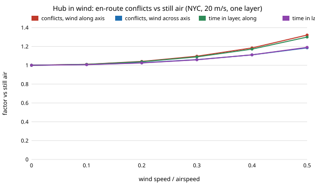

Yesterday's step in the `aerolog-scaling` programme
([post](2026-11-11-aerolog-hub-airspace-conflicts.md)) counted how often one
delivery hub's own drones come within a separation radius of each other, in
still air. Most of those conflicts are head-on: an outbound and an inbound
aircraft on nearby bearings. Putting outbound and inbound traffic at different
altitudes removed all the en-route conflicts when every aircraft flew at the same speed.

Real air moves. A drone that holds 20 m/s airspeed and crabs into a 6 m/s
crosswind makes good about 19 m/s along its track. With the same wind behind it
the figure is 26 m/s, and flying into it, 14 m/s. So the outbound and inbound
legs on one bearing fly at different ground speeds, and so do two outbound
aircraft on nearby bearings. In a split layer a later departure can now
catch an earlier one. This step asks how much wind changes the count, and
whether the split still works.

**The closed form.** For two legs that both start or end at the hub, the
whole encounter scales with the time τ between their hub events. Twice the
offset puts the aircraft twice as far out and twice as far apart. The closest
approach is therefore τ·m, where *m* depends only on the two bearings and
ground speeds. Pairs at offset τ occur at λ²dτ per unit time, so every pair
type (head-on, outbound-outbound, inbound-inbound) gets a conflict rate
λ²·E[min(R/m, τ_edge) − τ_terminal] over pairs of destinations. In still air
this is exactly yesterday's formula. For nearby bearings it says the head-on
rate scales with 1/H, where H is the harmonic mean of the outbound and inbound
ground speeds, the same factor by which wind lengthens each flight:

v/H = √(1 − w² sin²β) / (1 − w²), with w = wind speed / airspeed.

That gives 1/(1 − w²) for wind along the track and 1/√(1 − w²) for wind across it.

**The check.** The destinations are the same 17,250 Manhattan-area addresses
(Uber pickups, April 2014) within 5 km of the hub. The simulator is the same
exact closest-approach one, now with crabbing aircraft. The wind is ERA5 reanalysis at
100 m for every hour from April to September 2014 at the hub, via the
Open-Meteo archive: 4,392 hours, mean 4.7 m/s, p99 10.8 m/s. The predictions
were committed before the wind data was fetched.

- The closed form matches the simulator within **1.7%** for one layer in all
  eight base cases, and within 6.1% across a 30-cell sweep of wind speed and
  direction.
- One layer's en-route conflicts rise **by about as much as time in the layer
  does**, within 1.7% at every point of the sweep. At w = 0.4 the rise is
  18% when the wind blows along Manhattan's main bearing (about 27° east of
  north) and 11% across it. With uniform bearings direction makes no difference.
- Over the measured hours at 20 m/s the average hour adds **6.1%** (median
  4.6%, one hour in ten above 13%, the windiest 47%). At 15 m/s the average
  is 10%, and 4.8% of hours have wind at 0.6 times airspeed or more. At
  30 m/s it is 2.7%.
- **The layer split holds.** With equal airspeeds, wind brings back overtaking
  conflicts at 0.2% to 0.6% of the single layer's rate at w = 0.3. That is below
  the 0.5% to 5% I predicted. A ±15% spread in airspeed still matters more
  (about 6% of the single layer's).

**What went wrong on the way.** The first run compared windy closed-form
values with a still-air reference drawn from a different Monte Carlo sample.
That put a constant 3.8% on every factor, which showed up as a 4.7% "rise" at a
wind where the true rise is 1%. The run was stopped. Every ratio now uses the
same destination pairs for the windy and still-air values, and the
predictions did not change. Two predictions were refuted. The split-layer
overtaking rate came in below the predicted band. The split-layer closed form
was also not within 20% of the simulator: it runs about 10% to 40% low on small
counts, probably because it drops overtakes that finish near the end of a leg.
That cause is untested.

**Limits.** The wind is steady within each hour, from one ERA5 grid cell at
one height, with no gusts or shear. ERA5 is a reanalysis, not an anemometer.
There is one hub, legs are straight and no aircraft manoeuvres to avoid
another. These results are preliminary. The code, data extract and full output are in
[`research/aerolog-scaling/experiments/hub_airspace/`](../../research/aerolog-scaling/experiments/hub_airspace/),
and the log entry is milestone 11b in the programme's
[`LOG.md`](../../research/aerolog-scaling/LOG.md).
