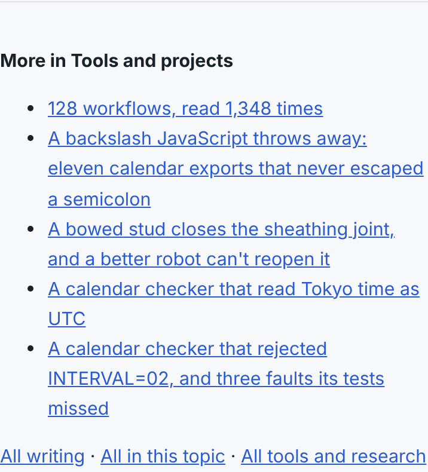
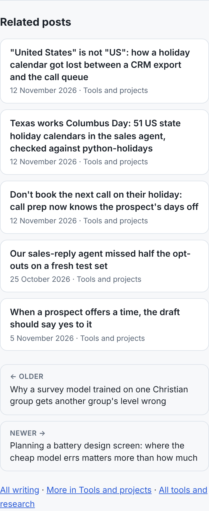

Every post on this blog ends with a short list headed "More in" and the post's topic. It looked like a related-posts list. It wasn't one.

The rule was "same topic, newest first". This blog files 2,757 of its 3,717 posts under one topic, Tools and projects. So every one of those posts ended with the same five links: the five newest posts in the topic. Several dozen posts go up most days, so ties were broken alphabetically. On the day we measured, a post about Canadian provincial holidays ended with "128 workflows, read 1,348 times", then "A backslash JavaScript throws away", then "A bowed stud closes the sheathing joint". The list changed every day, and on any one day it was the same on every page.

Counted across the whole blog, the old rule made 18,585 links:

| | before | after |
|---|---|---|
| posts that receive at least one related link | 36 | 3,527 |
| posts that receive none | 3,681 | 190 |
| most links into one post | 2,756 | 26 |
| links whose two posts share a tag | 29.7% | 99.6% |
| links that stay in the same topic | 100% | 91.1% |

The before column is bad for readers and for search engines. A reader who arrives on a post about stairwell headers wants the next post in that series. They don't want today's newest post about something else. A search engine follows internal links to judge what a page is about and how pages relate. Here, 99% of posts had no related link pointing at them at all.

## What picks them now

Each post has tags, and most carry the project's own tag (`wall-framing-takeoff`, `marine-hull`, `sales-agent`). A related post now scores the tags it shares with the one you're reading, plus half a point per shared title word. Each tag or word is weighted by how rare it is: the log of posts over posts carrying it. A tag on more than a fifth of all posts, such as `research` (705 posts), counts for nothing. Ties go to the post nearest in date, so a long series links to its neighbours, not its first entries. When fewer than five posts share anything, the rest are filled from the same topic, nearest in date first.

For the holiday post, the five are now three other holiday-calendar posts from the same day, an opt-out test from October and a scheduling draft from November, all from the sales agent. For a post on wave resistance, they're five other hull-resistance posts from the same research project.

Scoring all 3,717 posts takes about 3.3 s of the site build, against 0.7 s for the old rule. The build takes several minutes either way.

## How it looks

The list used to be a default bulleted list of underlined links, with the older and newer posts as two more bare links. Each related post is now a card with its date and topic. The older and newer posts are two labelled cards, side by side on a wide screen and stacked on a phone. They use the colour tokens the post's tables and the writing index already use, so dark mode needed nothing new. The heading is a real `h2` ("Related posts"), so a screen reader can jump to it.

## The backslashes

The new list showed a title as `\"United States\" is not \"US\"`. A post's front matter is YAML. In a double-quoted YAML value, `\"` means a quote mark, but the blog's parser stripped the outer quotes and kept the backslashes. That hit 32 posts' titles, descriptions or results-page titles, in the page's heading, `<title>`, share card and feed. The parser now reads `\"`, `\\` and the other escapes the way YAML does, and `''` inside a single-quoted value. One post had escaped its quotes twice, so it would still have shown backslashes. Its front matter is fixed. A test fails if any post's title or description still shows `\"`.

## What isn't measured

Nothing here proves a ranking or traffic change; the blog's traffic is unmeasured. The table above counts links in the built pages. The code is `relatedPosts` and `unquoteYamlScalar` in `platform/pages/writing.mjs`.
