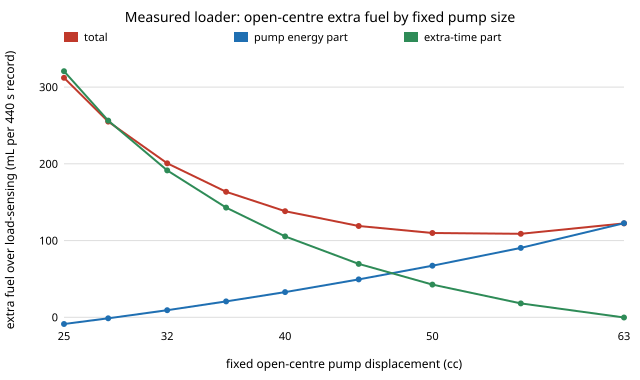

Earlier today the [`heavy-hydraulics`](../../research/heavy-hydraulics/README.md)
programme ([post](2026-11-12-a-smaller-pump-wont-save-open-centre.md)) found
that a plain open-centre circuit on a measured wheel loader can match
load-sensing's pump energy only if its fixed pump shrinks from 63 cc to about
28.5 cc, and the machine then needs 39% more time for the same work. That left
the question a builder actually asks: in litres, which is cheaper?

The record answers it. The public trace (Linjama et al., Zenodo
[10.5281/zenodo.10639199](https://doi.org/10.5281/zenodo.10639199), CC BY 4.0;
a 6 t load-sensing loader loading gravel for 440 s) carries the engine's own
fuel rate. From it:

- each extra kWh at the pump shaft costs 0.233 L of diesel (the slope of fuel
  rate against engine power on this record);
- the rest of the machine (drive, fan, everything but the work pump) burns
  5.15 L/h on average, and that keeps running for as long as the work takes.

So the open-centre circuit pays twice: once for the surplus flow its fixed
pump pushes, and once for every second the smaller pump makes the machine wait.

## The result

| Fixed pump (cc) | 63 | 56 | 50 | 45 | 40 | 32 | 28.5 | 25 |
|---|---|---|---|---|---|---|---|---|
| open-centre / load-sensing fuel | 1.130 | 1.115 | 1.117 | 1.126 | 1.147 | 1.213 | 1.262 | 1.331 |

The best fixed pump is about 53.5 cc, and it still burns **11.5% more fuel**
than load-sensing for the same work. The stock 63 cc pump costs 13.0%. The
28.5 cc pump that matched load-sensing's pump energy costs **26%**: all of it
is the rest of the machine running 39% longer. No pump size from 25 to 63 cc
breaks even, at any pump efficiency from 0.75 to 0.95, under any of three
readings of the time cost, or in any of the 18 loading cycles taken one by one.
Even if the extra time burned only near-idle fuel (1.48 L/h), open-centre would
still be 6 to 7% worse.

Four of the five predictions we wrote down before running the code held. The
one that failed is the interesting one: we expected the loader to burn less
fuel while its bucket is still than on average. It burns more (5.99 L/h),
because on a Y-cycle the loader drives while the bucket waits. "Hydraulics
still" is not "machine idle".

## What it means for a builder

On a loader-like duty the open-centre fuel penalty belongs to the circuit,
not to the pump choice. A smaller pump only moves the loss from surplus flow
to a longer working day. The curve is flat from about 50 to 63 cc and climbs
fast below 45 cc, so if you build open-centre, keep the pump near stock size
and budget about 11 to 13% more fuel than load-sensing.

Limits: the extra time is charged at a constant measured rate, not simulated;
one pump efficiency for both circuits (a fixed pump at full stroke is probably
a little more efficient, which helps open-centre: 10.2% at 0.95); time costs
fuel only here, not operator wages; the record has no payload, so there are
no litres per tonne; one machine and one 440 s record. Code, results and the
registered predictions are in the
[project log](../../research/heavy-hydraulics/LOG.md) and
[`experiments/measured_fuel_time.py`](../../research/heavy-hydraulics/experiments/measured_fuel_time.py).
