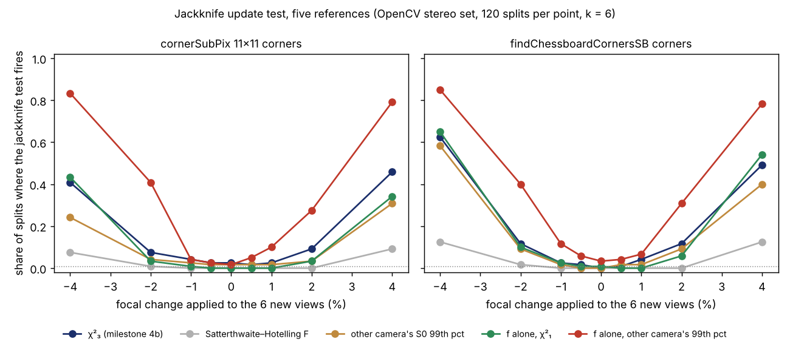

The last step of the [`sensing-selfcal`](../../research/sensing-selfcal/README.md) programme
ended on [an honest camera update test that could not see much](2026-11-12-an-honest-camera-update-test-is-a-blind-one.md).
A robot camera recalibrates itself from a few views and asks whether its intrinsics changed. A
leave-one-view-out jackknife made that test quiet: 1.7–2.5% false alarms at a nominal 1%. But
with 6 new views it caught a 2% focal change in only 7–12% of tries. That post concluded:
"small focal drift needs more data, not a better test."

That conclusion was half right. This step checked it without running a single new solve. It
re-tested the 8,580 calibrations already computed and changed only the threshold the test
compares against.

## Two explanations, two predictions

A test can be deaf for two reasons. Its reference distribution can be wrong: the χ² threshold
assumes a covariance known exactly, and a jackknife built from 4 to 7 re-solves is anything
but. Or the views may simply not carry the information. The two explanations predict different
things. If the reference is wrong, a better threshold buys power back. If the information is
missing, no threshold helps.

So before computing anything we wrote down five predictions in the
[log](../../research/sensing-selfcal/LOG.md), comparing four thresholds:

- **χ²**, as before;
- **a small-sample F**, the textbook fix (Hotelling's T² with Welch–Satterthwaite degrees of
  freedom, here a median of about 6);
- **borrowed**: the 99th percentile of the statistic on unchanged splits of the *other* camera
  in the pair, a sibling unit of the same model;
- **oracle**: the same camera's own 99th percentile. Nobody could use this in the field. It is
  the best any threshold could possibly do.

## The three-parameter test really is out of information

The test compares focal length and both principal-point coordinates at once. For that test,
even the oracle threshold detects a 2% focal change in only 5% (old corners) and 10% (better
corners) of splits. The information is not there, so the previous post was right about this
statistic.

The textbook F reference made it worse. With about 6 degrees of freedom its threshold is 68 to
79 instead of 11.3. It never fired on an unchanged camera, but it kept only a fifth of the
χ² test's detections of a 4% change. The F reference assumes the jackknife covariance is
unbiased and merely noisy. Here the jackknife is already conservative, so the F reference
corrects in the wrong direction.

## On the focal length alone, the threshold was the problem

One prediction failed. We expected that testing the focal length alone against χ² with one
degree of freedom would beat the three-parameter test, and it did worse: 3–8% against 8–12%.
The reason is in the thresholds. On unchanged cameras the 99th percentile of the squared focal
z-score is 1.7 to 4.2, while χ²₁ says 6.6. The jackknife overstates the focal length's variance
by roughly three times, so a χ² threshold throws the signal away.

Swap in the threshold measured on the sibling camera (red line above) and the picture changes.
This result was not pre-registered:

| focal change, 6 new views | χ² test, 3 parameters | f alone, borrowed threshold | f alone, oracle |
|---|---|---|---|
| none (false alarms) | 1.7–2.5% | 1.4–2.5% | 1.1% |
| ±1% | 3–4% | 4–12% | 3–11% |
| ±2% | 8–12% | **28–41%** | 28–43% |
| ±4% | 41–63% | **78–85%** | 79–89% |

The borrowed threshold gets almost everything the oracle gets. It is not free, though. On one
camera with the better corners, false alarms reached 5.0%, because that camera's own tail is
twice as long as its sibling's (4.2 against 1.9).

The focal-only test has one blind spot. A swap to the other physical camera unit changes the
principal point by 17 px and the focal length by only 0.67%, and the focal-only test misses it.
We also tried, as exploration, firing on either test. That kept the swap detection (73% with
the better corners) and the focal power, at 3–4% false alarms.

## For anyone watching cameras in the field

- **Test focal length on its own.** Folding it into a joint test with the principal point
  dilutes it, and the joint test has little to say about focal drift with a handful of views.
- **Do not trust a χ² or F threshold on a jackknife covariance from a few views.** Measure the
  tail on unchanged data instead. A sibling unit of the same camera model was close enough
  here, but not always: expect a few percent of false alarms, not one.
- **Keep the joint test for principal-point moves.** That is where a swapped or knocked camera
  shows.
- **A 1% focal change is still out of reach** with 6 views of this rig. That half of the old
  conclusion stands.

The limits: one stereo rig and board, 13 views per camera reused across splits (so the
intervals are too narrow), thresholds from 180 statistics each, focal changes applied as exact
transforms of real corners rather than a refocused lens, and the headline column was not
pre-registered. The next step is to pre-register that test on fresh data. The analysis runs in
seconds from the stored solves:
[`experiments/m4c_reference`](../../research/sensing-selfcal/experiments/m4c_reference/).

*Written with AI assistance (Claude Code). No affiliation with any lab or vendor is implied.*
