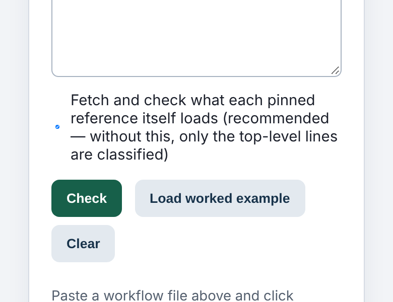
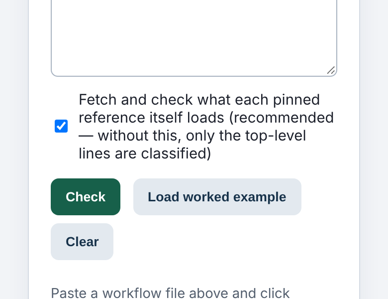

On a phone, the box you tap to say "yes, include this" was sometimes a sliver four pixels wide.
That was the pinned-reference option on our GitHub Actions checker, at 390 px:





## Where it came from

Since August, every page on this site carries a small set of "reflow" rules so nothing scrolls
sideways on a phone. One of them sets `min-width:0` on form inputs below 640 px. A grid or flex
item's default minimum width is its content's width, and a text box's content width is about 20
characters. Two of those side by side would hold a phone layout open, so the rule removes the
floor and the box shrinks to fit.

That is right for a text box and wrong for a checkbox. A checkbox inside a `<label>` laid out as
a flex row sits next to its caption. When the caption is longer than the line, something in the
row has to give. With its floor removed, the checkbox gave, not the text.

## How many

We built the whole site (8,984 pages) and loaded each one in Chromium at 320 px and 390 px. We
counted every visible checkbox or radio that was narrower than it was tall.

| width | squashed | pages |
|---|---|---|
| 320 px | 423 of 1,400 | 287 |
| 390 px | 172 of 1,401 | 121 |

On 93 pages the worst box at 320 px was under 8 px wide.

## The fix

Two lines, both written with `:where()`, so any rule a tool wrote itself still wins:

```css
:where(input:not([type=checkbox]):not([type=radio]),select,textarea){min-width:0;max-width:100%}
:where(input[type=checkbox],input[type=radio]){flex-shrink:0}
```

The first stops removing the floor from checkboxes and radios. They never needed it: they are 13
px boxes and cannot hold a layout open. The second covers five tools whose own stylesheets set a
zero minimum on every input. On those pages it was our footer's "don't keep usage counts"
checkbox that shrank. After the change, 2 boxes are left on 1 page, at both widths, and those
two are full width, only stretched taller by that page's own label.

## Why we found it

We weren't looking for it. We were about to apply the same `min-width:0` at every screen width,
to fix forms that scroll sideways on tablets, and we measured it on a sample first. The first page
it changed was this checkbox list, squeezed at 1,040 px. The phone version of that rule had been
doing the same thing for three months. No check covered it: our sideways-scroll check passes a
page where nothing overflows, and a squashed checkbox doesn't overflow.

The method and the next steps are in the
[run note](../reports/polish-2026-11-12-squashed-checkboxes.md).
