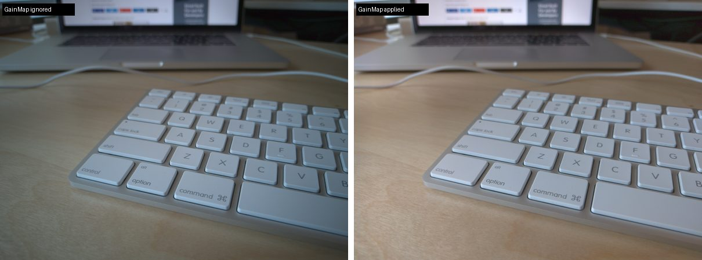

[ShootFlow](https://github.com/duncan-haywood/oss-monorepo/tree/main/ventures/photo-editing) develops raw photos into 16-bit masters on your own machine. Until today every DNG we had checked against LibRaw was a DNG our own tools had written. So we fetched three DNGs written by real cameras from a public sample collection: an LG Nexus 5X phone, a Leica T and a Pentax Q-S1. We developed each one with ShootFlow and with LibRaw and compared the two.

## The data matches

We used the same white balance, the same white level and dcraw's colour method on both sides. Half of all pixels differed by less than this:

| camera | median difference, 8-bit steps | 99th percentile |
|---|---|---|
| LG Nexus 5X | 0.105 | 1.20 |
| Leica T | 0.027 | 0.14 |
| Pentax Q-S1 | 0.023 | 0.16 |

The black level, white level, colour pattern and white balance agree on all three. The Nexus shows the largest gap because its black level is fractional (52.07 on one channel, 51.85 on another), and LibRaw rounds those to whole numbers.

The first run also caught a difference in the check itself. The Pentax tags its files with −0.5 EV of baseline exposure. ShootFlow applies that, as Adobe does, and LibRaw ignores it. So every channel came out at 2^−0.5 = 0.7075 of LibRaw's, and we measured 0.7074 to 0.7075. The check now turns that setting off on both sides.

## The corners

LibRaw and ShootFlow agreed on the Nexus, and both were wrong in the same way: the corners came out dark and tinted. A phone lens loses a lot of light towards the edges. Android doesn't correct the raw data for that. Instead it writes what it measured into the file: four gain maps under a tag called `OpcodeList2`, one for each colour position on the sensor. Each map is a 13 × 17 grid of multipliers. On this frame they run from 1.00 in the middle to 3.8 in the corners, and red needs more than blue. A reader that skips them shows corners at about a third of their brightness. The phone's own photo never looks like that.

ShootFlow now applies them by default. It follows the DNG specification's rules for where the map points sit and for blending between neighbouring points, and it caps a value at white. Every other opcode is listed in the develop report and left unapplied. One example is the Leica's lens-distortion correction, which the file marks as required. `--no-opcodes` turns all of this off. The fast numpy engine gives the same bytes as the pure-Python one.

## How we know the arithmetic is right, and what we can't say yet

The corner numbers depend on what was in the photo, so they show how big the correction is, not whether it is right. The tests show that. They darken a known scene with a known shading, and the gain map has to give the scene back. One test uses a map that rises in a straight line across the frame. Its correct answer is a perfectly flat field that we can work out by hand, so it checks where the map points sit.

We haven't compared against Adobe's render of this frame, and the file has no phone-rendered JPEG to compare with either. This phone's maps also stop just short of the frame edge: it writes a spacing of 1/13 for 13 points. We follow the specification as written, so the last strip of the frame uses the edge row of gains.

Measurements, the check tool and how to rerun it are in [eval/camera-dngs-2026-11-12.md](https://github.com/duncan-haywood/oss-monorepo/tree/main/ventures/photo-editing/eval/camera-dngs-2026-11-12.md). Next up is the Leica's lens-distortion correction.
