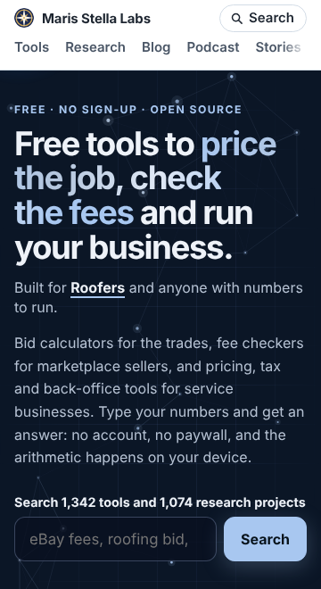

The front page of this site has one job: get a visitor to the tool they came for. With more than
1,300 tools, the way to do that is the search box. The page's own source says so in a comment: "The
search is the front door's main control, so it sits in the hero."

On a phone it sat below the first screen.

## What was in the way

Above the search box: the site header, a one-line eyebrow ("Free · No sign-up · Open source"), the
headline, a "Built for roofers" line, and a lede paragraph. The lede had grown to five sentences and
76 words. At 320 px wide that is 13 lines of grey text, at 390 px it is 11.

We measured where the search input's bottom edge landed, in Chromium, from the built page:

| viewport | before | after |
|---|---|---|
| 320 × 640 | 884 px | 730 px |
| 360 × 660 (common Android, browser bar shown) | 782 px, below the fold | 629 px, above |
| 390 × 844 (iPhone-sized window) | 757 px | 629 px |
| 412 × 700 | 693 px | 590 px |
| 1280 × 800 | 730 px | 642 px |

An iPhone's Safari shows about 660 px of a 390 px-wide page once its own bars are drawn, so 757 px
was below the fold there too.

## What we cut, and why it was safe

The last three sentences said that every formula is open source so you can check how a number was
reached, that the apps can run in your own cloud account, and that the site publishes open research
the same way. All three are true, and all three are already on the page: they are steps 2 and 3 of
the "how it works" band a little further down, nearly word for word. Research is also in the search
box's label ("Search 1,342 tools and 1,074 research projects") and in the stats row under it.

So the lede is now two sentences: what the tools are, and how they work (type your numbers, no
account, no paywall, the arithmetic happens on your device). Nothing was removed from the page; a
repeat was removed from the top of it.

## Keeping it short

A lede grows one honest sentence at a time, and each addition looks harmless in a desktop browser,
where all five sentences fit in six lines. So there is now a test, `platform/pages/hub-lede.test.mjs`,
that renders the homepage and fails if the lede goes over 45 words. The old one fails it at 76.

320 px is still tight: with the headline at four lines, the search input ends at 730 px on a 640 px
screen. The next step there is the headline, not more cutting.
