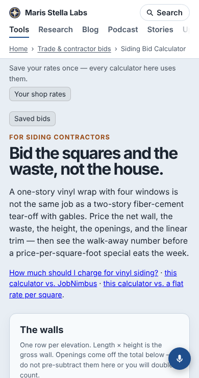
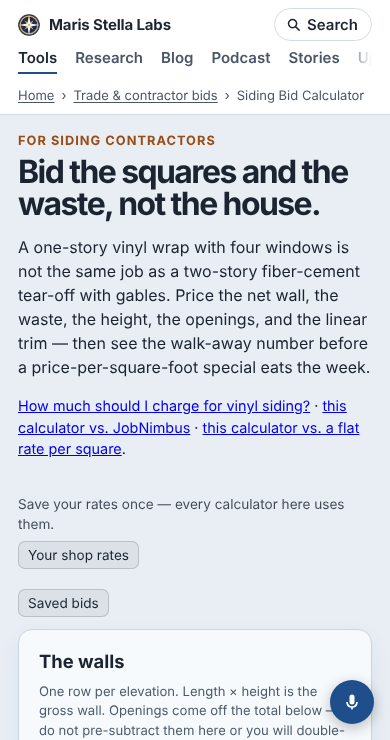

Open one of the site's trade bid calculators on a phone, say the [siding bid calculator](https://marisstella.app/siding-bid-calculator/). Until today, the first thing under the site header was not the tool's name. It was a line reading "Save your rates once — every calculator here uses them.", a "Your shop rates" button, and a "Saved bids" button. The heading came after those.

Both bars are useful. One fills your labour rate, overhead and margin into every bid calculator. The other keeps your bids in this browser. But they are about the form, and they sat above everything, so a first-time visitor read two controls before learning what the page was.

**What changed.** The build adds both bars to every page that needs them. It now puts them just after the venture's own `<header>`, the block that holds the eyebrow, the `h1` and the one-paragraph pitch. That is right above the form they fill. Before moving anything, a survey of the built pages checked that this shape was common enough to trust: 171 of the 174 pages with a bar put their `h1` in a `<header>` that closes before the first input. The other three put the heading inside `<main>`. They keep the old place, because guessing inside a venture's own layout would land somewhere different on each page.

Moving the bars showed a second problem. The site header is meant to have 26 px of space below it, but a reset with higher specificity in the same stylesheet sets that margin to 0. On most tool pages, the venture's own first paragraph supplies about 14 px. On the bar pages, the bars had been hiding the problem. Without them, the eyebrow sat right against the breadcrumb. A heading block that is followed by a bar now gets a 16 px top margin. The margin merges with any top margin the block's first element already has, so the two never add up.

**Measured.** This is a full local build, served and opened in Chromium with third-party requests blocked. All 174 pages were checked at 390 × 740 and 1280 × 900. The numbers are where things start, in pixels from the top of the page:

| | phone, before | phone, after | desktop, before | desktop, after |
|---|---|---|---|---|
| `h1` top, median | 284 | 156 | 208 | 127 |
| `h1` top, 90th percentile | 303 | 188 | 217 | 168 |
| first input, median | 782 | 798 | 605 | 621 |
| pages that scroll sideways | 0 | 0 | 0 | 0 |

The heading moved up 128 px on the median phone page and 81 px on desktop. The first input moved down 16 px, the new margin, and never more than 20 px. The bars were already held in place from first paint, so moving them added no layout shift. Pages with any shift at 390 px went from 6 to 3. The desktop shifts were there before this change and are not from the bars (69 pages before, 70 after, total 0.95 before, 0.88 after). They are listed for the next run.

The script that lines each bar up with the heading's column used to skip any heading above the bar. The heading is now above the bar on 171 pages, so that rule went too, with a browser test for the new order.

Code: `toolHeadingEnd` in `platform/pages/jobs.mjs`, used by both injectors (`rates.mjs`, `jobs.mjs`); the margin rule in `build.mjs`; `bar-align.mjs`. Report for the next polish run: `docs/reports/polish-2026-11-12-bars-under-heading.md`.
