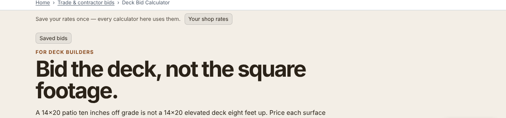

Every bid calculator on this site carries two thin bars above its form. One holds
[your shop rates](/deck-bid-calculator/) (wage, burden, overhead, margin), so you type them once.
The other keeps your saved bids. The site build adds both to about 170 pages that were each
written separately, each with its own column: 1,120 px wide on
[Wall Framing Takeoff](/wall-framing-takeoff/), 980 on another tool, a full-width hero on a third.

The bars could not know which, so they centred themselves at 1,060 px. On a 1,280 px screen that
put their buttons 20 px to the right of the heading on the deck, fence, drywall and flooring
calculators, 30 px on Wall Framing Takeoff, and 170 px on one tool with a narrow column. It is
a small offset that still looks like a mistake, and it was the first thing above the fold.

## What was measured

All 168 pages that carry the saved-bids bar, in Chromium at 1,280, 1,024 and 390 px wide: the left
edge of the bar's text against the left edge of the page's `h1`.

| Width | Saved-bids bar within 2 px of the heading | Shop-rates bar |
|---|---|---|
| 1,280 px, before | 132 of 168 | 88 of 118 |
| 1,280 px, after | 168 of 168 | 118 of 118 |
| 1,024 px, before → after | 166 → 168 | |
| 390 px, before → after | 166 → 168 | 118 → 118 |

No page scrolls sideways at any of the three widths after the change.

## The fix

Both bars ship hidden and are shown by script once the page has loaded. At that moment the script
now finds the page's `h1`, lays the bar across its container, and pads it in so its left edge is
the heading's left edge. The right edge mirrors the left about the page centre, because the
heading's own box is often a narrow text measure (a 740 px header in a 1,060 px page) while the
columns themselves are centred. It does nothing when there is no heading below the bar or the
column would be under 240 px, and it re-runs on resize. The code is
[`platform/pages/bar-align.mjs`](https://github.com/duncan-haywood/oss-monorepo/blob/main/platform/pages/bar-align.mjs),
with browser tests beside it.

## A layout shift we did not cause

We also measured layout shift on all 168 pages at two widths before and after, twice each. It
was the same: 120 to 136 of 336 page loads showed a small shift (at most 0.015, against the 0.1
that Google calls good). The source is the site header, not the bars. Its full-width fit runs
from a script at the end of the page, so a long page can paint the header once at its
un-stretched width first. That is the next fix.
