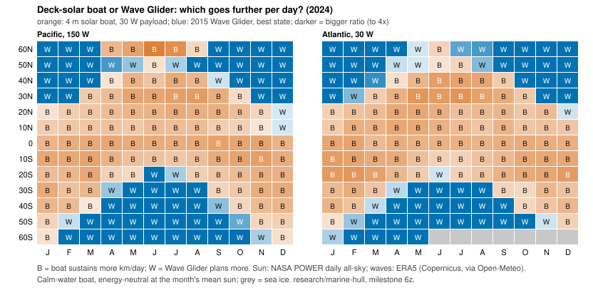

The [last post](2026-11-12-wave-glider-or-solar-boat-season-and-latitude.md) found that whether a solar-powered survey boat or a Wave Glider covers more distance per day flips with the season: at five sites, the solar boat won everywhere in July 2024 and lost at four of five in January. Two months and five sites can't tell you where the line between them sits, or how it moves through the year. That is what a survey planner choosing one platform for a year-round line actually needs.

So this step drew the map. We took two ocean meridians, 150 W in the Pacific and 30 W in the Atlantic, from 60 S to 60 N every 10 degrees, and fetched every month of 2024: daily sunlight from NASA POWER and hourly waves from the ERA5 reanalysis. The solar side is the same 4 m boat with a 30 W payload as before, sailing at the fastest speed its panels can sustain. The Wave Glider side is the same speed law fitted to a 2015 Wave Glider mission, at its best month. Nine predictions were written down and committed before the data were fetched.

What came out (eight of the nine predictions held):

- **The tropics belong to the solar boat.** Within 10 degrees of the equator it wins 11 to 12 months a year on both meridians, covering 85 to 106 km/day on average against the Wave Glider's 55 to 64.
- **The winter storm belts belong to the Wave Glider.** Poleward of 40 degrees in that hemisphere's winter, the boat's panels can't even cover its 30 W payload, so it sustains nothing, while the Wave Glider still plans 60 to 85 km/day in the big seas.
- **The line swings about 30 degrees a year.** In the north the flip sits at 30 degrees in January and moves to 50 degrees from April to August. In June there was no flip at all: on the Pacific meridian the boat won all the way to 60 N. The south mirrors it.
- **On a year's average, about 30 to 35 degrees is the break-even.** The boat wins 7 to 8 months a year at 30 degrees, 5 to 6 at 40 and about 2 at 50.
- **A battery buys about 10 degrees.** If the boat starts every month with a full 10 kWh pack (think a monthly port call), it leads on the year's average out to 40 degrees.

The prediction that failed is a useful one. We expected the result to survive taking 10% off the Wave Glider's plan, since ERA5 ran about 10% high against real buoys. It mostly did: only 2.6% of the month-by-month winners changed. But one month's "flip latitude" jumped by 20 degrees, because one point near the equator was a near tie (67 against 69 km/day). So the single flip-latitude number is fragile. The winner map and the months-per-latitude counts are the results to rely on.

Caveats, as before: the solar boat is modelled in calm water, which flatters it most in exactly the winter storm belts where it already loses. The Wave Glider's own payload also runs on solar panels, and that budget isn't modelled yet. It's one year and one 2015 vehicle. Those are the next steps. The code, the pre-registered predictions, the data and the results are in `research/marine-hull/` (milestone 6z).

*Written with AI assistance (Claude Code).*
