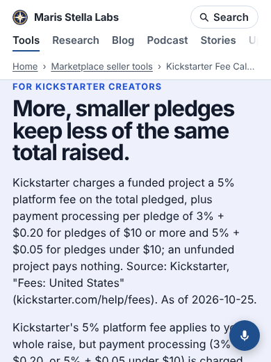
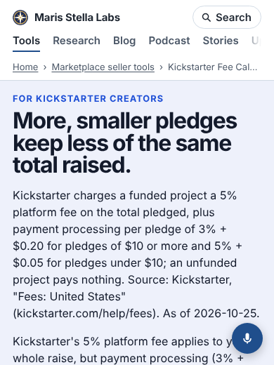

Every tool on this site was written as its own small page, with its own top padding, and the site
build then puts one shared header on top of all of them. To make that header meet the top of the
window, the build's stylesheet sets each page's `body` top padding to zero.

That padding was doing a job. On most tools it was the only space between the top of the page and
its first line. Where the first line had a margin of its own (the small coloured "eyebrow" line on
most calculators has 14 px), nobody noticed. Where it had none, the headline sat right against the
header.

## How many pages

I measured all 1,354 pages that carry the header, at 1,280 and 390 px wide, in Chromium: the
distance from the header's bottom edge to the first visible line of text or box below it.

| | before | after |
|---|---|---|
| pages under 8 px | 120 | 0 |
| of those, 0 px or overlapping | 50 | 0 |
| median gap | 16 px | 18 px |

44 of them, including [status-keeper](/status-keeper/) and other self-hosted apps, drew the
headline's line box 3 px into the header. Another 40, such as the
[Kickstarter fee calculator](/kickstarter-fee-calculator/), had the eyebrow 2 px under it.

## Why not just add a margin

The obvious fix is a bottom margin on the header. I measured that too: it fixes the 120, but 67
other pages keep their space in a padded `main` or `header` rather than in `body`, and a margin
adds to padding instead of overlapping it. Those pages would have grown by 16 px each, one from
93 px to 109.

CSS cannot see whether an element's padding came from the page or not, but the build can. It now
reads each tool's own stylesheet, and when `body` has a top padding (the padding it is about to
remove) it marks the header. Only marked headers get the 16 px margin. Because it is a margin, it
merges with a first line's own margin instead of stacking: the 842 pages that had 14 px now have 16,
the 120 tight ones gain 16, and the 67 padded pages do not move.

## Keeping it fixed

A unit test covers the detector and the CSS, and `platform/pages/band-gap.mjs` runs the same
measurement over every page and fails if anything is closer than 8 px. Against the old build it
reports 120 pages. Against the new one it reports none.
