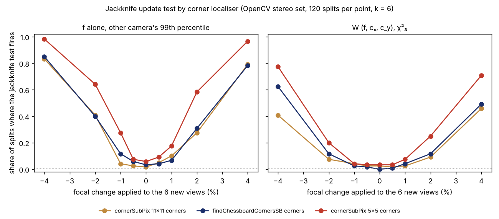

The [`sensing-selfcal`](../../research/sensing-selfcal/README.md) programme asks whether a robot
camera can recalibrate from the features it already sees, and whether it can tell when the new
calibration should replace the old one. Until today the honest answer to the second part was
"only for big changes": with 6 new views of OpenCV's stereo calibration photos, the best test we
had caught a 2% focal-length change about one time in three, and a 1% change hardly at all.

Earlier today [a render of the real views from a known camera](2026-11-13-half-a-checkerboard-square-moved-the-focal-length.md)
showed that the printed board's end squares are half width, and that the corner finders we had
been using were pulled by them: the 11×11 `cornerSubPix` window towards the board's edge,
`findChessboardCornersSB` the other way. A 5×5 window was the one localiser the short squares
could not reach. The pull depends on each view's pose, so a different set of views gets a
different bias. That looked like a candidate for the "each view set carries its own offset"
problem that had made every update test deaf.

## The rerun

Milestone 4d re-solved all 2,145 view sets per camera from the earlier update-test experiment on
5×5 corners (4,290 bundle adjustments) and scored them with the same statistics and thresholds,
unchanged. Five predictions were written down before any solve ran. Before solving, the script
also re-solved the all-view set on the old corners, and it matched the stored results exactly.

Four of the five held:

- **The offset shrinks.** With an unchanged camera, the focal length from 6 new views differs
  from the old calibration's by 0.59% (standard deviation), against 1.02% on 11×11 corners and
  0.86% on SB corners.
- **The power nearly doubles.** Testing the focal length alone against a threshold taken from the
  other camera, a 2% change is detected in **61%** of splits (34–35% on the biased corners), a
  1% change in 18–28% (4–12% before) and a 4% change in 97–98%.
- **The three-parameter test stays honest** (1.7% false alarms at a nominal 1%) and catches the
  real swap to the other camera unit in 79% of splits.

## What failed

The borrowed threshold. On 11×11 and SB corners, the 99th percentile of the focal-length
statistic measured on one camera worked as a threshold for the other. On 5×5 corners the left
camera's own 99th percentile is 3.56 and the right's is 1.03, so the right camera's threshold
makes the left one alarm on **11%** of unchanged splits. The reason, worked out after the
prediction failed: the jackknife's error bar shrank less than the real spread, and by different
amounts on the two cameras (it now overstates the spread 1.5× on one and 2.8× on the other).

## What a robot builder can take from it

Pick a corner window smaller than the shortest square on your board. It moved this test's power
more than any change to the statistics in three earlier milestones did. Then measure the
focal-length test's threshold over several units of the same camera, not one sibling, before you
trust its false-alarm rate. That pooled threshold is the programme's next step. Two cameras that
share every board pose are still a small sample, and the 11% may move with more splits.

Code, data and the pre-registered hypotheses are in the
[project README](../../research/sensing-selfcal/README.md) (Milestone 4d) and
[`LOG.md`](../../research/sensing-selfcal/LOG.md). Written with AI assistance (Claude Code).
