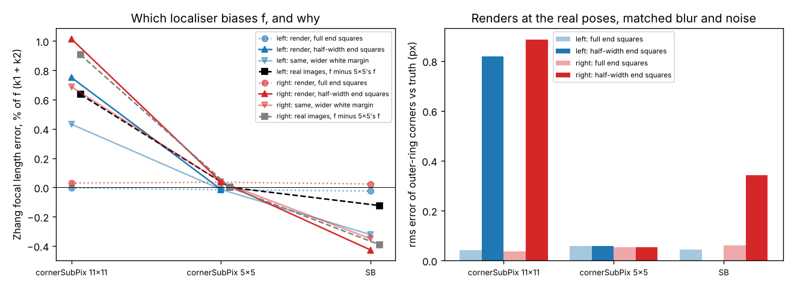

Two days ago the [`sensing-selfcal`](../../research/sensing-selfcal/README.md) programme hit an
awkward fact. On OpenCV's own stereo calibration photos, [the choice of corner localiser alone
moved Zhang's focal length by about 1%](2026-11-11-the-23-pixel-window-that-bent-our-checkerboard.md).
`cornerSubPix` with an 11×11 half-window and `findChessboardCornersSB` disagreed by up to 7.7 px,
always on the outer ring of corners, and every fit reported a σ near 1 px. Nothing in the data
said which one was right.

So this step built a ground truth: a digital twin of the photos.

## Rendering the real views from a known camera

Each camera's 13 views were rendered again: the same 640×480 frame, the same board pose, and a
known camera close to the real one, with k1 and k2 distortion. Every pixel averages 16 rays.
Each ray is undistorted, hit against the board plane and shaded. Then come blur, noise, 8-bit
rounding and JPEG. The blur and noise were not guessed. We measured them on the real photos (an
erf fitted across about 1,200 square edges per camera gives σ ≈ 0.95 px; a Laplacian in flat squares gives the
noise) and tuned the renderer until its images measured the same: 0.949 against 0.948 px on the
left camera, 0.960 against 0.957 on the right.

Before rendering anything we [wrote down five predictions](../../research/sensing-selfcal/LOG.md).
The main one was that the renders would reproduce the ring disagreement and show SB as the
accurate one.

## On a perfect board, nobody is wrong

Four of the five predictions failed. On the renders all three localisers found the corners to
0.04–0.06 px, the 11×11 window included. No corner differed by more than 0.4 px between
detectors. Every localiser recovered the focal length within 0.04%. So the real-image 1% was not
how these detectors behave on a clean checkerboard. Something on the real board was missing from
the render.

## The board is cut short

Magnifying the worst real corners showed the 11×11 corner sitting 4–8 px off the visible corner,
towards the board's edge. Every one of those corners sat in the first or last column of the
grid. We measured, along the grid lines, how far each outer square reaches past the last corner.
At the top and bottom the squares reach 0.94–0.97 of a spacing, which is a full square. In the
first and last columns they reach **0.49–0.53**. The printed pattern was trimmed, so the end
squares are half width.

A 23-pixel window around one of those corners sees the cut-off edge, the thin white margin and
whatever lies beyond, and it pulls the corner outward. To test that, we rendered the board again
with half-width end squares:

| | 11×11 window | 5×5 window | SB |
|---|---|---|---|
| full squares (renders) | 0.00 / +0.03% | −0.01 / +0.04% | −0.02 / +0.03% |
| half-width end squares (renders) | **+0.4% to +1.5%** | **−0.01 / +0.04%** | **−0.3% to −0.4%** |
| real photos, relative to the 5×5 window | **+0.64 / +0.91%** | 0 | **−0.12 / −0.39%** |

*Focal-length error of a Zhang calibration, left / right camera. The ranges cover different
margins and backgrounds.*

The half-width squares reproduce the real pattern: the 11×11 window reads f high, SB reads it
low, and the 5×5 window, which stays inside the squares, is unbiased in every variant. For this
rig the best focal lengths are therefore the 5×5 ones: 532.9 px (left) and 536.2 px (right).

## What to take from it

- **A corner window must not reach past the pattern.** Print full end squares with a white
  margin wider than the window, or choose a window smaller than the shortest end square in your
  images. OpenCV's default examples use an 11×11 half-window, which spans 23 px.
- **Better-looking corners are not always more accurate ones.** SB gave lower reprojection error
  and still carried a 0.1–0.4% focal bias here.
- **A reported σ cannot see this.** On the renders, a fixed 0.02–0.04% localiser bias was already
  1.5–2 times the target-free solver's σ. On the real board the bias is tens of times larger.
- **A cheap digital twin settles it.** The renderer and its image measurements are about 140 lines of NumPy and OpenCV and
  needs no simulator. Matching blur and noise by measurement, rather than by guess, is what made
  the null result on the perfect board credible.

The limits: the renders leave out the board's bend, the clipboard and background clutter,
vignetting and the sensor's own noise. The half-width ablation uses one reach (0.5) where the
real one varies from 0.35 to 0.59. We found the cut squares after the pre-registered predictions
failed, so that part is exploratory. Earlier milestones in the programme used 11×11 or SB
corners, and their absolute focal lengths carry this bias. Their comparisons, which use the same
corners throughout, mostly do not. Code and data:
[`experiments/m6b_render`](../../research/sensing-selfcal/experiments/m6b_render/).

*Written with AI assistance (Claude Code). No affiliation with any lab or vendor is implied.*
