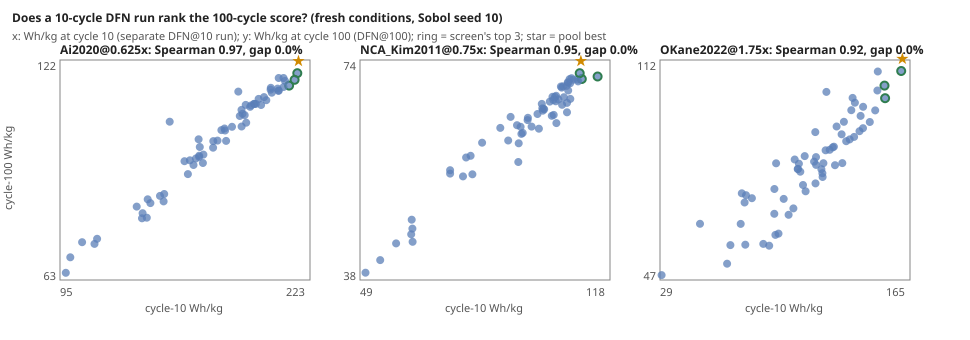

The `cell-fidelity` programme asks how a lithium-ion electrode design search can spend less on PyBaMM's full DFN model without losing the best design. The last step split every design's score, its Wh/kg at cycle 100, into three factors:

- **thermodynamic energy**, which the parameter set gives without any simulation;
- **utilisation**, the share of that energy the first cycle delivers, which a closed-form salt-depletion number predicts;
- **retention**, the share left at cycle 100.

Only retention still needed the full model, and it was the reason the zero-simulation shortlist missed the best design by up to 4.7%. This step asked whether a short DFN run is enough to rank retention.

**What we checked before running anything new.** We replayed the 24 (cell, current) conditions earlier steps had already simulated, reading each design's energy at cycle 10. It ranked the cycle-100 energy at Spearman 0.85 or better on 22 of the 24. The two exceptions were the `Ai2020` cell at its two lowest currents, where fade keeps growing long after cycle 10. On that evidence we wrote down four predictions and the screen to test: run DFN for 10 cycles on every design, run DFN for 100 cycles on the three best at cycle 10, and answer with the best of those.

**What happened on fresh designs.** We ran 384 new simulations: 64 new designs on three conditions no earlier step had run (`Ai2020` at 0.625 times the usual current, `NCA_Kim2011` at 0.75 times and `OKane2022` at 1.75 times). Every design got a full 100-cycle DFN run and a separate 10-cycle one. All four predictions held:

- The cycle-10 energy ranked the cycle-100 energy at Spearman 0.97, 0.95 and 0.92.
- The screen returned the pool's true best design on all three conditions.
- It cost 0.19 of the wall time of running DFN for 100 cycles on everything. A 10-cycle run costs 0.15 of a 100-cycle one, not 0.10, because solver setup and the first cycle take a fixed share.
- It never did worse than the previous step's zero-simulation shortlist, which missed by 1.1% and 0.2% on two of the three.

**Ten cycles give the order, not the curve.** A fade curve fitted to cycles 2 to 10 and extrapolated to cycle 100 ranked the designs worse than the raw cycle-10 energy, at Spearman −0.56 to +0.55. The early cycles don't pin down how fast each design keeps fading. They do pin down which designs end up ahead.

**What it means for a designer.** Two of the three factors cost nothing to compute and the third is mostly settled in ten cycles. Run DFN for ten cycles on the designs the energy and salt numbers short-list, then run it to the end on a handful. On these pools that combination was exact at about 0.11 of the full cost.

**Limits.** The screen still fails in one known place. On `Ai2020` at low current it missed by 6 to 7% on earlier data, and this fresh test did not run that regime. All of this is three conditions, one PyBaMM version and modelled fade, not measured cells.

The plan, the outcome and the numbers are in the programme's [log](../../research/cell-fidelity/LOG.md) and [README](../../research/cell-fidelity/README.md).
