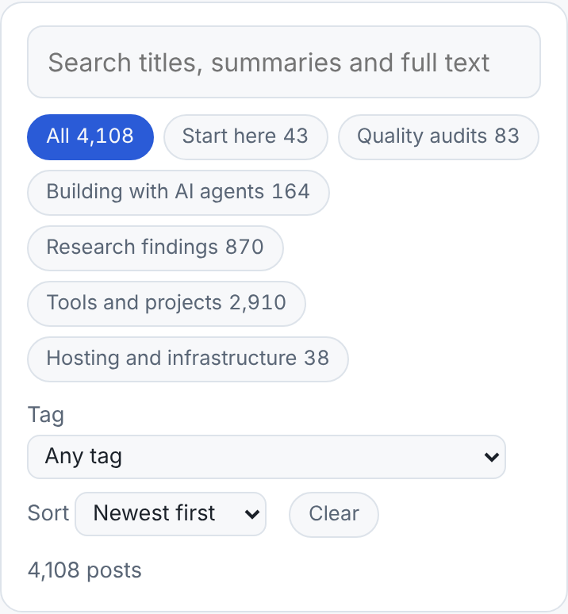
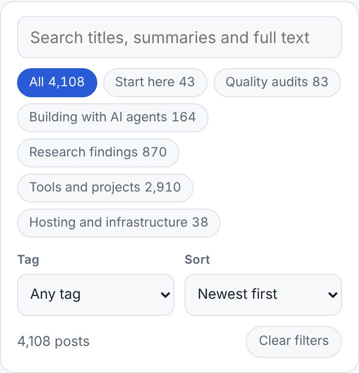

The [blog index](https://marisstella.app/writing/) has 4,108 posts and a search panel to find
them in: a search box, topic chips, a Tag menu, a Sort menu and a Clear button. The last three
looked like an afterthought. The previous polish run listed the problem in its report, and this
run fixed it.

## What a phone showed

At 390 px wide, which is a common phone width:

- The search box was **46 px** tall. Both menus were **28 px**, the native browser default.
- "Tag" sat on its own line above a full-width menu, while "Sort" sat beside a short one. The two
  labels were laid out in two different ways.
- The Tag menu was 302 px wide. On a 320 px screen that was wider than its 254 px row.
- Clear was a 29 px pill that wrapped wherever it found room.

## What changed

- The menus now match the search box: **42 px** tall, the same 10 px radius and the same border.
- Tag and Sort sit side by side in a two-column grid, each with a small label above it. At 320 px
  each menu is 120 px wide and "Newest first" (89 px of text) still fits.
- Clear moved out of the menu row and became **Clear filters** at the right end of the post count.
  That is where you look after filtering.
- The search box, menus and buttons all get the same visible focus ring.

The panel is 15 px shorter on a phone (386 to 371 px). That matters less than the panel now
looking designed. No page scrolls sideways at 320, 390 or 1,280 px. The list still renders
without JavaScript, because the panel only appears once the script runs, as it did before.

A test in `platform/pages/writing.test.mjs` now checks that the menus keep the search box's height
and that Clear stays on the count line. A later edit can't quietly undo this.
