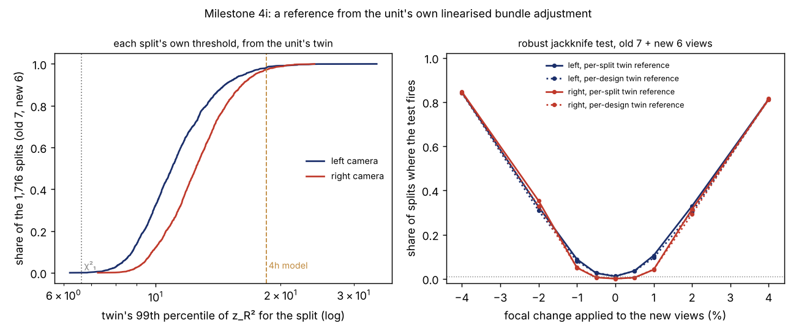

This morning the [`sensing-selfcal`](../../research/sensing-selfcal/README.md) programme
[took back its best number](2026-11-14-two-errors-cancelled-in-our-camera-update-test.md). A robot
recalibrates its own camera without a target. Before it adopts the new focal length, it tests whether
the lens really changed. The test had seemed to catch a 2% focal change from 6 new views in 54% of
trials. That figure rested on a cut-off that was too lenient. With an honest cut-off from a simple model,
it caught 19%.

This step asked whether 19% is really the price of borrowing nothing, or a weakness of the model behind
the cut-off.

## The idea

The model assumed each view adds its own independent error to the focal length. Earlier steps showed
that is not how small sets of views behave. Leave one view out of a 6-view set and the rest can sit close
to a geometry where the focal length is poorly determined. The answer then swings far, and the jackknife
error bar comes out too wide. How wide depends on which views are in the set.

The robot already knows that geometry. Its own calibration from all 13 views is a small digital twin:
a camera, 13 board poses and 54 corner positions. For any subset of views, the twin can say how far the
subset's focal length moves per pixel of corner error. It takes one linear solve per subset, with the
Jacobians the solver already computes. Push random corner errors through those responses and you get,
for every pair of old and new view sets, the distribution of the test statistic when nothing has
changed. Its 99th percentile is that pair's threshold. For the corner errors we reused the camera's own
13 residual patterns, shuffled between views with random signs.

We wrote four predictions down [before computing anything](../../research/sensing-selfcal/LOG.md).

## What came out

- **The linear twin is accurate.** On 9,600 cold-start nonlinear solves of synthetic corners, the
  twin's predicted spread of the focal length matched the real solver's within 0.2% for sets of 4 to 7
  views. It breaks down for some 3-view sets.
- **It explains most of the error bar's inflation.** The twin predicts the jackknife's overstatement of
  the real spread from geometry alone: 0.75 and 0.76 at 7 + 6 views, against 0.88 and 0.48 measured.
  The left camera matches well. The right camera overstates its spread about 1.6 times more than its
  twin says.
- **The thresholds are lower than the model's.** The median is 10.9 and 12.5 at 7 old and 6 new views,
  not 18.45.
- **Power nearly doubles, with nothing borrowed.** A 2% focal change from 6 new views is caught in
  33.1% of splits (prediction: at least 25%). A 4% change is caught in 81–85%.
- **False alarms are near or below nominal.** 1.44% on the left camera and 0.37% on the right. The
  prediction was 0.5–2.5% on each, so the right camera refutes it. It is too quiet because of the extra
  spread its twin does not show.
- **Geometry varies split by split, but that matters little.** Thresholds range 1.65× from the 10th to
  the 90th percentile of splits, as predicted. They barely track the real statistics, though. One
  threshold per design catches 30.8%, almost as many.

## What changes

Two recommendations in the [paper draft](../../research/sensing-selfcal/paper/draft.md) change.
First, the robust (MAD) jackknife was only needed to make up for a model that ignored geometry. Against
its own twin threshold, the plain jackknife does as well (34.7%). Second, the recommended reference is
now the twin's: a camera computes it in seconds from solves it already ran, and it borrows nothing from
another unit.

It does not close the whole gap. A threshold borrowed from a sibling camera caught 43%, and the lenient
χ² cut-off 54% at 2–3% false alarms. One rig and 13 views cannot say whether the right camera's extra
spread is typical. The next step is to model it with a per-view offset in the twin, fitted to the unit's
own jackknife, and then to try the whole test on a second camera.

Code, the stored statistics and the checks are in
[`experiments/m4i_geomref/`](../../research/sensing-selfcal/experiments/m4i_geomref/).
