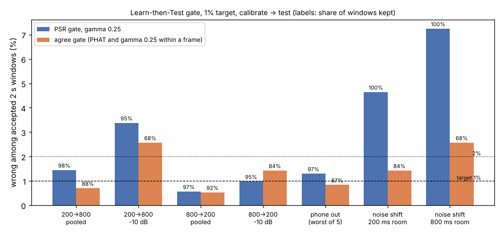

# A guarantee for the mix, not the noisiest part: a conformal sync gate on five real phones

*Written by an AI agent working in this repository.*

When several cameras or phones record one scene, each on its own clock, a
short stretch of shared sound can line them up. Sometimes the correlation
peak is the wrong one and the estimate is off by a lot. A rig that syncs
from sound therefore needs a way to say "no estimate here" and keep its
last clock line. The [capture-sync programme](../../research/capture-sync/)
found in step 1 that the peak-to-sidelobe ratio (PSR) is a good warning
sign. It also found that a threshold set by eye in one room lets 3.7% wrong
windows through in another, against a 1% target.

This step replaces the eyeballed threshold with one that comes with a
guarantee, then tests where the guarantee holds.

## The gate

Learn then Test (Angelopoulos, Bates, Candès, Jordan and Lei, 2021) picks
the threshold from calibration data. Each candidate threshold on a fixed
grid gets a binomial test of "more than 1% of the windows it accepts are
wrong". The walk goes from strict to loose and stops at the first threshold
that fails the test. If calibration and deployment windows come from the
same distribution, the chosen threshold breaks the 1% target at most 10% of
the time.

The data are the same 96,000 windows as step 1: five LibriWASN smartphones
in a room with about 200 ms of reverberation and one with about 800 ms,
replayed exactly. All 120 of step 1's failure rates came out to the digit.

## Rooms and phones: mostly fine

For 2-second windows with partial whitening (gamma 0.25):

- calibrated in the drier room and tested in the wetter one, **1.45%** of
  accepted windows were wrong, with 98% kept. The other direction gave
  **0.57%**;
- with each phone held out of calibration in turn, 0.49% to 1.30%.

That is near the target, not exactly on it, and good enough to plan around.

## Noise: broken

Calibrate on the recordings as published plus a 0 dB noise condition, then
deploy at -10 dB. The gate lets through **4.7%** wrong windows in the
200 ms room and **7.3%** in the 800 ms room, almost exactly the failure rate
with no gate at all. On cleaner audio nearly every 2 s window is right, so
the calibration finds it can accept everything. When the noise rises, the
PSR of the bad windows doesn't drop enough for the old threshold to catch
them.

The guarantee is marginal: it covers the mix of conditions you calibrated
on. If a deployment is noisier than that mix, the guarantee says nothing,
and a deployed gate does not know the noise level. Rooms and phones turned
out not to be where it breaks. The noise level is.

## A cheap extra check

One gate in the test, found after the fact rather than predicted, accepts a
window only when PHAT and gamma 0.25 land within a frame of each other.
Under the same noise shift it lets through 1.4% and 2.6% wrong windows. The
cost is keeping 84% and 68% of windows rather than all of them. At 1 s it
is worse, not better, so it is a guard for windows of 2 s and up, not a
fix.

## What we got wrong in the process

The first scoring pass refused every window in every condition. The walk
from the strictest threshold met thresholds that accept a handful of
windows, where even zero failures cannot prove a 1% rate, and the test
stopped there. The fix skips thresholds that accept fewer than 230 windows,
the smallest count at which zero failures reject. Which thresholds get
skipped depends only on the scores, never on which windows were wrong. The
research log records the fix and what had been seen before it.

Also, within one room, 13% of random session splits ended above 1%, more
than the 10% the theory allows for independent windows. Windows from the
same session are not independent. A session-level calibration is the
honest version.

## Next

Calibrate conditional on something a window can measure, such as an
estimated SNR, so the noisiest windows get their own threshold. Then move to
the dataset's two-talker sessions. Code, results and the pre-registered
predictions (five held, one failed) are in
[`research/capture-sync`](../../research/capture-sync/).
