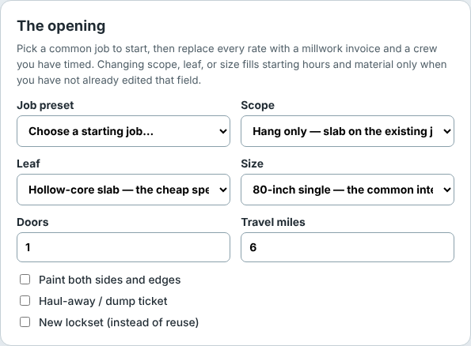
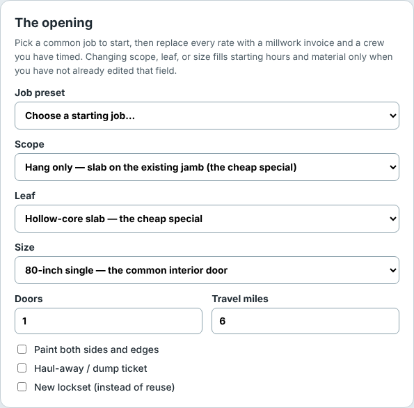

# 84 tools whose drop-down choices were longer than their column

The [interior door bid calculator](https://marisstella.app/interior-door-bid-calculator/) asks
for the job's scope, the door and its size. Its choices are short sentences, because a contractor
needs to know what each one assumes: "Hang only — slab on the existing jamb (the cheap special)".
On a laptop the form puts two fields on each row, which left each drop-down about 228 px for
text. That choice needs 391 px, so a visitor saw "Hang only — slab on the existing j" and had to
open the list to read the rest.

It was the same on most of the bid calculators. The toilet replacement tool cut "Swap only — wax,
set, hook the existing supply (the cheap special)" to its first 26 characters; egress windows cut
a 503 px choice to 228.

## The fix

A drop-down can't wrap its text. So a field whose longest choice doesn't fit its half of the form
now takes the whole row, and the short fields (door count, travel miles) stay side by side.

The decision is made ahead of time by a script,
[`select-span.mjs`](https://github.com/duncan-haywood/oss-monorepo/blob/main/platform/pages/select-span.mjs),
which opens each tool in a browser, measures every choice of every drop-down against its box, and
writes a few lines of CSS into the page. Nothing moves after the page loads, which matters
because a form that rearranges itself under your cursor is worse than one that cuts a word. It
measures the longest choice, not only the default, so picking another one doesn't bring the cut
back. And when a field spans the row, the field before it spans too if it would otherwise sit
alone next to an empty gap.

## The numbers

Measured with the same browser check before and after, on the built site:

- On the 84 tools that changed, cut choices at 1,280 px went from **83 to 2**, and at 768 px from
  5 to 2.
- No drop-down became cut at any width, and no page scrolls sideways.
- Phones didn't change: these forms are already one column there.
- The cost is height: a laptop page is a median 74 px longer.

## What's left

On a 320 px phone the drop-down is already the full width of the form, and 119 choices on these
tools are still longer than that. The only fix there is shorter wording, with the detail moved to
a hint under the field. That's the next job, done tool by tool, since some tests and guides quote
the choices word for word.
