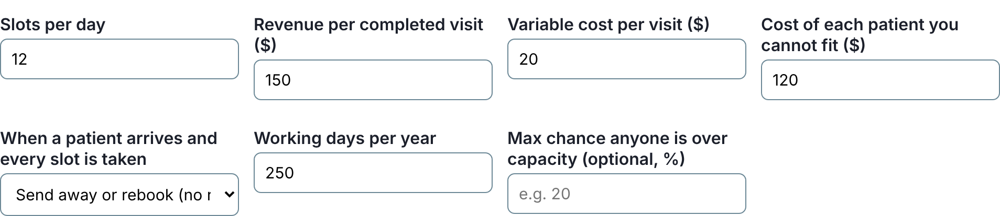
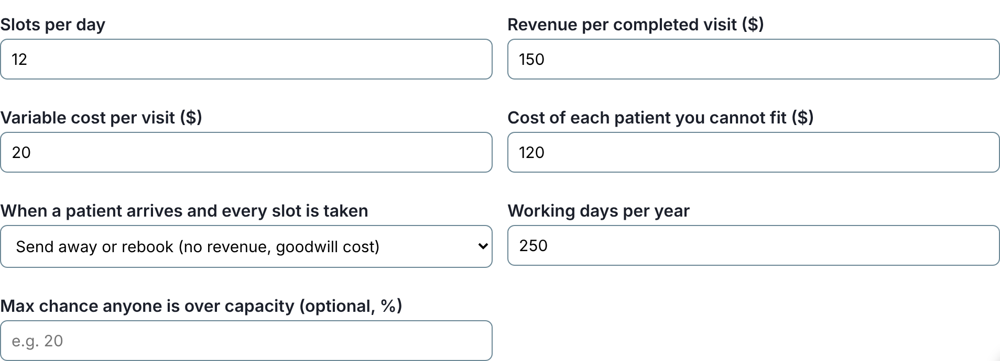

# 178 tools whose settings grid cut its own drop-downs

The [appointment overbooking optimizer](https://marisstella.app/appointment-overbooking-optimizer/)
asks what happens when a patient arrives and every slot is taken. The default answer is "Send
away or rebook (no revenue, goodwill cost)". On a laptop, the form showed "Send away or rebook
(no r".

The cause is one line of CSS that about 170 of these tools share: "as many columns as fit, each
at least 220 px wide". On a laptop that means four columns of 228 px, so each drop-down has about
186 px for its text. A native drop-down can't wrap, so anything longer is cut under the arrow.
Measured across every tool with a drop-down, 442 had a choice cut at 1,280 px wide.

## The fix

An [earlier pass](2026-11-14-drop-downs-that-needed-the-whole-row.md) gave a long drop-down the
whole row in two-column forms. In a four-column grid that is too heavy, and spanning two columns
leaves a hole whenever the field lands in the last one. These grids already say what they want,
though: columns of at least some width. So a script,
[`select-track.mjs`](https://github.com/duncan-haywood/oss-monorepo/blob/main/platform/pages/select-track.mjs),
raises that minimum to what the grid's longest choice needs, for that one grid. Every field keeps
its place and its tab order, and the grid shows three or two columns where it showed four.

It is decided ahead of time and written into the page as a few lines of CSS, so nothing moves
after load. Before writing, it checks in a browser at every width from 320 to 1,280 px that the
grid never gets more columns than it had, so the phone layout stays as it was, and that the cut
choices now fit. A choice so long that it would turn the form into a single column is left alone;
that one needs a shorter label, not a wider column.

## The numbers

| | before | after |
|---|---|---|
| cut choices at 1,280 px | 442 on 243 tools | 149 on 82 tools |
| cut choices at 390 px | 408 | 403 |

What's left is mostly choices longer than half the form (an EU regulation checker has an 842 px
one) and the phone width, where the drop-down is already as wide as the screen. Both want shorter
visible labels with the detail moved to a hint underneath, which is the next pass.
