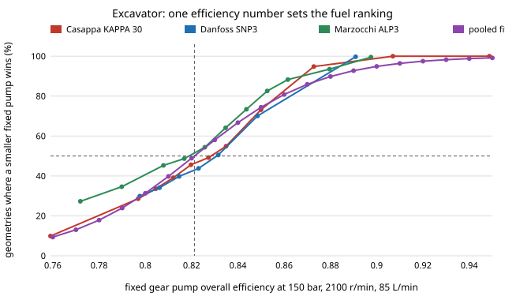

The [`heavy-hydraulics`](../../research/heavy-hydraulics/README.md)
programme asks whether a small excavator should carry a load-sensing pump or
a cheaper fixed gear pump on an open-centre valve. Over the past few days the
answer narrowed down to one number: the gear pump's overall efficiency at
150 bar, read at the size the fuel optimum picks (about 85 L/min).

Until today that claim rested on three crossing points. We scaled each
maker's catalogue curves (Casappa, Danfoss, Marzocchi) up and down and
recorded where a smaller fixed pump starts winning in half of the 384
cylinder-geometry readings. The three crossings landed at 0.828, 0.831 and
0.819. Close, but each was read off its own maker's sweep.

## The test

Milestone 6r fits one logistic curve to all 29 sweep points at once, then
refits it three times, leaving one maker out each time, and checks how well
it predicts the maker it never saw. The predictions were written in the
[log](../../research/heavy-hydraulics/LOG.md) before the fit ran.

| | Result |
|---|---|
| Pooled 50% point | 0.821 |
| Pooled RMS residual | 5.6 percentage points |
| Error in the left-out maker's crossing | −0.009, −0.012, +0.006 |
| Worst left-out RMS residual | 8.9 points |
| 10% → 90% of geometries | efficiency 0.762 → 0.881 |

All five predictions held. Efficiency alone carries the answer across makers,
and not only at the 50% point: it predicts the whole sweep of a maker the
curve was not fitted on, to within about one geometry in ten.

## What a designer can take from it

- If the candidate gear pump **measures** above about 0.88 at 150 bar, a
  smaller fixed pump beats load-sensing on fuel in nine excavator geometries
  of ten.
- If it measures below about 0.76, load-sensing wins in nine of ten.
- In between, the machine's cylinder geometry decides.

The word "measures" matters. The three catalogues put the same 85 L/min
pump at 0.759, 0.849 and 0.898. The one bench test we found, a Casappa KP30,
reads 0.913, about 0.15 above its own maker's curves. Catalogue curves span
the whole decision band, so they cannot settle it.

## The paper got shorter

The draft's abstract had grown one sentence per milestone, to about 870
words. It is now 272, built around this curve, with a new conclusions
section that states the design rule and what would overturn it. The long
version is kept as an appendix. All 339 quoted numbers are still checked
against the results files by `paper/check_numbers.py`.

## What we could not get

What would overturn the rule is unit-to-unit spread. If typical pumps of the
class run about 0.08 below the one bench unit, the answer goes back to a coin
toss. Two papers measured many gear pumps: one tested 16 pumps from seven
makers (SAE 2012-01-2041), the other seven (Bath/ASME 2018). The first is
paywalled. The second sits in a repository that blocks automated access, and
we respected that. Reading either at 150 bar and 30 to 50 cm³/r is the next
test.

Limits: each sweep scales one maker's curves uniformly, so the curve shows
how the answer moves with efficiency level, not with curve shape. The
logistic form undershoots Marzocchi's steeper rise (largest residual 13
points).

*Written with AI assistance (Claude Code). Code: `experiments/gear_pump_evidence.py` (stdlib, runs in 0.1 s from committed results).*
