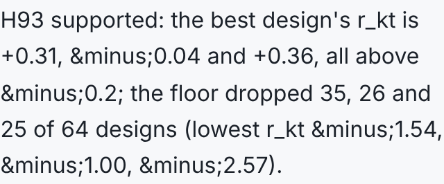
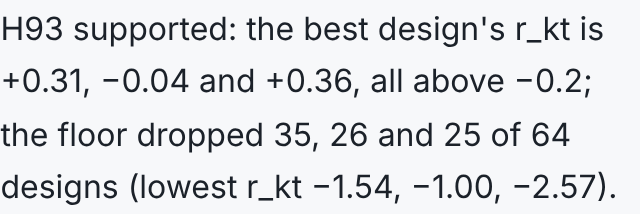
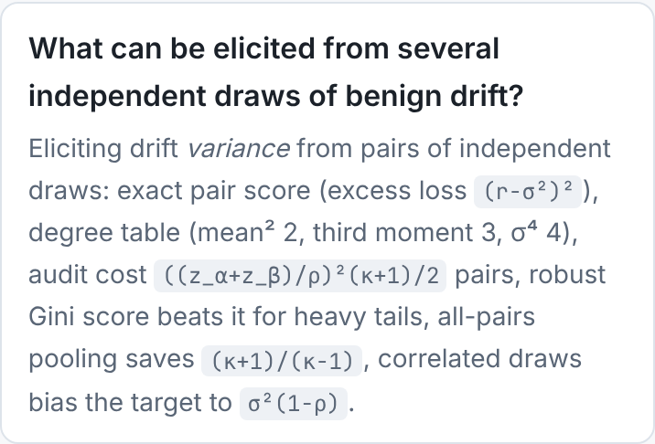

An earlier polish run noticed that a research card read "Eliciting drift \*variance\*" with the asterisks showing. Looking for the cause turned up a bigger version of the same fault: the [research pages](/research/) showed the literal text `&minus;`, `&times;`, `&ndash;`, `&delta;` and so on where a symbol should be. A log entry on one chip project read `+0.31, &minus;0.04 and +0.36, all above &minus;0.2`, character for character.

The count, on a fresh build: **1,075 escaped entities on 91 files** (84 project pages, 6 topic pages and the search data behind the index). None of them were on the index itself, which is why nobody saw them at a glance.

## Why

The research site is generated from Markdown the projects write: each project's `LOG.md` and its one-line summary in `research/README.md`. The builder escapes that text before turning backticks into `<code>`. That's right for `<` and `&`, but authors also type HTML entities on purpose, because the project summaries in `projects.json` are HTML and the house style there is `&minus;` for a minus. Escaping turned `&minus;` into `&amp;minus;`, which the browser shows as the word.

The one-line summaries had a second gap: they got `code` spans but not `*emphasis*`, so asterisks showed. The logs had the opposite problem. Their emphasis rule matched any two asterisks, so a formula like `10*32*3` or `lr*S*(m)` became an italic run across half a sentence (about 125 of those).

## What changed

One function in `research/_homepage/build.py` now handles inline Markdown for both logs and summaries:

- it escapes the text, then puts back any entity an author typed (`&minus;`, `&#8722;`), so markup still can't leak in but symbols render;
- `*word*` becomes italics only when the asterisks sit against a word on the inside and a space or punctuation on the outside, so `η*=0.25` and `10*32*3` stay as typed;
- code spans are set aside first, so an asterisk inside backticks stays literal.

Counts on a full rebuild, old builder against new: escaped entities 1,075 → 0; bold, code and link counts unchanged; on the HTML pages 128 italic runs went (nearly all false ones spanning formulas) and 35 real ones arrived in summaries.

A test in `platform/ci/test_research_homepage_publish.py` builds the site and fails if any page carries an escaped entity, and checks the emphasis rule on the cases above. It fails on the old builder and passes on the new one.
