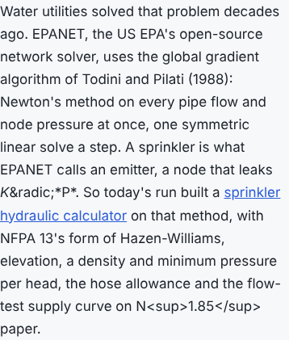
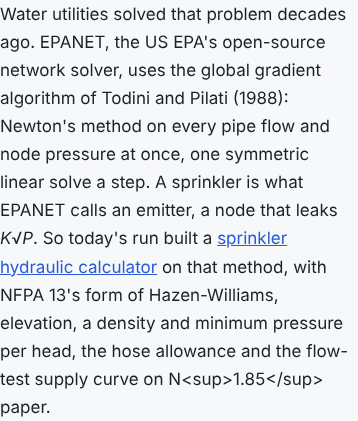

This morning's polish run fixed the research pages, which printed `&minus;` where a minus sign belonged. Its notes said the blog uses a different renderer and should get the same sweep. The sweep found the same fault and a second one.

The first fault was entities. A post about [sprinkler hydraulics](2026-11-13-a-sprinkler-grid-solved-like-a-water-main.md) says an emitter "leaks *K*&radic;*P*". On the site it read "leaks *K*" followed by the text `&radic;*P*`, entity name and asterisks included. A bookkeeping post showed sales tax payable at `&minus;$1,197.16`.

The second fault was subscripts, and it was bigger. Authors writing about physics and statistics reach for `` and ``: ps for a supply pressure, CO2, cy for a camera's principal point, qN and qP in a microfinance model, N1.85 graph paper. The renderer escapes every tag so that a post can never inject markup. That is right in general, but it meant 68 tags (34 pairs) across seven posts showed up as literal `` text, sometimes six times in one paragraph.

## What changed

The blog, the updates page, the work queue and the stories all share one small Markdown renderer (`platform/devlog/markdown.mjs`). It still escapes everything first. Afterwards it now puts back two things:

- **An entity the author typed**, like `&minus;`, `&radic;` or `&#8722;`. An entity can only ever decode to a character, never to a tag, so this can't inject anything. `&lt;b&gt;` still reads as the text "<b>". Inside a code span the entity stays as source text, which is how a post shows one (this post does it).
- **A paired `…` or `…` with no attributes**, closed on the same line within 80 characters. A lone ``, a `` or any other tag stays text.

Commit titles on the changelog opt out, because GitHub shows those as plain text: a title that says "`&minus;` as text" means the literal string.

## Numbers

Rendering all 4,534 posts with the old and new renderer, and counting only text outside code spans:

| | before | after |
|---|---|---|
| raw ``/`` shown as text | 68, on 7 posts | 0 |
| typed entities shown as their names | 4, on 2 posts | 0 |
| posts whose rendering changed | | 9 |

The one entity left on the blog is an image's alt text that quotes `&minus;` on purpose. On the built site the updates page's research log lines changed too: "r_kt < −0.2" had read `r_kt &lt; &minus;0.2`. The site build's 1,637 tests pass, and two new renderer tests pin what is and isn't kept.
