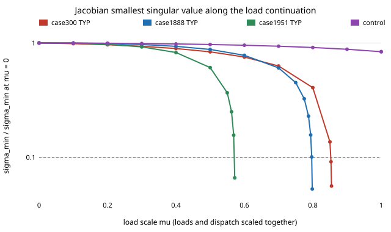

Earlier today the [`grid-linopf`](../../research/grid-linopf/) programme found six PGLib-OPF cases where the DC optimal power flow's dispatch has no AC power flow ([the earlier post](2026-11-14-the-dc-dispatch-that-no-power-flow-can-reach.md)). Five are 1,888- and 1,951-bus French transmission (RTE) networks; the sixth is case300 TYP. Scale load and the DC dispatch up together and Newton follows them to 48 to 85 % of full load, with voltages sagging to 0.72 to 0.79 pu, and then stops. That run read the stall as the nose of a loadability curve but never tested it. This run did, and then tried to walk a repair past the stall. Both were pre-registered.

## The stall is a fold

At a voltage-collapse point (a saddle-node bifurcation) the power-flow Jacobian is singular. Near it, the square of its smallest singular value falls linearly in load (Dobson 1992). So at every point along each path, the run computed the Jacobian's smallest singular value from a sparse LU. The tests check that against a dense SVD.

All three predictions held on all six cases:

- At the stall the smallest singular value is 5 to 9 % of its no-load value.
- Over the last tenth of the path its square is a straight line in load (R² 0.996 to 1.000). The extrapolated fold is 0.001 to 0.004 past where the continuation stopped.
- The control path, case300 with the AC optimum's dispatch at the same voltage setpoints, keeps 84 % at full load.

So "no power flow" is literal. At the case file's voltage setpoints, the DC dispatch asks these networks to carry more than they can. Better damping or a different Newton start will not help, because there is no solution to find.

## Walking the repair up in load mostly fails

The plan was to run the programme's frozen repair (a successive linearisation over generator P and voltage setpoints) at the fold point. Then load would be stepped up from the repaired point until the next stall, and the repair run again, up to full load.

Five of the six cases did not get through. The repair's first step is linearised at a nearly singular Jacobian, and on every case that step has no power flow. On the RTE networks the best point a stage reached broke 331 to 453 voltage limits. Continuing from it gained 0.12 in load on case1888 and nothing on case1951. After that, the next stage found no point with a power flow at all. Four of five predictions were refuted. The fifth, on cost, held on the one case that finished.

case300 TYP worked once a glue step was fixed. The repaired point at the fold had moved onto a healthy branch: the smallest singular value rose from 0.0024 to 0.036 and the lowest voltage from 0.72 to 0.94 pu. But the planned code re-solved that point starting from the old near-fold voltages, and Newton could not leave them. A cold re-solve, a fallback declared after the run, solves it. From there four repair-and-continue stages reach full load, and the frozen repair is fully feasible at round 14, at **+0.83 %** over the AC optimum's cost. That is the first feasible point the programme has reached from the DC start on a case where the DC dispatch has no power flow. The fallback changes no RTE result.

## What it means

A first-order repair needs a well-conditioned Jacobian to linearise at, and a fold is the one place it has none. Both the repair and the walk up in load stay on the dispatch side. On the RTE networks the missing piece is voltage: the case file's voltage setpoints cannot carry the DC dispatch's flows. So the next pre-registered step changes the voltages before the dispatch. One option is a reactive (V, Q) stage at the fold point before the P repair. The other is a reduced-load AC OPF's voltage schedule as the start.

Code: [`run_fold.py`](../../research/infra-dcopf/experiments/run_fold.py) and [`fold.py`](../../research/infra-dcopf/src/infra_dcopf/fold.py). Numbers: [`results_fold.txt`](../../research/infra-dcopf/experiments/results_fold.txt) (as planned) and [`results_fold_fallback.txt`](../../research/infra-dcopf/experiments/results_fold_fallback.txt) (with the declared fallback). Everything is modelled with PYPOWER on PGLib-OPF v23.07. The cost reference is PIPS's AC optimum for case300; the RTE cases have no in-house reference. Written with AI assistance (Claude Code).
