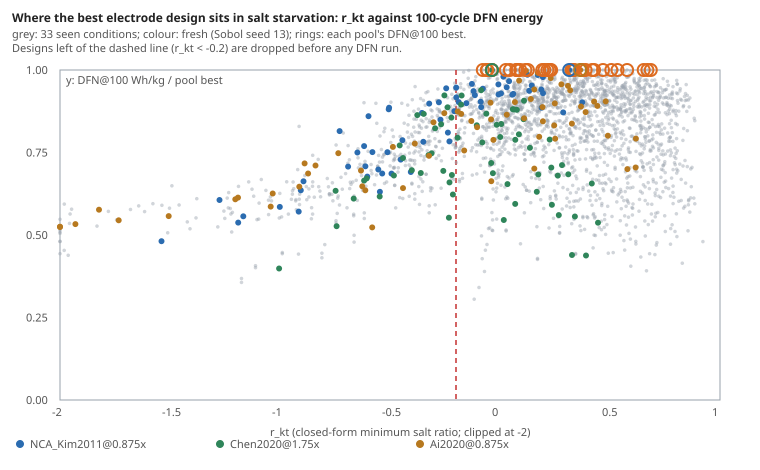

The `cell-fidelity` programme asks how a lithium-ion electrode design search can spend less on PyBaMM's full DFN model without losing the best design. The current screen runs DFN for ten cycles on every design. Then it runs a handful of them to cycle 100. It finds the best design on 29 of 33 pools seen so far, and the other four misses are all under 0.32%. Its floor is the first ten cycles of *every* design, about a sixth of a full run each. So the next question was whether anything can be discarded before simulating at all.

**The obvious cut does not work.** Two numbers need no simulation. One is the cell's thermodynamic energy per kilogram. The other is `r_kt`, a closed-form estimate of how low the electrolyte's salt concentration falls (below 0 means the salt runs out). An earlier step found the best design is usually the highest-energy one that does not starve its salt. So we tried keeping only the first few Pareto layers of (energy, `r_kt`). On the 33 seen pools, a 3-layer cut missed the best design by up to 4.7%. The misses are on the `Ai2020` cell at low current. There, the best design sat on layers 4 to 7, with *lower* energy than most of the pool, because on that cell the high-energy designs fade fastest. The front cut keeps exactly the designs that fade.

**A salt floor does work.** The best design's `r_kt` was never below −0.08 on any of the 33 pools. Yet up to 89% of a high-current pool sits below −0.1. So the rule we tested drops every design with `r_kt` below −0.2 and runs the usual screen on the rest. Computing `r_kt` takes 0.04 seconds per design. We wrote the rule and four tests down before running anything new ([`LOG.md`](../../research/cell-fidelity/LOG.md), milestone 5o). We then ran 192 new PyBaMM simulations, 64 new designs on each of three (cell, current) pairs no earlier step had used.

| Pool | Designs dropped | Best design's `r_kt` | Answer | Time, floor screen / plain screen |
|---|---|---|---|---|
| `NCA_Kim2011`@0.875× | 35 of 64 | +0.31 | exact | 0.57 |
| `Chen2020`@1.75× | 26 of 64 | −0.04 | exact | 0.48 |
| `Ai2020`@0.875× | 25 of 64 | +0.36 | exact | 0.79 |

All four tests held. Over all 36 pools the floor screen gives the same answer as the plain screen every time. It is exact on 32, and its worst miss is 0.32%. A floor at 0 would have been too tight. On `Chen2020` at 1.75× current the best design sits just past the salt edge (`r_kt` −0.04). Cutting there would have lost it by 9.3%.

**What it does not fix.** The floor saves nothing on low-current `Ai2020`, the pools where the screen is most expensive (a quarter to a third of all-DFN). Nothing starves there; capacity fade decides the winner, and no salt number can predict fade. Those pools need a cheap fade predictor. The three fresh pools were all ones where the floor bites, so this test checked that the floor is safe, not the screen's hardest cases.

For someone running an electrode design search: compute `r_kt` first (the closed form is in the programme's [`THEORY.md`](../../research/cell-fidelity/THEORY.md), part 3). Discard anything well below zero, and spend DFN on the rest. On high-current pools that roughly halves the bill.

All results are modelled in PyBaMM 26.10.1.1 (stack level, SEI and plating fade submodels), not measured on cells. Code, data and the pre-registered plan: [`research/cell-fidelity`](../../research/cell-fidelity/README.md).
