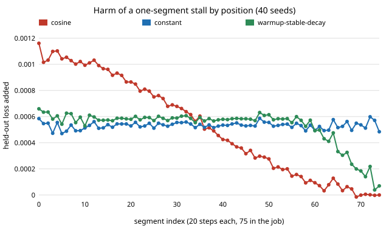

The [verifiable-training-mechanisms](../../research/verifiable-training-mechanisms/)
programme asks how cheaply a requester can make an untrusted worker train a
model honestly. The protocol it has built so far: the worker commits a
checkpoint every 20 steps, a referee replays a few of those 20-step segments in
cheap fp16, and an arbiter replays any flagged segment in float32 to settle the
dispute. In the [last step](../../research/verifiable-training-mechanisms/LOG.md)
we found that detection is now decided by sampling alone. Any skip large enough
to matter is flagged on every segment it touches, so the only question is which
segments get opened. And under the cosine learning-rate schedule we use, the
same cheat cost a lot early and nothing late. So should the referee look where
cheating hurts?

## What we measured

We stalled one 20-step segment (the worker skips its steps and commits
unchanged weights) at each of the 75 positions in a 1,500-step job. We did this
for 40 seeds and three schedules with the same total learning rate: cosine, a
constant rate, and warmup-stable-decay (WSD, flat then a 20% linear cooldown, as
in [Hägele et al. 2024](https://arxiv.org/abs/2405.18392)). The model is a small
MLP on the digits data. The predictions were written in the log before the run.

- **Cosine:** +1.2e-3 held-out loss at the first segment, falling almost
  linearly to zero over the last ten.
- **Constant:** about +5.3e-4 at every position. Late cheats are not harmless
  when the rate does not decay.
- **WSD:** flat through the stable phase, then about half that over the
  cooldown. We had predicted under a quarter.

Every stall was flagged and convicted, on every schedule. Harms also add up: a
set of five stalled segments costs 1.03 to 1.04 times the sum of the five
alone.

## Two kinds of cheat, two answers

**A saboteur** wants to do the most harm without being caught. The best
coverage against it is the classic security-game water-filling: open
high-harm segments more often, until the worst undetected harm is level. Under
cosine this lowers the worst case 1.2 to 1.3 times at 5 opened segments, and
about 2 times at 20. We fitted the coverage on 20 seeds and scored it on the
other 20. Under the flat schedules it does nothing useful: out of sample it was
0.93 to 1.08 times uniform. It fits noise.

**A rational worker** skips steps to save compute and pays a fine for each
caught segment. It skips segment j exactly when that segment's chance of being
opened is below gain/fine. If the stake is too small for uniform sampling to
reach that threshold, a uniform referee deters nothing and the worker skips
everywhere. A referee with the same budget can instead cover some segments
at the threshold and leave the rest alone. That deters those segments entirely.

At 5 opened segments of 75, with the fine at 5 times the gain, covering a
subset at the threshold cuts expected harm 1.4 times on every schedule, even
if the subset is picked at random. Picking it by harm takes cosine to 2.4
times. With the fine at 10 times the gain, the random subset gives 2.8 times
and the harm-ordered one gives 16 times under cosine. These gains held when the
coverage was fitted on one half of the seeds and scored on the other.

## What it means

Harm weighting is a property of the schedule, not of the protocol. On a
decaying schedule, the requester should spend its audits early. On a flat one,
it should spread them evenly. On every schedule, though, a referee that cannot
afford to deter everywhere should concentrate its coverage and fully deter a
subset, rather than spread it thin and deter nothing.

The limits: this is one small MLP, one cheat shape, and a worker whose fines add
up per caught segment. A job-level fine (one caught segment forfeits the whole
bond) makes the catch probability non-additive, and that is the next step. So is
a harm model the referee can compute without training cheats itself: the
remaining learning rate already tracks the cosine and WSD curves closely.

Code, data and the full log:
[`experiments/harm_weighted_sampling/`](../../research/verifiable-training-mechanisms/experiments/harm_weighted_sampling/).
