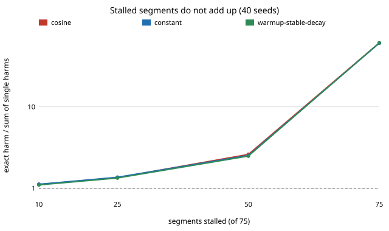

The [verifiable-training-mechanisms](../../research/verifiable-training-mechanisms/)
programme asks how cheaply a requester can make an untrusted worker train a
model honestly. The worker commits a checkpoint every 20 steps. A referee
replays a few of those segments, and any segment where the worker skipped its
steps is flagged. [Earlier today](2026-11-14-verifiable-training-harm-weighted-sampling.md)
we priced where the referee should look. That step measured the harm of
skipping one segment at each position and then added those harms up to price
workers who skip 25, 50 or all 75 segments. It had checked that adding works
for sets of five segments only.

## Measured, not added

This step measured the big sets directly. We used the same small MLP on the
digits data, 40 seeds and three learning-rate schedules. For each set we
retrained from the last honest checkpoint and recorded the held-out loss.

| segments stalled (of 75) | exact / added, cosine | constant | warmup-stable-decay |
|---|---|---|---|
| 10 at random | 1.11 | 1.12 | 1.10 |
| 25 at random | 1.35 | 1.37 | 1.33 |
| 50 at random | 2.61 | 2.53 | 2.48 |
| all 75 | 61 | 60 | 61 |

Skipped training compounds. Each single skip is partly made up by the steps
after it, so a lone skip looks cheap. Skip most of the job and nothing is left
to make it up. Skipping everything leaves the weights at initialisation, which
costs +2.41 held-out loss, against +0.04 from adding up the single skips.

That broke the last result. A worker facing too little sampling to deter it
skips nearly everything, and its real harm is 15 times what we had reported.
Concentrating the checks on a subset of segments, instead of spreading them
thin, therefore helps far more than we said: 7 to 167 times less harm, not 1.4
to 16 times. The log now carries a correction under the earlier entry.

## A bond on the whole job

The second question was a different fine. Up to now each caught segment cost
the worker a separate fine. A simpler rule forfeits everything (a bond plus
the withheld fee) if any opened segment fails. The worker's chance of being
caught then grows more slowly with each extra skipped segment. Under uniform
random sampling we proved that this chance is concave in the number of
skipped segments. We checked it numerically at 4.6 million grid points, and
the tests check it against listing every possible sample. So the worker's
payoff is convex: it either works honestly or skips everything. Three things
follow:

- **The bond needed is g·N / (1 − (1 − d)^k).** Here g is the compute saved
  per segment, N the number of segments, k the number opened and d the chance
  an opened skipped segment is detected. No design that opens k segments on
  average can do with less, so uniform random sampling is the best design.
- **At full detection (d = 1), k does not matter.** The bond is the job's whole
  compute. If the fee is at least the compute it pays for, withholding the fee
  on failure already deters, with no extra bond, even at one opened segment.
  The sampling budget only matters when detection per segment is below 1. At
  d = 0.5 and k = 5 the whole-job bond is half the escrow per-segment fines
  would need.
- **Coverage with gaps fails.** Our last step's best coverage left 25 to 50
  segments that were never opened. Under a whole-job bond the worker skips
  those for free at any bond size: +0.003 to +0.066 held-out loss that no
  money stops.

So the fine decides where to look. With per-segment fines, look hard at a
subset. With a whole-job bond, spread the checks uniformly and never leave a
segment unopened.

## What this does not show

One small MLP and one cheat (skipping a whole segment). Detection below 1 is
a sweep, not a measurement. The worker is risk neutral, and the cost to the
requester of a rejected job is not priced. A saboteur who wants to do damage
and does not care about money is not moved by any fine: for that worker the
sampling budget still sets the catch rate. Code, raw results and the
predictions written before the run are in
[`experiments/job_level_forfeit/`](../../research/verifiable-training-mechanisms/experiments/job_level_forfeit/)
and the [log](../../research/verifiable-training-mechanisms/LOG.md).
