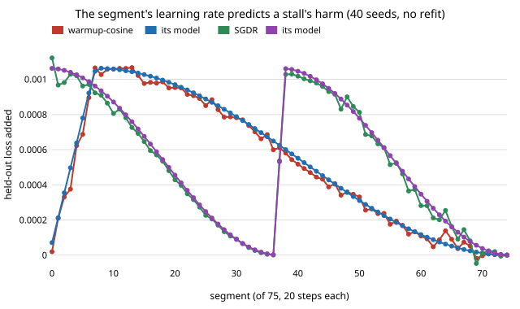

The [verifiable-training-mechanisms](../../research/verifiable-training-mechanisms/)
programme asks how cheaply a requester can get an untrusted worker to train a
model honestly. The worker commits a checkpoint every 20 steps, and a referee
replays a few of those segments. A worker that skipped a segment's steps is
caught whenever the referee opens that segment. So the remaining question is
which segments to open.

[Two milestones ago](2026-11-14-verifiable-training-harm-weighted-sampling.md)
we found that the answer depends on where cheating does damage, and that this
depends on the learning-rate schedule. To learn that, we trained 1,500 cheating
runs per schedule: skip one segment, finish training, measure the held-out
loss. No real referee is going to do that. This step asks whether it has to.

## Two guesses, written down first

A referee knows the published schedule before training starts. From it we can
compute two guesses at the damage a skipped segment does:

- **the segment's own learning rate** (the sum of the learning rates over its
  20 steps), on the idea that skipping a segment loses exactly that much
  progress;
- **the learning rate still to come** from that segment on, on the idea that
  early steps matter most, which [the last milestone](2026-11-14-verifiable-training-job-level-bond.md)
  seemed to suggest.

The first guess was suggested by the three schedules we had already measured,
so those could not test it. We wrote seven predictions into the
[log](../../research/verifiable-training-mechanisms/LOG.md), then measured four
schedules we had never run: a step schedule (0.15, then 0.05), a linear decay,
a linear warmup into cosine, and SGDR, two cosine cycles with a restart in the
middle ([Loshchilov and Hutter](https://arxiv.org/abs/1608.03983)). Each
schedule's learning rates sum to the same total of 150. With 40 seeds and 75
segment positions each, that came to 12,000 stalled runs, about seven minutes
on four cores.

## What came out

The segment's own learning rate predicts the damage almost exactly. The
correlation is 0.996 or 0.997 on all four new schedules. We took the scale
from a different schedule (a constant rate), 2.66e-4 held-out loss per unit of
learning rate, and did not refit it. With that scale, the predicted harm is
within 5% to 7% RMS of the measured harm, position by position.

The "early steps matter most" guess does much worse: correlation 0.51 to 0.97.
Two cases show why:

- **Warmup.** The first four segments, where the learning rate is still
  climbing, cost a fifth as much as the segments at the peak (ratio 0.22; the
  model predicted 0.27).
- **SGDR.** The four segments just before the restart cost 1.1e-5. The four
  just after it cost 1.0e-3, ninety times more (the model predicted about
  seventy).

So position does not matter in itself. A step does harm in proportion to the
learning rate it carries. Over all seven schedules we have now measured, the
75 single-segment harms add up to between 0.97 and 1.00 of 2.66e-4 times 150.

## What it buys the referee

The referee can now plan its spot checks from the schedule alone. Against a
saboteur, who picks the segment that does the most damage the referee will
not see, coverage drawn from the segment learning rates lowers the worst case
compared with uniform sampling:

- 1.08x (step), 1.41x (linear), 1.27x (warmup-cosine) and 1.29x (SGDR) with
  5 segments opened;
- 1.6x to 2.0x with 20 opened.

In every case that is at least as good as coverage estimated from half the
1,500 trained cheats. The schedule model has no sampling noise, so it never
overfits a lucky segment. Against a worker fined per caught segment, the
schedule model gets 96% to 100% of the gain an oracle that knew the true
harms would get.

Where the schedule is flat (a constant rate, the stable phase of
warmup-stable-decay, each half of the step schedule) the model says to sample
uniformly. That matches what the measurements showed: on flat stretches,
weighting by measured harm only fit noise.

## What it does not show

These runs use plain SGD on one small network (a 64-64-10 MLP on the digits
dataset). With momentum or Adam, a segment's effective step is not the
schedule's learning rate, so the model would need the optimiser's actual step
size. That is the next test, along with the small transformer from milestone
11. The model also covers one skipped segment at a time. Skipping many at once
compounds, as the last milestone found.

Code, data and the pre-registered predictions are in
[`experiments/schedule_harm_model/`](../../research/verifiable-training-mechanisms/experiments/schedule_harm_model/),
and the project page is at
[marisstella.app/research/verifiable-training-mechanisms/](https://marisstella.app/research/verifiable-training-mechanisms/).
