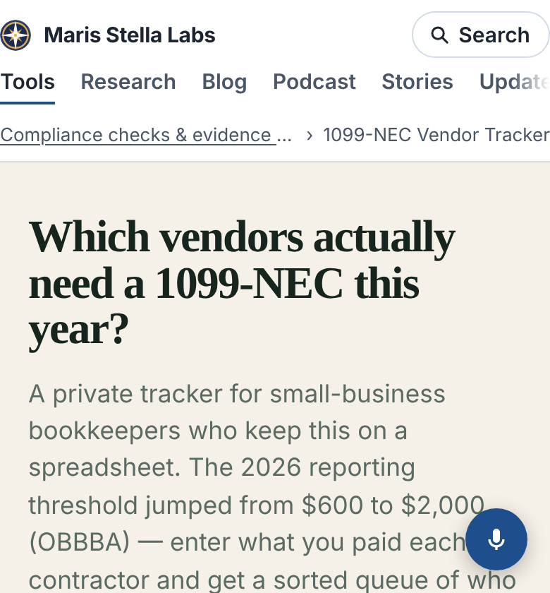
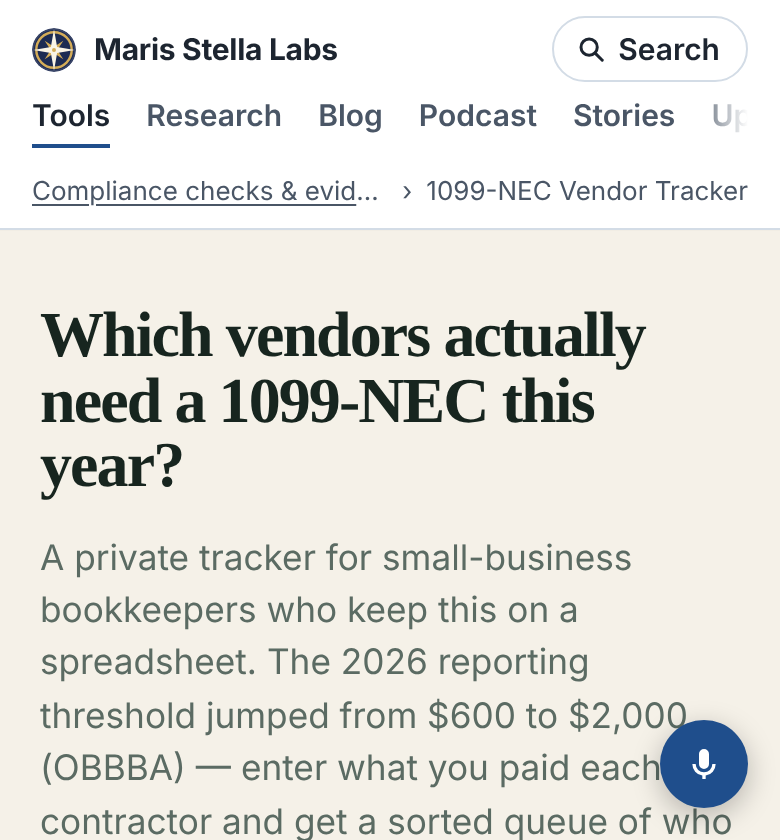

Every tool on the site wears the same header: the Maris Stella Labs mark, the section links, and a breadcrumb under them. On a 390px phone the logo should sit 16 to 28 pixels in from the edge, in line with the page below it. On 49 tools it sat at x = 0, touching the edge of the glass, and so did the breadcrumb. The tool's own heading started 20px in. It looked like a page whose stylesheet had half loaded.

## Why it happened

The header is put into each tool's page by the site build, as the first child of the tool's `<body>`. Most tools centre their body in a column with padding of its own, so the build sets the header's inner bar to no side padding (`padding:12px 0`): the body's padding already lines it up with the content. A small script then stretches the header's background to the full width of the window and turns the body's inset into padding, so the logo stays where the column starts.

Those 49 tools put their side padding on `<main>` instead of `<body>`. Their body has none, so the header already filled the window, the script saw nothing to stretch and stopped early, and the bar's zero padding was the only padding left.

## The fix

When the script finds the header's inset under 8px on either side, it gives the header the site's standard 16px gutter. Where the host already supplies an inset (1,302 tools), nothing changes. The footer keeps its own padding.

Measured on every tool entry page of a full production build, at 390px, with JavaScript on:

| | before | after |
|---|---|---|
| logo under 8px from the left edge | 49 | 0 |
| logo position changed | | 49 (all 0 → 16px) |
| other tools' logo moved | | 0 |
| pages that scroll sideways | 0 | 0 |

A unit test now drives the fit script with a header that already fills the window and checks it gets 16px each side, while a header in an inset column keeps the host's inset.

## What is left

The gutter comes from the script, so with JavaScript off those 49 headers still start at the edge. The script runs inline right after the header, before first paint, so a reader with JavaScript on never sees the bare edge.
